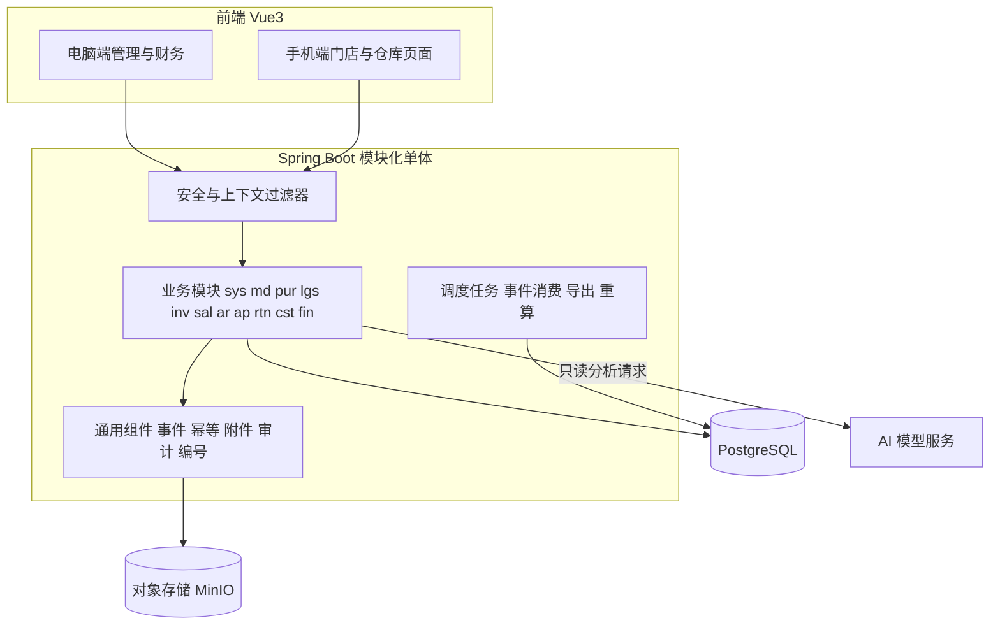

# 00 总体架构与通用约定

PRD 来源：第 03 章（国家复用）、第 16 章（状态与一致性）、第 17 章（通用要求）。
本文定义所有模块共用的约定。模块文档只引用这里的规则，不重复描述。

## 1. 总体架构



### 1.1 后端工程结构

```
jxc-server/
  jxc-common/            # 上下文、异常、返回体、幂等、事件、附件、审计、编号、金额工具
  jxc-module-sys/        # 国家、组织、用户权限、审批、待办、导入、审计查询
  jxc-module-md/         # 基础档案
  jxc-module-pur/        # 中国采购
  jxc-module-lgs/        # 国际物流与 MX 实收
  jxc-module-inv/        # 库存、调拨、盘点、预警、分类、补货
  jxc-module-sal/        # 销售订单、价格、出库、签收
  jxc-module-ar/         # 收款、授信、应收、核销
  jxc-module-ap/         # 应付、预付、付款、对账
  jxc-module-rtn/        # 销售退货、退款、供应商退货
  jxc-module-cst/        # 成本、费用分摊、利润、AI 分析
  jxc-module-fin/        # 账套、科目、凭证、账簿、结账、报表
  jxc-app/               # 启动模块、配置、Flyway 脚本汇总
```

每个业务模块内部分层：

```
com.hs.jxc.<module>/
  api/          # 对其他模块开放的接口（Java interface + DTO），只能依赖这里
  controller/   # REST 控制器
  service/      # 领域服务，事务边界在这一层
  domain/       # 实体、枚举、状态机
  mapper/       # MyBatis-Plus Mapper
  event/        # 发布与消费的业务事件
```

模块间约束：

- 只能通过对方的 `api` 包调用，不能直接访问对方的 Mapper 或表。
- 同一事务内必须一起成功的操作（例如出库同时扣库存、生成应收），通过 `api` 同步调用并共享事务。
- 可以延后、可重试的处理（例如生成凭证、重算分类、刷新利润事实表）通过业务事件异步消费。

### 1.2 前端工程结构

```
jxc-web/
  src/
    layouts/          # PcLayout、MobileLayout
    router/           # 路由表，meta.perm 声明权限码
    stores/           # Pinia：user、country、dict、todo
    api/              # axios 实例，统一注入 X-Country-Id、Idempotency-Key
    directives/       # v-perm 按钮级权限
    components/       # DocAttachment、ApprovalPanel、AuditTimeline、MoneyText、QtyText、CountrySwitcher
    modules/<module>/ # 每个业务模块的 views、components、api
    locales/          # zh-CN（一期评审语言）、es-MX（扩展包，按实施确认）
```

## 2. 国家与账套隔离

PRD 第 17 章要求：订单、库存、价格、成本、往来、收付款、凭证、账簿、附件和统计结果都要有明确的国家及账套归属。

### 2.1 数据归属

| 类别 | 归属字段 | 示例 |
| --- | --- | --- |
| 全局共享 | 无 `country_id` | `md_product`、`md_currency`、`sys_user`、`sys_country`、`sys_permission` |
| 国家业务 | `country_id NOT NULL` | 订单、库存、价格、客户、供应商关系、规则版本 |
| 国家财务 | `country_id` + `book_id NOT NULL` | 凭证、科目余额、期间、成本快照 |

### 2.2 执行机制

1. 请求头 `X-Country-Id` 指定当前国家。`CountryContextFilter` 校验用户在该国家有授权，然后写入 `RequestContext`。用户没有该国家授权时返回 403。
2. 自定义的 MyBatis-Plus 拦截器 `CountryLineInterceptor` 对所有带 `country_id` 的表自动追加 `country_id = :ctx` 条件，全局共享表在白名单中豁免。
3. `DataScopeInterceptor` 按用户的数据范围（仓库、门店、账套）追加过滤条件，见 [02 权限与审批](02-权限与审批.md)。
4. 按 ID 访问单据时，如果单据不在用户范围内，统一返回 404，不暴露单据是否存在（对应 A34）。
5. 导出、异步任务、事件消费者和 AI 取数都要带上发起人的上下文执行，复用同一套查询服务。调度任务按国家逐个运行，每次只处理一个国家的数据。
6. 跨国家汇总是独立权限 `sys:cross-country:view`，必须指定汇总币种和汇率版本。

### 2.3 禁止写死

通用流程代码中不得出现 `MX`、`MXN`、`America/Mexico_City` 这类字面量。币种、时区、仓店和价格规则一律从国家配置读取。代码评审和 CI 检查时用 `rg` 扫描这些字面量（测试数据和初始化脚本除外）。

## 3. 通用字段与命名

### 3.1 表命名

表名前缀与模块一致：`sys_`、`org_`（组织，属于 sys 模块）、`wf_`（审批，属于 sys 模块）、`md_`、`pur_`、`lgs_`、`inv_`、`sal_`、`ar_`、`ap_`、`rtn_`、`cst_`、`fin_`、`ai_`。

### 3.2 通用列

所有业务表都包含下列列，后续各模块的表结构中不再重复列出：

| 列 | 类型 | 说明 |
| --- | --- | --- |
| `id` | `bigint` | 雪花 ID，主键 |
| `country_id` | `bigint` | 国家归属（全局表没有这一列） |
| `created_by` / `created_at` | `bigint` / `timestamptz` | 创建人、创建时间 |
| `updated_by` / `updated_at` | `bigint` / `timestamptz` | 最后修改人、修改时间 |
| `version` | `int` | 乐观锁，每次更新加 1 |

单据表另外包含：

| 列 | 类型 | 说明 |
| --- | --- | --- |
| `doc_no` | `varchar(32)` | 单据编号，规则见 3.4 节，`(country_id, doc_no)` 唯一 |
| `biz_date` | `date` | 业务日期，按国家或仓店的时区确定 |
| `status` | `varchar(32)` | 状态，取值见各模块的状态机 |
| `remark` | `varchar(500)` | 备注 |

### 3.3 数值类型

| 用途 | 类型 | 说明 |
| --- | --- | --- |
| 金额 | `numeric(20,4)` | 存储精度 4 位；展示和舍入按币种的小数位（CNY、MXN 都是 2 位） |
| 数量 | `numeric(18,4)` | 一律以基础单位存储；箱、件之间按单位换算，不能直接相加 |
| 汇率 | `numeric(18,8)` | 保存汇率记录 ID 和汇率值的快照 |
| 比率 | `numeric(9,6)` | 折扣率、税率 |

舍入规则：行金额先按币种小数位四舍五入（`HALF_UP`），再汇总；分摊差额由金额最大的行吸收（见 [11](11-成本费用与利润AI分析.md)）。

### 3.4 单据编号

`sys_doc_number_rule`：`country_id`、`doc_type`、`prefix`、`date_pattern`（例如 `yyMMdd`）、`seq_length`、`reset_cycle`（DAY/MONTH/YEAR/NEVER）。
编号示例：`MX-SO-261015-0001`。序号用 PostgreSQL 的 `UPDATE ... RETURNING` 原子递增，不使用内存缓存。

## 4. 时间与时区

- `biz_date`（业务日期）和完整时间戳（`timestamptz`，按 UTC 存储）分开保存。
- 时区取值顺序：仓店配置的时区，没有就用国家默认时区。
- 日结、订单统计周期、到期日、报表期间按上述时区计算。
- 前端按当前国家时区显示时间，并标注时区缩写。

## 5. 多币种

- 每个金额都保存原币币种和原币金额。需要换算的地方另存 `rate_id`、`rate`、`rate_date`、本位币金额和舍入结果。
- 汇率由授权人员手工维护并确认（[03 基础档案](03-基础档案.md)），按适用范围和生效日期取值。
- 缺少汇率时，允许保存为“待补汇率”状态，但禁止执行成本确认和记账。不能把 CNY 金额直接当作 MXN 使用。
- 已确认的单据不随汇率修改自动重算。实际结算产生的差额单独记录为汇兑差额。
- 不同币种的金额不能直接相互抵减。

## 6. 业务事件（事务内事件表）

### 6.1 表结构 `sys_biz_event`

| 列 | 类型 | 说明 |
| --- | --- | --- |
| `id` | `bigint` | 主键 |
| `country_id` / `book_id` | `bigint` | 归属 |
| `event_type` | `varchar(64)` | 事件类型，例如 `SAL_OUTBOUND_CONFIRMED` |
| `source_type` / `source_id` | `varchar(32)` / `bigint` | 来源单据 |
| `event_seq` | `int` | 同一来源的第几次事件（例如第 2 次冲销） |
| `payload` | `jsonb` | 事件内容快照 |
| `biz_date` | `date` | 业务日期，用来确定会计期间 |
| `occurred_at` | `timestamptz` | 发生时间 |
| `status` | `varchar(16)` | `PENDING` / `DONE` / `FAILED` |
| `retry_count` / `last_error` | `int` / `text` | 重试次数、最近一次错误 |

唯一约束：`(event_type, source_type, source_id, event_seq)`。

### 6.2 发布与消费

- 业务服务在同一个数据库事务中写入业务数据和事件，保证不会出现“业务已完成但事件丢失”。
- 消费者按 `event_type` 注册，每个消费者另有消费记录表 `sys_biz_event_consume(event_id, consumer, status)`，同一事件对同一消费者只处理一次。
- 消费失败时记录错误并按退避策略重试，超过阈值后生成“事件处理失败”待办；页面展示“未完成及可重试原因”（PRD 第 16 章）。

### 6.3 一期事件清单

| 事件 | 发出模块 | 主要消费方 |
| --- | --- | --- |
| `PUR_DOMESTIC_RECEIPT_CONFIRMED` | pur | ap（按规则确认应付） |
| `LGS_SHIPMENT_DISPATCHED` | lgs | inv（在途展示） |
| `LGS_RECEIPT_CONFIRMED` | lgs | inv（同步入库）、cst（入库成本） |
| `LGS_FEE_CONFIRMED` | lgs | ap、cst（分摊） |
| `INV_TRANSFER_SHIPPED` / `INV_TRANSFER_RECEIVED` | inv | cst |
| `INV_STOCKTAKE_POSTED` | inv | cst、fin |
| `INV_STOCK_CHANGED` | inv | inv（预警与分类重算） |
| `SAL_ORDER_APPROVED` / `SAL_ORDER_QTY_CHANGED` | sal | inv（分类重算）、ar（信用预占） |
| `SAL_OUTBOUND_CONFIRMED` | sal | cst（出库成本）、fin（收入、应收、成本凭证） |
| `AR_RECEIPT_CONFIRMED` / `AR_WRITEOFF_DONE` / `AR_WRITEOFF_REVERSED` | ar | fin |
| `AP_BILL_CONFIRMED` / `AP_PAYMENT_CONFIRMED` / `AP_SETTLEMENT_DONE` | ap | fin |
| `RTN_SALES_RECEIVED` / `RTN_SALES_SETTLED` / `RTN_REFUND_PAID` | rtn | cst、fin |
| `RTN_PURCHASE_RETURN_DONE` | rtn | ap、cst、fin |
| `CST_INBOUND_COST_CONFIRMED` / `CST_COST_ADJUSTED` / `CST_EXPENSE_RECORDED` | cst | fin |

## 7. 幂等与并发

### 7.1 幂等

- 下列写操作要求前端在请求头携带 `Idempotency-Key`（UUID）：收货确认、出库确认、到账确认、核销、撤销核销、退款支付、凭证生成、记账、导入确认。
- 表 `sys_idempotency(key, user_id, endpoint, request_hash, response, created_at)`。相同的 key 和相同的请求内容直接返回首次结果；相同的 key 但请求内容不同，返回 409。
- 业务层另有唯一约束兜底，例如库存流水 `(source_type, source_line_id, txn_type, seq)`、凭证 `source_event_id`。
- 前端在按钮提交期间禁用按钮；同一个弹窗内重试时复用同一个 key。

### 7.2 并发

- 单据更新使用乐观锁（`version`）；冲突时返回 409，并提示“单据已被他人修改，请刷新”。
- 库存扣减使用条件更新，并检查影响行数，例如：
  `UPDATE inv_stock_summary SET reserved_qty = reserved_qty + :q WHERE id = :id AND on_hand_qty - reserved_qty - frozen_qty >= :q`。
- 涉及多行库存时，先按 `(warehouse_id, product_id)` 排序再加锁，避免死锁。
- 任一步骤失败时整个事务回滚，不会出现“页面显示完成但账实未更新”。

## 8. 附件与凭证文件

### 8.1 表结构

`sys_attachment`：`id`、`country_id`、`category`、`file_name`、`content_type`、`size`、`storage_key`、`sha256`、`uploaded_by`、`uploaded_at`、`status`（VALID/DELETED）。

`sys_attachment_link`：`attachment_id`、`biz_type`、`biz_id`、`version_no`、`linked_by`、`linked_at`、`unlinked_at`。

### 8.2 附件类别

| 类别 | 用途 | 来源 PRD |
| --- | --- | --- |
| `SALES_DOC` | 销售单据，所有销售出库前必须有 | 09 |
| `PAYMENT_PROOF` | 收款凭证、转账截图 | 09 |
| `CREDIT_APPROVAL_PROOF` | 赊销审批依据 | 09 |
| `SIGN_PROOF` | 客户签收证明 | 08 |
| `PURCHASE_DOC` / `EXPORT_DOC` / `LOGISTICS_DOC` | 采购、出口、物流单证 | 05、06 |
| `FEE_BILL` | 费用账单 | 06 |
| `REFUND_PROOF` / `PAYMENT_OUT_PROOF` | 退款、对外付款凭证 | 11、05 |
| `VOUCHER_ATTACH` | 记账凭证附件 | 14 |
| `IMPORT_FILE` | 导入文件 | 17 |

销售单据、收款凭证和记账凭证分别管理，不能互相替代。

### 8.3 规则

- 上传、删除、替换都保留版本和操作人；删除只做逻辑删除。
- 出库等关键动作在执行时重新检查附件是否有效。附件已被删除时再次拦截。
- 下载时先做权限校验，再签发 5 分钟有效的临时 URL；附件权限继承所属单据的权限。

## 9. 规则版本化

授信规则、价格、库存上下限、分类规则、审批规则、凭证映射模板、国家模板都使用同一模式：

- 规则表加 `version_no`、`status`（DRAFT/ACTIVE/RETIRED）、`effective_from`、`effective_to`、`source_template_item_id`。
- 修改已生效的规则时生成新版本，旧版本标记为 RETIRED，不覆盖。
- 业务单据保存命中的 `rule_version_id`，历史单据始终按当时的版本解释。
- 会影响在途业务的变更必须先预览影响范围，例如“将影响 12 张未出库订单的额度判断”，再由用户确认。

## 10. 审计日志

`sys_audit_log`：`country_id`、`user_id`、`action`、`resource_type`、`resource_id`、`before_value jsonb`、`after_value jsonb`、`ip`、`user_agent`、`occurred_at`、`reason`。

必须记录审计日志的操作：

- 配置变更、授权变更、代理、撤销授权
- 审批、价格修改
- 出库、到账确认、核销、退款
- 凭证审核、记账、冲销、结账、反结账
- 导出（记录筛选条件和行数）、AI 提问

审计日志只能新增，不能修改或删除，查询需要权限 `sys:audit:view`。

## 11. 接口约定

- 路径：`/api/v1/{module}/{resource}`，例如 `/api/v1/sal/orders`。
- 状态变更动作使用子路径加 POST，例如 `POST /api/v1/sal/orders/{id}/submit`。
- 返回体：`{ "code": "OK", "message": "", "data": {}, "traceId": "" }`。
- 业务错误码格式为 `模块_原因`，例如 `INV_INSUFFICIENT_AVAILABLE`、`SAL_ATTACHMENT_MISSING`、`FIN_PERIOD_CLOSED`、`SYS_CONFIG_MISSING`。前端按错误码显示可操作的提示。
- 分页参数：`page`、`size`、`sort`；列表、导出和汇总使用同一个查询对象，保证筛选条件和权限一致。
- 导出：`POST .../export` 创建异步任务，返回任务 ID；导出时继承字段权限，隐藏字段直接不输出。
- 配置缺项拦截：返回 `SYS_CONFIG_MISSING`，`data.missing` 中列出缺失的配置项及配置页链接。

## 12. 技术假设（实施前可替换）

| 假设 | 理由 | 替换影响 |
| --- | --- | --- |
| MyBatis-Plus 而非 JPA | 报表和复杂 SQL 多，拦截器方便统一注入国家过滤 | 换 JPA 时需要用 Hibernate Filter 重写隔离机制 |
| MinIO 作为默认对象存储 | 可以私有化部署 | 附件存储接口可替换 |
| 一期不引入消息中间件 | 单体部署，事件表足以保证一致性 | 后续可把事件表的消费者改为转发到 MQ |
| AI 模型供应商未定 | PRD 没有指定 | 通过 `AiProvider` 接口适配不同模型 |
| 手机端使用 Element Plus 响应式布局 | 只需要覆盖门店录单、凭证上传、仓库操作 | 交互要求提高时可引入 Vant |

## 13. 非功能要求

- 性能：普通列表及详情在约定数据量下，第 95 百分位响应不超过 2 秒；报表和导出走异步任务。最终基线经压测确定。
- 安全：密码使用 BCrypt；银行账号等敏感字段加密存储并脱敏显示；成本、客户专属价、银行信息使用独立的字段权限。
- 备份恢复：上线前演练 PostgreSQL 全量备份、按时间点恢复和对象存储备份。
- 测试分层：单元测试、接口测试、自动化端到端测试、真实页面验收分别记录，不能互相代替（PRD 第 18 章）。
- 第二国家回归：核心功能升级时，同时运行墨西哥和第二测试国家的主流程回归用例。
