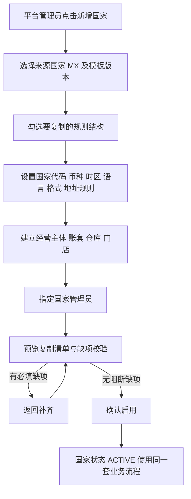
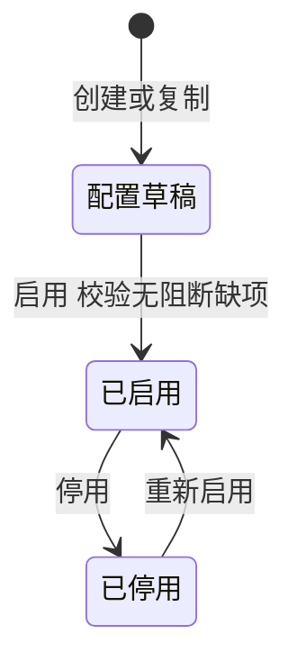

# 01 国家配置与组织

## 1. 模块目标与来源

- PRD 来源：第 03 章（国家组织、按国家复用、从墨西哥模板新增国家）、第 09 章（单店上线与多店扩展）、第 17 章（国家隔离与扩展要求）。
- 需求组：R02（门店）、R08（国家配置与模板复制）；决策 D02、D12、D13。
- 目标：
  - 建立 国家、经营主体、账套、仓库、门店 的归属关系。
  - 支持以墨西哥为模板复制新国家，新国家独立配置和独立运行。
  - 支持新增门店，不需要另建系统。

## 2. 范围

| 一期做 | 一期不做 |
| --- | --- |
| 国家档案、地区参数、启用模块 | 跨主体贸易、法定集团合并及抵销 |
| 经营主体、仓库、门店的增改和停用 | 其他国家实际投产 |
| 国家模板发布、复制向导、缺项校验、启用 | 新国家专属的本地接口、电子发票 |
| 模板升级预览与按国家确认 | 自动同步墨西哥配置到其他国家 |
| 配置就绪检查，缺项时拦截对应业务动作 | |

账套（`fin_book`）的字段定义见 [12 内部财务](12-内部财务总账与结账.md)，本模块负责在复制向导中创建账套。

## 3. 角色与权限点

| 权限码 | 说明 | 默认授予 |
| --- | --- | --- |
| `sys:country:create` | 创建国家、发起模板复制 | 平台管理员 |
| `sys:country:activate` | 启用国家 | 平台管理员 |
| `sys:country:view` | 查看国家列表 | 平台管理员、国家管理员（只看自己被分配的国家） |
| `sys:country-param:edit` | 维护地区参数 | 国家管理员（本国） |
| `sys:template:publish` | 发布模板版本 | 平台管理员 |
| `sys:template:upgrade` | 预览和确认模板升级 | 国家管理员（本国） |
| `org:entity:edit` | 维护经营主体 | 国家管理员 |
| `org:warehouse:edit` | 维护仓库 | 国家管理员 |
| `org:store:edit` | 新增和维护门店 | 国家管理员 |

国家管理员只能管理被分配的国家；墨西哥的权限不会自动延伸到新增国家（PRD 第 12 章）。

## 4. 业务流程

### 4.1 从墨西哥模板新增国家

复制向导的规则：

1. 复制先生成目标国家的配置草稿（`sys_country.status = DRAFT`），页面显示来源国家、模板版本和复制清单。
2. 默认不复制的内容：交易订单、库存余额、成本余额、客户欠款、收付款、凭证、历史报表，以及墨西哥的实际账号授权、银行资料和其他敏感经营数据。这些内容在模板项中标记为 `sensitive = true`，不出现在可勾选清单里。
3. 必须重新配置或复核的项目：当地币种金额、税率、账务政策、人员授权、收款账户。这些复制过来后状态为 `NEED_REVIEW`，复核前不生效。
4. 期初数据通过目标国家独立的导入流程完成（见 [13](13-工作台通知与数据导入.md)）。

### 4.2 新增门店

## 5. 业务规则

### 5.1 组织归属

- 一个国家可以有多个经营主体；一个经营主体对应一个或多个账套；国家不等同于法律主体。
- 仓库和门店都属于某个国家下的某个经营主体。门店可以有独立的门店仓和收款账户。
- 仓库类型：`WAREHOUSE`（MX 仓）、`STORE`（门店仓）。墨西哥仓库按实际数量建立，系统不预设只有一个。
- 中国供应商所在地不要求建立中国运营账套；中国采购的国内节点只作追踪，不建国内仓。

### 5.2 地区参数

每个国家独立维护：国家代码（ISO 3166）、默认交易币种、本位币候选、时区、语言、日期格式、数字格式、地址规则（地址字段结构和必填项）。

### 5.3 配置就绪检查

`ConfigReadinessService.check(countryId, action)` 按动作列出必需的配置。缺项时，业务接口返回 `SYS_CONFIG_MISSING`，并生成配置待办：

| 动作 | 必需配置 |
| --- | --- |
| `SALES_ORDER_SUBMIT` | 交易币种、至少一个启用的门店或销售归属、适用的审批规则 |
| `SALES_OUTBOUND` | 仓库、编号规则、付款方式规则 |
| `COST_CONFIRM` | 汇率（采购币种到本位币）、成本计价方法 |
| `VOUCHER_POST` | 账套、开放期间、凭证映射模板已复核、科目 |
| `RECEIPT_CONFIRM` | 收款账户 |

### 5.4 版本独立

- 目标国家启用后拥有独立的规则版本。修改墨西哥的配置不会自动改变新国家。
- 模板升级时，先生成差异预览（`sys_template_upgrade`），再由各国国家管理员分别确认是否应用。
- 历史订单和已记账凭证保留原规则版本，不会被重写。

### 5.5 停用

被历史单据引用的国家、主体、仓库、门店只能停用，不能删除。停用后不能新建单据，但可以查询历史。

## 6. 状态机

### 6.1 国家

### 6.2 复制任务

`DRAFT`（选择中）、`VALIDATING`（校验中）、`READY`（可启用）、`ACTIVATED`（已启用）、`CANCELLED`（已取消）。

### 6.3 模板升级

`PREVIEWED`（已预览）、`CONFIRMED`（已确认应用）、`REJECTED`（不应用）。

## 7. 数据模型

### 7.1 `sys_country`（全局表）

| 字段 | 类型 | 约束 | 说明 |
| --- | --- | --- | --- |
| `code` | varchar(8) | 唯一 | ISO 国家代码，例如 MX |
| `name` | varchar(64) | | 名称 |
| `status` | varchar(16) | | DRAFT / ACTIVE / DISABLED |
| `default_currency` | char(3) | | 交易币种，例如 MXN |
| `timezone` | varchar(64) | | IANA 时区 |
| `locale` | varchar(16) | | 例如 es-MX |
| `date_format` / `number_format` | varchar(32) | | 显示格式 |
| `address_rule` | jsonb | | 地址字段结构与必填规则 |
| `enabled_modules` | jsonb | | 启用的模块清单 |
| `source_country_id` | bigint | 可空 | 模板来源国家 |
| `source_template_version_id` | bigint | 可空 | 模板版本 |
| `is_test` | boolean | | 测试国家标记（第二国家验收用） |
| `activated_by` / `activated_at` | | | 启用人、启用时间 |

### 7.2 `sys_country_template`（模板版本）

| 字段 | 类型 | 说明 |
| --- | --- | --- |
| `source_country_id` | bigint | 来源国家 |
| `version_no` | int | `(source_country_id, version_no)` 唯一 |
| `status` | varchar(16) | DRAFT / PUBLISHED / RETIRED |
| `published_by` / `published_at` | | 发布人、发布时间 |
| `change_note` | text | 版本说明 |

### 7.3 `sys_country_template_item`（模板项）

| 字段 | 类型 | 说明 |
| --- | --- | --- |
| `template_id` | bigint | 所属模板 |
| `item_type` | varchar(32) | MODULE / FORM_FIELD / FLOW / ROLE_TEMPLATE / REPORT_DEF / CLASSIFY_RULE / PRICE_RULE_STRUCT / CREDIT_RULE_STRUCT / APPROVAL_RULE / VOUCHER_MAPPING / REPORT_MAPPING / ACCOUNT_CHART / DOC_NUMBER_RULE / DICT |
| `item_key` | varchar(64) | 模板项标识 |
| `payload` | jsonb | 规则结构内容（不含金额阈值、人员、账户） |
| `requires_review` | boolean | 复制后是否必须复核 |
| `sensitive` | boolean | 为 true 时不允许复制 |

### 7.4 `sys_country_clone_job`（复制任务）

| 字段 | 类型 | 说明 |
| --- | --- | --- |
| `target_country_id` | bigint | 目标国家（DRAFT） |
| `template_id` | bigint | 模板版本 |
| `selected_items` | jsonb | 勾选的模板项 ID 列表 |
| `copy_result` | jsonb | 每个模板项在目标国家生成的配置 ID |
| `missing_items` | jsonb | 缺项清单 `[{key, level: BLOCK/WARN, link}]` |
| `status` | varchar(16) | 见 6.2 节 |

### 7.5 `sys_country_config_review`（复核记录）

`country_id`、`config_type`、`config_id`、`source_template_item_id`、`review_status`（NEED_REVIEW / REVIEWED）、`reviewed_by`、`reviewed_at`、`comment`。

### 7.6 `sys_template_upgrade`（模板升级）

`country_id`、`from_template_id`、`to_template_id`、`diff jsonb`（新增、修改、删除的项及其影响说明）、`status`、`decided_by`、`decided_at`。

### 7.7 `org_entity`（经营主体）

`country_id`、`code`、`name`、`legal_name`、`tax_id`、`address jsonb`、`status`。`(country_id, code)` 唯一。

### 7.8 `org_warehouse`（仓库）

| 字段 | 类型 | 说明 |
| --- | --- | --- |
| `entity_id` | bigint | 所属经营主体 |
| `code` / `name` | | `(country_id, code)` 唯一 |
| `type` | varchar(16) | WAREHOUSE / STORE |
| `store_id` | bigint | 门店仓对应的门店 |
| `timezone` | varchar(64) | 可空，为空时用国家时区 |
| `address` | jsonb | 地址 |
| `allow_negative` | boolean | 固定为 false，一期禁止负库存 |
| `status` | varchar(16) | ENABLED / DISABLED |

### 7.9 `org_store`（门店）

`entity_id`、`code`、`name`、`default_warehouse_id`、`timezone`、`address jsonb`、`status`、`opened_at`。门店的收款账户见 [03](03-基础档案.md) 中 `md_fund_account.store_id`。

## 8. REST 接口

| 方法 | 路径 | 用途 | 说明 |
| --- | --- | --- | --- |
| GET | `/api/v1/sys/countries` | 国家列表 | 只返回用户被授权的国家 |
| GET | `/api/v1/sys/countries/{id}` | 国家详情 | |
| PUT | `/api/v1/sys/countries/{id}/params` | 修改地区参数 | 写审计日志 |
| GET | `/api/v1/sys/country-templates` | 模板版本列表 | |
| POST | `/api/v1/sys/country-templates` | 从某国家当前配置生成模板草稿 | |
| POST | `/api/v1/sys/country-templates/{id}/publish` | 发布模板 | |
| POST | `/api/v1/sys/country-clone-jobs` | 创建复制任务及目标国家草稿 | 需要 `sys:country:create` |
| PUT | `/api/v1/sys/country-clone-jobs/{id}/items` | 修改勾选项 | 只能在 DRAFT 状态修改 |
| POST | `/api/v1/sys/country-clone-jobs/{id}/apply` | 生成目标国家的配置草稿 | 幂等 |
| GET | `/api/v1/sys/country-clone-jobs/{id}/preview` | 复制清单与缺项 | |
| POST | `/api/v1/sys/countries/{id}/activate` | 启用国家 | 有阻断缺项时返回 `SYS_CONFIG_MISSING` |
| GET | `/api/v1/sys/countries/{id}/readiness?action=` | 就绪检查 | |
| GET | `/api/v1/sys/countries/{id}/reviews` | 待复核配置列表 | |
| POST | `/api/v1/sys/countries/{id}/reviews/{reviewId}/confirm` | 复核确认 | |
| POST | `/api/v1/sys/template-upgrades` | 生成升级差异预览 | |
| POST | `/api/v1/sys/template-upgrades/{id}/confirm` | 确认应用 | |
| CRUD | `/api/v1/org/entities` | 经营主体 | 删除接口仅允许未被引用的记录，否则只能停用 |
| CRUD | `/api/v1/org/warehouses` | 仓库 | 同上 |
| CRUD | `/api/v1/org/stores` | 门店 | 新增门店时可同时创建门店仓 |

## 9. 前端页面

| 路由 | 页面 | 主要交互 | 手机端 |
| --- | --- | --- | --- |
| `/settings/countries` | 国家列表 | 状态、来源模板、启用时间；新增国家按钮 | 否 |
| `/settings/countries/clone` | 复制向导 | 6 步：来源与版本、勾选项、地区参数、组织与账套、管理员、预览与启用 | 否 |
| `/settings/countries/:id` | 国家详情 | 地区参数、启用模块、待复核项、模板升级 | 否 |
| `/settings/templates` | 模板版本 | 发布、对比两个版本的差异 | 否 |
| `/settings/entities` | 经营主体 | 列表与编辑 | 否 |
| `/settings/warehouses` | 仓库 | 列表与编辑、停用 | 否 |
| `/settings/stores` | 门店 | 新增门店向导：门店、门店仓、收款账户、人员 | 否 |

全局组件 `CountrySwitcher` 位于顶栏。切换国家后：

- 重置 Pinia 的 `country` store（币种、时区、格式）；
- 刷新菜单（各国启用的模块不同）；
- 清空列表筛选缓存；
- 重新拉取待办数量。

## 10. 跨模块依赖

- 被所有模块依赖：通过 `CountryApi.getContext(countryId)` 读取币种、时区、格式、启用模块。
- 复制向导调用各模块的 `TemplateCloneApi.cloneStructure(templateItem, targetCountryId)`：02 角色模板与审批规则、06 分类规则、07 价格规则结构、08 授信规则结构、12 科目与映射模板。
- 就绪检查调用各模块的 `ReadinessContributor` 汇总缺项。

## 11. 对应验收用例

A06（新增第 2 家门店）、A33（国家模板创建）、A34（复制不继承人员权限和银行资料）、A35（当地配置生效）、A36（复制不带业务数据）、A37（同一核心功能完成第二国家流程）、A38（规则与模板版本独立）。

## 12. 待确认与实施配置

- 第二测试国家的选取，以及它的币种、时区（PRD 未指定，由验收准备确定）。
- es-MX 等语言包是否在一期交付（PRD 只要求中文评审）。
- 经营主体与账套是否一对一（建议一期一对一，结构上支持一对多）。
