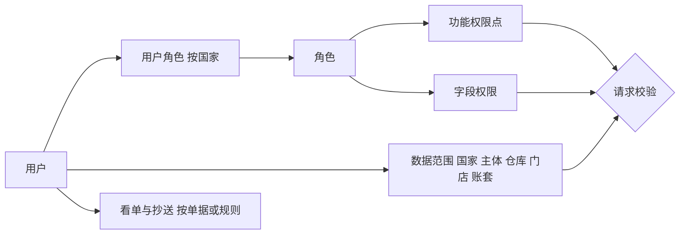
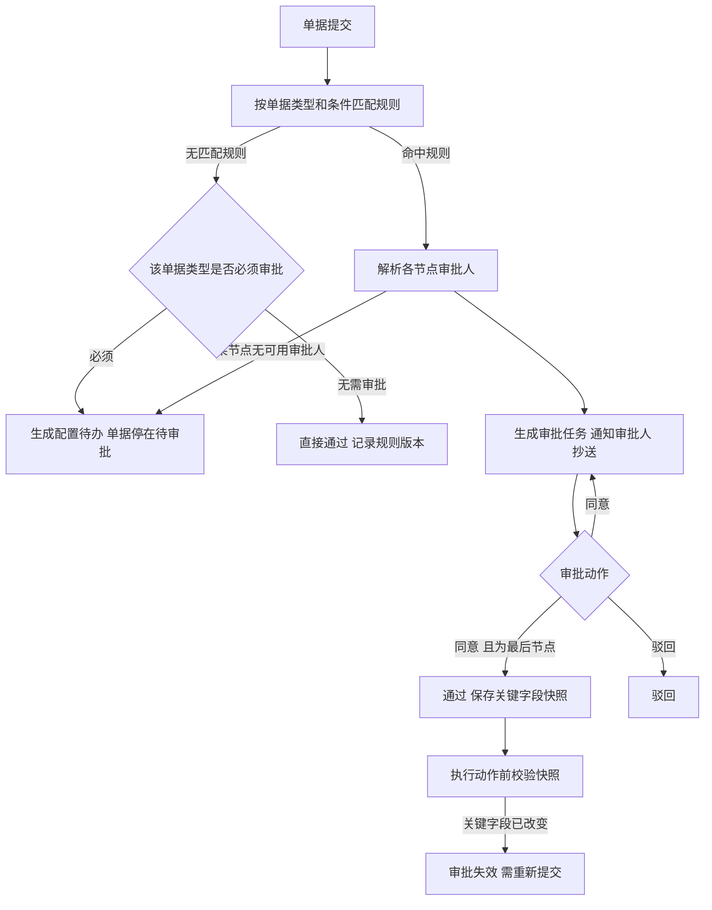
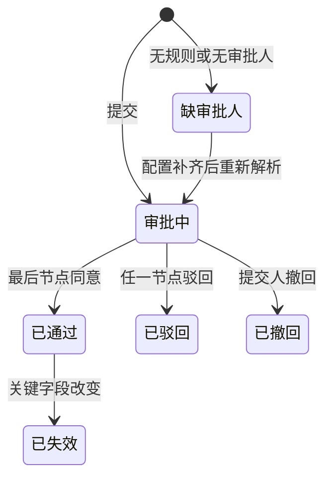

# 02 权限与审批

## 1. 模块目标与来源

- PRD 来源：第 03 章（角色、初始化管理员）、第 12 章（上线后权限分配与审批）、第 17 章（国家隔离）。
- 决策：D06（具体人员上线后分配，配置与校验能力一期具备）。
- 目标：
  - 按 国家、仓库、门店、角色、单据 授权，并在页面、搜索、详情、附件、导出、报表、AI 和接口各层统一生效。
  - 提供可配置的审批规则：单据关键字段变化后必须重新审批，没有审批人时不能自动通过。
  - 看单人、抄送人、审批人和财务关键操作的权限彼此独立。

## 2. 范围

| 一期做 | 一期不做 |
| --- | --- |
| 用户、角色、权限点、数据范围、字段权限 | 单点登录、外部身份源对接 |
| 平台管理员、国家管理员的分级管理 | 外部审批系统对接 |
| 代理授权、撤销授权、留痕 | |
| 审批规则引擎、审批实例、审批待办、抄送 | |
| 财务审核、记账、结账、反结账的独立权限 | |

## 3. 权限模型



一次请求必须同时满足四项：

1. 功能权限：用户有对应的权限码。
2. 国家：用户在当前国家有授权。
3. 数据范围：单据的仓库、门店或账套在用户的数据范围内。
4. 字段权限：受限字段按策略隐藏或只读。

### 3.1 权限码规范

格式为 `模块:资源:动作`，例如 `sal:order:create`、`sal:outbound:confirm`、`ar:receipt:confirm`、`fin:voucher:post`。

动作分类：`view`、`create`、`edit`、`submit`、`approve`、`confirm`、`cancel`、`export`、`import`、`config`。

### 3.2 字段权限组

| 字段组 | 涉及字段 | 默认 |
| --- | --- | --- |
| `COST` | 采购单价、入库成本、出库成本、毛利 | 隐藏 |
| `CUSTOMER_PRICE` | 客户专属价、等级价 | 只对销售和业务负责人可见 |
| `ORDER_TOTAL` | 订单总金额、折扣 | 仓库人员隐藏 |
| `BANK_INFO` | 银行账号、收款账户详情 | 隐藏，只有出纳和财务可见 |
| `PROFIT` | 利润、贡献利润 | 隐藏 |
| `CREDIT` | 客户额度、欠款 | 销售和财务可见 |

字段权限在后端序列化时执行：`@FieldGroup("COST")` 注解配合 Jackson 过滤器，没有权限的字段直接不输出。导出使用同一套序列化逻辑，因此不能通过导出绕过。

### 3.3 内置角色模板

模板角色可以被复制到新国家，但不复制用户与角色的绑定。

| 角色模板 | 主要权限 |
| --- | --- |
| 业务负责人 | 经营及财务汇总查看、价格与授信规则维护、处理业务例外 |
| 采购物流员 | 采购、国内收货、出口节点、运输批次、换柜、派送、物流费用 |
| 仓库操作员 | 授权仓的入库、出库、调拨、盘点、退货验收、补货申请 |
| 业务员 / 门店员 | 代客录单、收款录入、凭证上传、签收跟踪 |
| 财务 | 到账确认、核销、往来、成本费用、凭证编制 |
| 财务主管 | 凭证审核、记账、结账（反结账需要单独授予） |
| 出纳 | 到账确认、付款登记、现金银行日记账 |
| 国家管理员 | 管理本国的仓店、角色、授权、审批规则；不自动拥有业务操作和财务审核权限 |
| 平台管理员 | 创建国家、发布模板；不自动拥有任何国家的业务数据权限 |

### 3.4 看单人、抄送人、审批人

| 身份 | 能做 | 不能自动获得 |
| --- | --- | --- |
| 看单人 | 查看授权仓库或单据中允许的字段 | 审批、改价、出库、到账确认 |
| 抄送人 | 接收通知；打开单据时仍按自己原有的权限范围校验 | 新的数据范围、审批执行权限 |
| 审批人 | 处理分配给自己的审批节点并记录意见 | 实际出库、支付、记账 |
| 仓库操作人 | 在授权的 MX 仓或门店收发、盘点 | 其他仓的明细、采购成本、全部客户价格 |
| 财务人员 | 按分配处理到账、核销、凭证和账簿 | 所有仓库的操作权限 |

### 3.5 分仓订单的可见性

一张销售订单分配给多个仓履约时，仓库人员只能看到分配给本仓的订单行和客户交付信息（收货人、地址、交期）。订单总金额受 `ORDER_TOTAL` 字段组控制，成本受 `COST` 字段组控制。

## 4. 审批流程



### 4.1 审批规则

- 规则按 国家 + 单据类型 配置，可设多条，按优先级匹配，取第一条命中的规则。
- 条件字段（PRD 第 12 章）：金额、客户或客户组、折扣率、仓库、付款方式（现款或赊销）、是否逾期、是否超额度、是否人工改价。
- 节点审批人类型：指定用户、角色（限定在单据所属的数据范围内）、单据字段（例如门店负责人）。
- 节点模式：`ANY`（任一人同意即可）、`ALL`（全部人同意）。
- 规则修改生成新版本；进行中的审批实例继续使用原版本。

### 4.2 关键字段与重新审批

每种单据类型声明自己的关键字段。审批通过时，计算关键字段的哈希 `key_fields_hash` 并与快照一起保存。

| 单据类型 | 关键字段 |
| --- | --- |
| 销售订单 | 客户、行商品、数量、成交价、折扣、付款方式、账期、出库仓 |
| 采购单 | 供应商、行商品、数量、单价、付款条件 |
| 退款 | 金额、收款方、支付方式 |
| 盘点调整 | 差异行与数量 |
| 补货待办 | 来源方式、数量 |

执行动作（例如出库）前，重新计算单据当前的关键字段哈希。与快照不一致时，审批实例置为 `INVALIDATED`，动作被拦截，返回 `WF_APPROVAL_INVALIDATED`（对应 A14）。

### 4.3 禁止默认通过

- 必须审批的单据类型没有匹配规则，或节点解析不出可用审批人时，不能自动通过。单据保持待审批，同时生成 `CONFIG_MISSING` 待办，分配给国家管理员。
- 管理员身份不会自动拥有审批权或财务审核权。

### 4.4 财务关键操作

| 权限码 | 操作 | 约束 |
| --- | --- | --- |
| `fin:voucher:audit` | 凭证审核 | 默认不能审核自己编制的凭证（可按国家配置为允许，配置变更写审计日志） |
| `fin:voucher:post` | 记账 | 只能对已审核的凭证记账 |
| `fin:period:close` | 结账 | |
| `fin:period:reopen` | 反结账 | 单独授予，必须填写原因 |

允许岗位兼任，但每个关键操作都记录实际操作人。

## 5. 业务规则

1. 新账号没有任何业务数据权限，直到管理员分配国家和数据范围（对应 A13）。
2. 授权、代理、撤销都写审计日志，记录前后值。
3. 代理授权（`sys_delegation`）有起止时间，期间被代理人的审批任务同时对代理人可见；代理人不获得被代理人的其他数据范围。
4. 搜索、详情、附件下载、导出、报表、AI 取数和接口统一走数据范围校验（对应 A34）。
5. 国家管理员不能给自己授予超出自身范围的权限，也不能创建国家。

## 6. 状态机

### 6.1 审批实例



### 6.2 审批任务

`PENDING`（待处理）、`APPROVED`（已同意）、`REJECTED`（已驳回）、`TRANSFERRED`（已转交）、`CANCELLED`（实例结束后自动取消）。

## 7. 数据模型

### 7.1 用户与角色

| 表 | 关键字段 |
| --- | --- |
| `sys_user`（全局） | `username` 唯一、`password_hash`、`display_name`、`phone`、`email`、`status`（ENABLED/LOCKED/DISABLED）、`is_platform_admin`、`last_login_at`、`locale` |
| `sys_role` | `country_id`（模板角色为空）、`code`、`name`、`role_type`（BUSINESS/FINANCE/ADMIN）、`template_role_id`、`status` |
| `sys_permission`（全局） | `code` 唯一、`name`、`module`、`perm_type`（MENU/ACTION/EXPORT/AI/API） |
| `sys_role_permission` | `role_id`、`permission_code` |
| `sys_user_role` | `user_id`、`role_id`、`country_id`、`granted_by`、`granted_at` |
| `sys_field_policy` | `role_id`、`resource`、`field_group`、`access`（HIDDEN/READ/WRITE） |

### 7.2 数据范围

`sys_user_data_scope`

| 字段 | 类型 | 说明 |
| --- | --- | --- |
| `user_id` | bigint | 用户 |
| `country_id` | bigint | 国家 |
| `scope_type` | varchar(16) | COUNTRY_ALL / ENTITY / WAREHOUSE / STORE / BOOK |
| `scope_ref_id` | bigint | 具体 ID；COUNTRY_ALL 时为空 |
| `effective_from` / `effective_to` | timestamptz | 有效期 |
| `granted_by` | bigint | 授权人 |

### 7.3 国家管理员与代理

- `sys_country_admin`：`user_id`、`country_id`、`manage_scope jsonb`（可管理的主体、仓、店）。
- `sys_delegation`：`from_user_id`、`to_user_id`、`country_id`、`scope jsonb`（单据类型）、`start_at`、`end_at`、`reason`、`status`（ACTIVE/REVOKED/EXPIRED）。

### 7.4 看单与抄送

`sys_doc_watcher`：`country_id`、`watch_type`（VIEWER/CC）、`target_type`（DOC/WAREHOUSE_RULE/DOC_TYPE_RULE）、`doc_type`、`doc_id`、`warehouse_id`、`user_id`、`field_groups jsonb`。

按规则配置的看单人（例如“某仓的所有出库单”）同样要在数据范围内才能看到单据，看单配置本身不扩大数据范围。

### 7.5 审批

| 表 | 关键字段 |
| --- | --- |
| `wf_approval_rule` | `country_id`、`doc_type`、`name`、`priority`、`condition jsonb`、`version_no`、`status`、`effective_from`、`effective_to` |
| `wf_approval_rule_node` | `rule_id`、`seq`、`node_name`、`approver_type`（USER/ROLE/DOC_FIELD）、`approver_ref`、`mode`（ANY/ALL）、`cc_users jsonb` |
| `wf_doc_type_config` | `country_id`、`doc_type`、`approval_required`、`key_fields jsonb` |
| `wf_approval_instance` | `country_id`、`doc_type`、`doc_id`、`doc_version`、`rule_id`、`rule_version_no`、`key_fields_hash`、`key_fields_snapshot jsonb`、`status`、`submitted_by`、`submitted_at`、`finished_at` |
| `wf_approval_task` | `instance_id`、`node_seq`、`assignee_id`、`delegate_from_id`、`status`、`comment`、`acted_at` |

`condition` 的结构示例：

```json
{
  "all": [
    { "field": "amount", "op": "gte", "value": 50000 },
    { "field": "paymentType", "op": "eq", "value": "CREDIT" }
  ]
}
```

阈值数值由用户配置，PRD 不固定。

## 8. REST 接口

| 方法 | 路径 | 用途 |
| --- | --- | --- |
| POST | `/api/v1/auth/login` / `refresh` / `logout` | 登录、刷新令牌、登出 |
| GET | `/api/v1/auth/me` | 当前用户、可用国家、当前国家的菜单与权限码 |
| CRUD | `/api/v1/sys/users` | 用户（创建时不带任何权限） |
| POST | `/api/v1/sys/users/{id}/reset-password` | 重置密码 |
| CRUD | `/api/v1/sys/roles` | 角色 |
| PUT | `/api/v1/sys/roles/{id}/permissions` | 设置角色权限点 |
| PUT | `/api/v1/sys/roles/{id}/field-policies` | 设置字段权限 |
| PUT | `/api/v1/sys/users/{id}/roles?countryId=` | 设置用户在某国家的角色 |
| PUT | `/api/v1/sys/users/{id}/data-scopes?countryId=` | 设置数据范围 |
| CRUD | `/api/v1/sys/delegations` | 代理授权 |
| CRUD | `/api/v1/sys/doc-watchers` | 看单与抄送配置 |
| GET | `/api/v1/sys/permissions/tree` | 权限点树 |
| CRUD | `/api/v1/wf/rules` | 审批规则（修改即生成新版本） |
| GET | `/api/v1/wf/rules/{id}/versions` | 规则版本历史 |
| PUT | `/api/v1/wf/doc-types/{docType}` | 单据类型的审批开关与关键字段 |
| GET | `/api/v1/wf/tasks/mine` | 我的待审批 |
| POST | `/api/v1/wf/tasks/{id}/approve` / `reject` / `transfer` | 审批动作 |
| POST | `/api/v1/wf/instances/{id}/withdraw` | 撤回 |
| GET | `/api/v1/wf/instances?docType=&docId=` | 单据的审批历史 |

对其他模块开放的接口 `ApprovalApi`：

- `submit(docType, docId, docSnapshot)`：返回审批实例；
- `assertValid(docType, docId, currentSnapshot)`：执行前校验，失效时抛出 `WF_APPROVAL_INVALIDATED`；
- `onApproved` / `onRejected` 回调：由业务模块注册。

## 9. 前端页面

| 路由 | 页面 | 手机端 |
| --- | --- | --- |
| `/login` | 登录 | 是 |
| `/settings/users` | 用户列表；详情抽屉分为“角色”“数据范围”“代理”三个标签页 | 否 |
| `/settings/roles` | 角色列表，权限点树勾选，字段权限矩阵 | 否 |
| `/settings/approval-rules` | 审批规则列表、条件编辑器、节点编辑器、版本历史 | 否 |
| `/settings/doc-watchers` | 看单与抄送配置 | 否 |
| `/approval/todo` | 我的审批待办，可进入原单 | 是 |
| `/approval/done` | 我处理过的审批 | 是 |

通用组件：

- `ApprovalPanel`：嵌入单据详情页，展示审批进度、意见、规则版本，以及“审批已失效”提示。
- `v-perm`：按钮级权限指令。
- 路由守卫：读取 `meta.perm` 判断能否进入页面。

## 10. 跨模块依赖

- 所有模块通过 `PermissionApi.check(...)`、`DataScopeApi.currentScope()` 进行校验。
- 07、04、10、06、08 通过 `ApprovalApi` 提交审批和执行前校验。
- 审批结果、抄送通过 13 的通知服务送达。

## 11. 对应验收用例

A09（授信规则只有授权人员可改）、A13（权限上线后分配）、A14（看单、抄送、审批，以及关键字段变化后旧审批失效）、A33（普通国家账号不能越权创建国家或授权）、A34（跨国家权限隔离）。

## 12. 待确认与实施配置

- 实际人员名单、角色分配、审批链和阈值（上线后由用户配置）。
- 是否允许编制人审核自己编制的凭证（默认不允许）。
- 密码策略和登录失败锁定次数。
