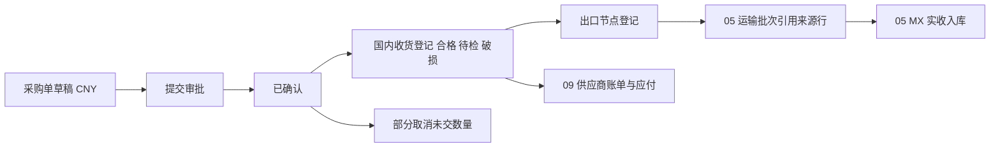
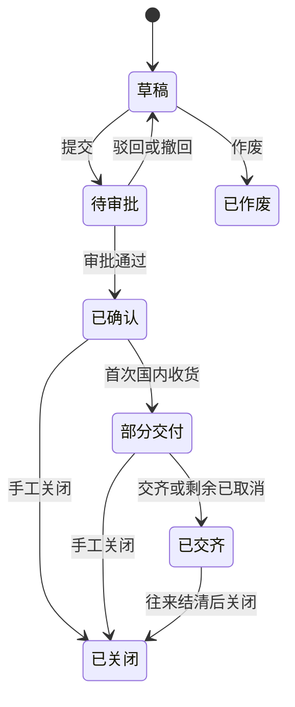

# 04 中国采购

## 1. 模块目标与来源

- PRD 来源：第 04 章（中国采购至墨西哥实收的流程）、第 05 章（采购及来源登记）、第 16 章（采购来源状态）。
- 需求组：R01、R07；决策 D02、D08、D12。
- 目标：
  - 记录中国采购（CNY）的供应商、商品、数量、价格、交期和付款条件。
  - 登记国内收货（合格、待检、破损）和出口节点，作为货源追溯。
  - 展示每条采购行的已交、未交、已发运、已到 MX、退货和付款情况。

关键边界：**国内收货不进入任何库存台账**。运营库存只在 MX 实收时增加（见 [05](05-国际物流与MX实收.md)）。

## 2. 范围

| 一期做 | 一期不做 |
| --- | --- |
| 采购单（草稿、确认、分批交付、部分取消、关闭） | 国内仓库存余额、拣货、调拨、盘点 |
| 国内收货登记（合格、待检、破损数量） | 采购询价、比价、招标 |
| 出口节点登记（报关单号、口岸、日期、单证） | 对接供应商系统 |
| 采购进度视图 | |
| 采购退货（见 [10](10-退货与退款.md)）、应付付款（见 [09](09-供应商物流商应付.md)） | |

## 3. 权限点

| 权限码 | 说明 |
| --- | --- |
| `pur:order:view` / `create` / `edit` / `submit` / `cancel` / `close` | 采购单 |
| `pur:order:export` | 导出 |
| `pur:receipt:create` / `confirm` | 国内收货登记 |
| `pur:export:create` / `confirm` | 出口节点登记 |

采购单价、金额属于 `COST` 字段组，仓库人员默认不可见。

## 4. 业务流程

## 5. 业务规则

### 5.1 采购单

- 采购单的 `country_id` 是业务归属国家（一期为墨西哥），`source_country` 记录采购来源地（CN）。
- 币种默认取供应商的结算币种（中国供应商为 CNY），可按权限修改，但不能写死。
- 行字段包括：商品、录入单位、录入数量、基础单位数量、单价、金额、税率、行交期。
- 付款条件文本化保存，同时保存结构化的预付比例和账期，供 09 生成应付提醒。
- 采购单确认本身不产生应付（PRD 第 05 章）；应付的确认时点由 09 的应付确认规则配置。

### 5.2 分批交付与取消

- 一条采购行可以有多次国内收货登记。
- 部分取消：只能取消“订购数量 − 已收合格数量 − 已收待检数量 − 已取消数量”以内的部分，写取消记录，并保留原因和操作人。
- 采购单状态由行数量汇总得出：
  - 所有行都满足“已交数量 + 已取消数量 ≥ 订购数量”时，为 `DELIVERED`；
  - 部分行已交，为 `PARTIAL_DELIVERED`；
  - 业务确认不再交付时，可手工 `CLOSED`，剩余未交数量自动转为取消。

### 5.3 国内收货登记

- 按实际情况登记合格数量、待检数量、破损数量，同时上传单证。
- 待检数量后续可以转为合格或破损（登记一条转换记录，不修改原记录）。
- 不写库存流水，只更新采购行的统计字段。
- 确认后发出 `PUR_DOMESTIC_RECEIPT_CONFIRMED` 事件；09 若配置为“按国内收货确认应付”，据此生成应付。

### 5.4 出口节点

- 记录报关单号、出口口岸、出口日期、出口单证，关联一条或多条国内收货行及数量。
- 出口节点登记的数量不能超过对应收货行的合格数量减去已登记出口的数量。
- 运输批次（05）的来源行引用出口节点行；如果业务上不单独登记出口节点，也可以直接引用国内收货行，由配置项 `pur.export.required` 控制。

### 5.5 进度视图

每条采购行展示下列数量，由各模块回写或实时汇总：

| 数量 | 来源 |
| --- | --- |
| 订购数量、已取消数量 | 本模块 |
| 国内已交（合格、待检、破损） | 本模块 |
| 未交数量 = 订购 − 已取消 − 合格 − 待检 | 计算 |
| 已发运数量 | 05 运输批次实际发运 |
| 已到 MX 数量（MX 实收合格 + 冻结） | 05 实收 |
| 退货数量 | 10 采购退货 |
| 已付款金额、未付金额 | 09 |

## 6. 状态机

- 是否需要审批由 02 中 `wf_doc_type_config` 的配置决定；不需要审批时，提交即确认。
- 已确认的采购单修改关键字段（供应商、数量、单价、付款条件）后，必须重新审批。
- 只有草稿可以作废；已有收货记录的采购单只能关闭。

国内收货登记的状态：`DRAFT`（草稿）、`CONFIRMED`（已确认）、`VOIDED`（作废，仅限未被出口或运输引用的记录）。

## 7. 数据模型

### 7.1 `pur_order`

| 字段 | 类型 | 说明 |
| --- | --- | --- |
| `entity_id` | bigint | 经营主体 |
| `supplier_id` | bigint | 供应商（`md_partner`） |
| `source_country` | varchar(8) | 来源地，例如 CN |
| `currency` | char(3) | 采购币种 |
| `order_date` / `expected_date` | date | 下单日期、预计交期 |
| `payment_terms` | varchar(200) | 付款条件（文本） |
| `prepay_ratio` / `term_days` | numeric / int | 预付比例、账期天数 |
| `total_qty` / `total_amount` / `tax_amount` | numeric | 汇总 |
| `status` | varchar(24) | 见状态机 |
| `approval_instance_id` | bigint | 审批实例 |

### 7.2 `pur_order_line`

| 字段 | 类型 | 说明 |
| --- | --- | --- |
| `order_id` / `line_no` | | |
| `product_id` / `unit` / `qty` / `base_qty` | | 录入单位、数量与基础单位数量 |
| `unit_price` / `amount` / `tax_rate` | numeric | 单价、金额、税率 |
| `delivery_date` | date | 行交期 |
| `cancelled_qty` | numeric | 已取消数量 |
| `qualified_qty` / `pending_inspect_qty` / `damaged_qty` | numeric | 国内收货累计 |
| `exported_qty` | numeric | 已登记出口 |
| `shipped_qty` / `arrived_mx_qty` | numeric | 由 05 回写 |
| `returned_qty` | numeric | 由 10 回写 |

### 7.3 其他表

| 表 | 关键字段 |
| --- | --- |
| `pur_order_cancel` | `order_line_id`、`cancel_qty`、`reason`、`cancelled_by`、`cancelled_at` |
| `pur_domestic_receipt` | `doc_no`、`order_id`、`supplier_id`、`receipt_date`、`location`、`status` |
| `pur_domestic_receipt_line` | `receipt_id`、`order_line_id`、`product_id`、`qualified_qty`、`pending_inspect_qty`、`damaged_qty`、`remark` |
| `pur_inspect_convert` | `receipt_line_id`、`to_qualified_qty`、`to_damaged_qty`、`converted_by`、`converted_at` |
| `pur_export_node` | `doc_no`、`declaration_no`、`export_port`、`export_date`、`status` |
| `pur_export_node_line` | `export_node_id`、`receipt_line_id`、`order_line_id`、`product_id`、`qty` |

附件通过 `sys_attachment_link` 关联：采购单（PURCHASE_DOC）、国内收货、出口节点（EXPORT_DOC）。

## 8. REST 接口

| 方法 | 路径 | 用途 | 关键校验 |
| --- | --- | --- | --- |
| GET | `/api/v1/pur/orders` | 列表（按供应商、状态、日期、商品筛选） | 数据范围 |
| POST | `/api/v1/pur/orders` | 新建草稿 | 供应商启用；商品已在本国启用 |
| PUT | `/api/v1/pur/orders/{id}` | 修改 | 乐观锁；已确认的单据修改关键字段后重新审批 |
| POST | `/api/v1/pur/orders/{id}/submit` | 提交审批 | |
| POST | `/api/v1/pur/orders/{id}/cancel-lines` | 部分取消 | 不超过可取消数量 |
| POST | `/api/v1/pur/orders/{id}/close` | 关闭 | |
| GET | `/api/v1/pur/orders/{id}/progress` | 进度视图 | 汇总 05、09、10 的数据 |
| POST | `/api/v1/pur/orders/export` | 异步导出 | 字段权限 |
| CRUD | `/api/v1/pur/domestic-receipts` | 国内收货登记 | 累计数量不超过未交数量 |
| POST | `/api/v1/pur/domestic-receipts/{id}/confirm` | 确认 | 幂等 |
| POST | `/api/v1/pur/domestic-receipts/lines/{lineId}/convert` | 待检转换 | |
| CRUD | `/api/v1/pur/export-nodes` | 出口节点 | 不超过可出口数量 |
| POST | `/api/v1/pur/export-nodes/{id}/confirm` | 确认 | 幂等 |

对 05 开放的接口 `PurchaseSourceApi`：

- `listShippableSources(supplierId?, productId?)`：可发运的来源行及剩余数量；
- `onShipped(sourceLineId, qty)`、`onArrived(...)`：回写发运和到货数量。

## 9. 前端页面

| 路由 | 页面 | 手机端 |
| --- | --- | --- |
| `/purchase/orders` | 采购单列表 | 否 |
| `/purchase/orders/:id` | 采购单详情：基本信息、行明细、进度标签页（国内交付、发运、到 MX、退货、付款）、附件、审批面板、操作日志 | 否 |
| `/purchase/domestic-receipts` | 国内收货登记列表与编辑 | 是（拍照上传单证） |
| `/purchase/export-nodes` | 出口节点 | 否 |

## 10. 跨模块依赖

| 方向 | 内容 |
| --- | --- |
| 依赖 03 | 供应商、商品、单位 |
| 依赖 02 | 审批 |
| 被 05 引用 | 来源行，发运后回写数量 |
| 被 09 引用 | 应付与账单关联采购行，付款情况回显 |
| 被 10 引用 | 采购退货关联采购行 |
| 被 11 引用 | 入库成本使用采购单价（CNY） |
| 发出事件 | `PUR_DOMESTIC_RECEIPT_CONFIRMED` |

## 11. 对应验收用例

A01（CNY 采购、部分国内交付及出口来源，不增加国内仓运营库存）、A21（采购保留 CNY 原价）、A23（采购应付可查）。

## 12. 待确认与实施配置

- 采购单是否必须审批，以及审批阈值。
- 是否强制先登记出口节点，再建运输批次（配置项 `pur.export.required`）。
- 待检转换是否需要质检人员单独确认。
