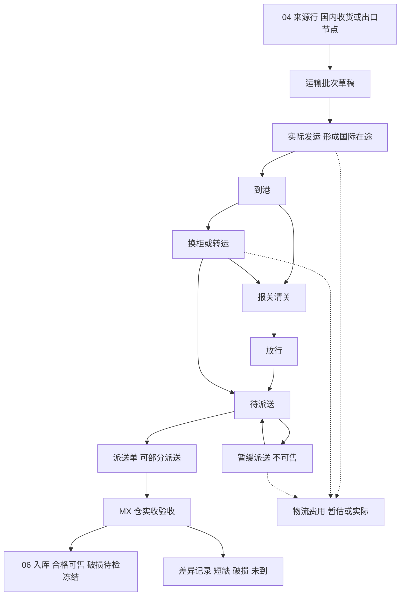
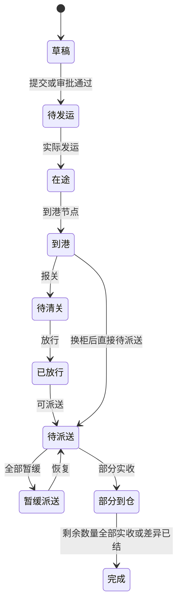

# 05 国际物流与 MX 实收

## 1. 模块目标与来源

- PRD 来源：第 04 章（中国采购至墨西哥实收的流程）、第 06 章（运输批次、换柜、暂缓派送、物流费用）、第 16 章（运输及派送状态）。
- 需求组：R01、R07。
- 目标：
  - 跟踪中国至墨西哥的海运或空运批次，以及报关清关、到港、换柜、暂缓派送、派送、MX 实收的全过程。
  - 每次实收只把实际验收的数量转入对应 MX 仓；短缺、破损、未到的数量继续作为异常或在途跟踪。
  - 登记物流费用（区分暂估与实际），作为应付（09）和成本分摊（11）的来源。

关键边界：

- 运输单草稿和审批不等于实际发运；只有实际发运后才形成在途数量。
- 在途只表示货物位置，不代表已完成财务资产确认。

## 2. 范围

| 一期做 | 一期不做 |
| --- | --- |
| 中国至墨西哥的海运、空运批次 | 其他跨境线路投产（结构上目的国取自配置） |
| 节点事件（计划时间与实际时间）、延误待办 | 对接物流商的轨迹接口 |
| 换柜（保留原柜历史）、暂缓派送、恢复派送 | 按商品库龄产生的预警 |
| 部分派送、部分实收、到货差异跟踪 | |
| 物流费用登记（CNY、MXN，暂估与实际） | 营销费用 |

## 3. 权限点

| 权限码 | 说明 |
| --- | --- |
| `lgs:shipment:view` / `create` / `edit` / `dispatch` | 运输批次、实际发运 |
| `lgs:node:record` | 记录节点事件 |
| `lgs:transship:create` | 换柜 |
| `lgs:hold:create` / `release` | 暂缓派送、恢复派送（恢复需要单独授权） |
| `lgs:delivery:create` / `dispatch` | 派送单 |
| `lgs:receipt:confirm` | MX 实收确认（限定在授权仓） |
| `lgs:discrepancy:handle` | 处理到货差异 |
| `lgs:fee:create` / `confirm` | 物流费用 |

## 4. 业务流程

清关与换柜按实际发生的顺序记录，系统不强制固定顺序。

## 5. 业务规则

### 5.1 运输批次

- 批次的 `country_id` 是目的国家，`dest_warehouse_id` 必须是该国家的 MX 仓。
- 运输方式：`SEA`（海运）需要船名、航次、提单号、柜号、封条号；`AIR`（空运）需要航班号、航空运单号。
- 行明细引用来源行（出口节点行或国内收货行），发运数量不能超过来源行的剩余可发运数量。
- 实际发运时：写入实际离港时间，把行的 `shipped_qty` 回写到 04，状态变为 `IN_TRANSIT`，发出 `LGS_SHIPMENT_DISPATCHED` 事件。

### 5.2 在途数量

| 数量桶 | 计算方式 | 是否可售 |
| --- | --- | --- |
| 国际在途 | 已发运，尚未到达目的国（状态为在途、到港前） | 否 |
| 当地待派送 | 已到港或放行，尚未派送 | 否 |
| 暂缓派送 | 暂缓记录中的有效数量 | 否 |
| 派送在途 | 已派送，尚未实收 | 否 |
| 已实收 | 实收确认的数量（转入 06） | 合格部分可售 |
| 差异 | 短缺、破损、未到的数量 | 否 |

恒等式：每条批次行满足 `发运数量 = 国际在途 + 当地待派送 + 暂缓 + 派送在途 + 已实收 + 已确认差异`。汇总时按这个恒等式校验，不重复计数。

### 5.3 节点事件

- 节点类型：`DEPARTED`（离港）、`ARRIVED_PORT`（到港）、`CUSTOMS_DECLARED`（报关）、`CUSTOMS_RELEASED`（放行）、`TRANSSHIPPED`（换柜）、`HOLD`（暂缓）、`RESUMED`（恢复）、`DISPATCHED`（派送）、`RECEIVED`（实收）、`EXCEPTION`（异常）。
- 每个节点记录计划时间、实际时间、地点、经办人、备注和附件。
- 节点事件只能新增和更正（更正生成新记录，并标记被更正的记录），不能覆盖。
- 延误规则：计划时间已过但没有实际时间，且超过配置的容忍小时数时，生成 `LOGISTICS_DELAY` 待办，并按配置通知责任人。

### 5.4 换柜

- 保存原柜号、新柜号、地点、时间、经办人、转移明细（批次行与数量）、差异和费用。
- 原柜记录保留在 `lgs_container` 中（设置 `active_to`），不能直接覆盖批次上的柜号。
- 转移数量与原柜数量之间的差额记为差异（`lgs_discrepancy`）。
- 一个原柜可以拆到多个新柜；多个原柜也可以合并到一个新柜。

### 5.5 暂缓派送

- 必填：原因（字典 `HOLD_REASON`）、停放地点、责任人、复查日期、涉及的批次行与数量。
- 暂缓期间这部分数量不可售，也不能派送。
- 恢复派送需要 `lgs:hold:release` 权限，可以部分恢复。
- 暂缓期间发生的费用（仓储、滞港）登记为物流费用，并关联暂缓记录。
- 复查日期到期时生成待办。

### 5.6 派送与 MX 实收

- 派送单从批次中“当地待派送”的数量里挑选，可以分多次派送。
- 实收在目标仓执行。对每一行登记：派送数量、实收合格数量、实收破损数量、待检数量、短缺数量。
- 校验：合格 + 破损 + 待检 + 短缺 = 派送数量。
- 确认实收时，在同一事务内调用 06 的 `InventoryApi.inbound(...)`：
  - 合格数量计入实物库存，并且可售；
  - 破损、待检数量计入实物库存，同时冻结；
  - 短缺数量不入库，生成差异记录。
- 幂等：实收确认要求 `Idempotency-Key`，库存流水的唯一键 `(LGS_RECEIPT, receipt_line_id, RECEIPT_IN)` 兜底，重复确认不会重复入库。
- 确认后发出 `LGS_RECEIPT_CONFIRMED` 事件，11 据此生成入库成本快照。
- 示例（A04）：派送 50 件，实收 48 件合格，短缺 2 件。只有 48 件进入该 MX 仓库存，另外 2 件作为差异继续跟踪。

### 5.7 到货差异

- 差异类型：`SHORT`（短缺）、`DAMAGED`（破损）、`NOT_ARRIVED`（未到）、`TRANSSHIP_DIFF`（换柜差异）。
- 处理结论：`LATER_ARRIVED`（后续到货，补做实收）、`CLAIM`（转索赔，见 10）、`WRITE_OFF`（核销，需要审批，财务影响通过 11 和 12 处理）、`SUPPLIER_CREDIT`（供应商贷项）。
- 差异未处理之前，这部分数量既不可售，也不会从统计中消失。

### 5.8 物流费用

- 字段：批次（或换柜、暂缓、派送单）、物流商、费用项目、币种、金额、发生地点（CN 或 MX）、状态（暂估或实际）、账单附件。
- 国内发生的费用支持 CNY，墨西哥发生的费用支持 MXN；币种按实际填写，不写死。
- 实际费用到达时，关联原暂估记录；差额由 11 进行调整，不直接覆盖已锁定的历史数据。
- 一条费用只能进入一张应付账单（09 中有唯一约束），避免采购台账和物流台账重复记同一笔款。
- 确认后发出 `LGS_FEE_CONFIRMED` 事件。

## 6. 状态机

### 6.1 运输批次

批次状态是对行数量和节点的汇总展示；数量判断以 5.2 节的数量桶为准。部分暂缓时，批次状态保持 `PENDING_DELIVERY`，页面另外显示暂缓数量标签。

### 6.2 其他单据

| 单据 | 状态 |
| --- | --- |
| 派送单 | DRAFT / DISPATCHED / PARTIAL_RECEIVED / RECEIVED / CLOSED |
| 实收单 | DRAFT / CONFIRMED |
| 暂缓记录 | ACTIVE / PARTIAL_RELEASED / RELEASED |
| 差异记录 | OPEN / RESOLVED |
| 物流费用 | DRAFT / CONFIRMED / BILLED / ADJUSTED / VOIDED |

## 7. 数据模型

### 7.1 `lgs_shipment`

| 字段 | 说明 |
| --- | --- |
| `doc_no`、`carrier_id`、`transport_mode` | 编号、物流商、运输方式（SEA/AIR） |
| `origin_location`、`dest_warehouse_id` | 发货地点、MX 目的仓 |
| `bl_no`、`vessel`、`voyage` | 海运：提单号、船名、航次 |
| `awb_no`、`flight_no` | 空运：航空运单号、航班号 |
| `current_container_no`、`current_seal_no` | 当前柜号与封条（历史见 `lgs_container`） |
| `total_boxes`、`gross_weight`、`volume` | 箱数、毛重、体积 |
| `planned_etd`、`planned_eta`、`actual_etd`、`actual_eta` | 计划与实际的离港、到港时间 |
| `status` | 见状态机 |

### 7.2 `lgs_shipment_line`

| 字段 | 说明 |
| --- | --- |
| `shipment_id`、`source_type`（EXPORT_NODE_LINE/DOMESTIC_RECEIPT_LINE）、`source_line_id`、`po_line_id` | 来源 |
| `product_id`、`base_qty`、`boxes`、`weight`、`volume` | 商品与计划数量 |
| `shipped_qty` | 实际发运数量 |
| `pending_delivery_qty`、`on_hold_qty`、`delivering_qty` | 当地数量桶 |
| `received_good_qty`、`received_frozen_qty` | 已实收（合格、冻结） |
| `discrepancy_qty` | 已确认的差异数量 |

### 7.3 其他表

| 表 | 关键字段 |
| --- | --- |
| `lgs_container` | `shipment_id`、`container_no`、`seal_no`、`active_from`、`active_to`、`replaced_by_id` |
| `lgs_node_event` | `shipment_id`、`node_type`、`planned_at`、`actual_at`、`location`、`operator_id`、`remark`、`corrects_event_id` |
| `lgs_transship` | `doc_no`、`shipment_id`、`from_container_id`、`to_container_id`、`location`、`transship_at`、`operator_id` |
| `lgs_transship_line` | `transship_id`、`shipment_line_id`、`moved_qty`、`diff_qty` |
| `lgs_hold` | `doc_no`、`shipment_id`、`reason_code`、`park_location`、`owner_id`、`review_date`、`status` |
| `lgs_hold_line` | `hold_id`、`shipment_line_id`、`hold_qty`、`released_qty` |
| `lgs_hold_release` | `hold_id`、`released_by`、`released_at`、`lines jsonb`、`remark` |
| `lgs_delivery` | `doc_no`、`shipment_id`、`dest_warehouse_id`、`dispatched_at`、`vehicle`、`driver`、`status` |
| `lgs_delivery_line` | `delivery_id`、`shipment_line_id`、`product_id`、`dispatch_qty`、`received_qty` |
| `lgs_receipt` | `doc_no`、`delivery_id`、`warehouse_id`、`biz_date`、`received_by`、`status` |
| `lgs_receipt_line` | `receipt_id`、`delivery_line_id`、`product_id`、`dispatch_qty`、`good_qty`、`damaged_qty`、`pending_inspect_qty`、`short_qty`、`inv_batch_id` |
| `lgs_discrepancy` | `source_type`（RECEIPT_LINE/TRANSSHIP_LINE）、`source_line_id`、`shipment_line_id`、`discrepancy_type`、`qty`、`reason_code`、`status`、`resolution`、`resolution_ref`、`resolved_by` |
| `lgs_fee` | `doc_no`、`ref_type`（SHIPMENT/TRANSSHIP/HOLD/DELIVERY）、`ref_id`、`carrier_id`、`expense_item_id`、`currency`、`amount`、`incurred_location`、`estimate_flag`（ESTIMATE/ACTUAL）、`estimate_fee_id`、`status`、`ap_bill_line_id` |

## 8. REST 接口

| 方法 | 路径 | 用途 | 关键校验 |
| --- | --- | --- | --- |
| CRUD | `/api/v1/lgs/shipments` | 运输批次 | 来源剩余数量；目的仓属于本国 |
| POST | `/api/v1/lgs/shipments/{id}/dispatch` | 实际发运 | 幂等；回写 04 |
| GET | `/api/v1/lgs/shipments/{id}/quantities` | 数量桶明细 | 恒等式校验 |
| POST | `/api/v1/lgs/shipments/{id}/nodes` | 记录节点事件 | |
| POST | `/api/v1/lgs/shipments/{id}/nodes/{eventId}/correct` | 更正节点事件 | 保留原记录 |
| POST | `/api/v1/lgs/transships` | 换柜 | 转移数量不超过原柜在柜数量 |
| POST | `/api/v1/lgs/holds` | 暂缓派送 | 不超过待派送数量 |
| POST | `/api/v1/lgs/holds/{id}/release` | 恢复派送 | `lgs:hold:release` |
| CRUD | `/api/v1/lgs/deliveries` | 派送单 | 不超过可派送数量 |
| POST | `/api/v1/lgs/deliveries/{id}/dispatch` | 派送出发 | |
| POST | `/api/v1/lgs/receipts` | 创建实收单 | |
| POST | `/api/v1/lgs/receipts/{id}/confirm` | 确认实收 | 幂等；数量恒等；调用 06 入库 |
| GET | `/api/v1/lgs/discrepancies` | 差异列表 | |
| POST | `/api/v1/lgs/discrepancies/{id}/resolve` | 处理差异 | 核销需要审批 |
| CRUD | `/api/v1/lgs/fees` | 物流费用 | |
| POST | `/api/v1/lgs/fees/{id}/confirm` | 确认费用 | 发出事件 |
| GET | `/api/v1/lgs/in-transit` | 在途汇总（按国家、仓、SKU） | |

## 9. 前端页面

| 路由 | 页面 | 手机端 |
| --- | --- | --- |
| `/logistics/shipments` | 批次列表（运输方式、柜号、状态、计划与实际到港、延误标识） | 否 |
| `/logistics/shipments/:id` | 批次详情：节点时间轴、柜号历史、行数量桶、暂缓、派送、实收、差异、费用 | 只读 |
| `/logistics/holds` | 暂缓派送列表（复查日期提醒） | 否 |
| `/logistics/deliveries` | 派送单 | 否 |
| `/logistics/receipts/:id` | 实收验收（逐行录入合格、破损、待检、短缺；支持扫码） | 是 |
| `/logistics/discrepancies` | 差异处理 | 否 |
| `/logistics/fees` | 物流费用（暂估、实际、关联账单） | 否 |
| `/logistics/in-transit` | 在途看板 | 否 |

## 10. 跨模块依赖

| 方向 | 内容 |
| --- | --- |
| 依赖 04 | 来源行，回写发运和到货数量 |
| 调用 06 | 实收确认时同步调用 `InventoryApi.inbound`，同一事务 |
| 被 06 引用 | 在途数量单独展示，不计入可售 |
| 被 09 引用 | 物流费用进入应付账单 |
| 被 11 引用 | 费用分摊、入库成本 |
| 被 10 引用 | 差异转索赔 |
| 被 13 引用 | 待派送、待收货、延误、复查待办 |

## 11. 对应验收用例

A02（实际发运形成在途，可售数量不增加，目的国取自配置）、A03（原柜和新柜都可追溯；暂缓记录原因、责任人、费用；恢复后可部分派送）、A04（派送 50 件实收 48 件）、A22（费用的暂估与实际）、A23（物流应付）、A30（重复确认实收不重复入库）。

## 12. 待确认与实施配置

- 节点延误的容忍时长，以及通知对象。
- 运输批次是否需要审批。
- 差异核销的审批规则。
