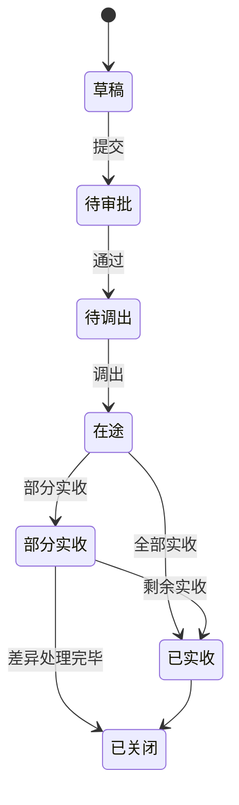
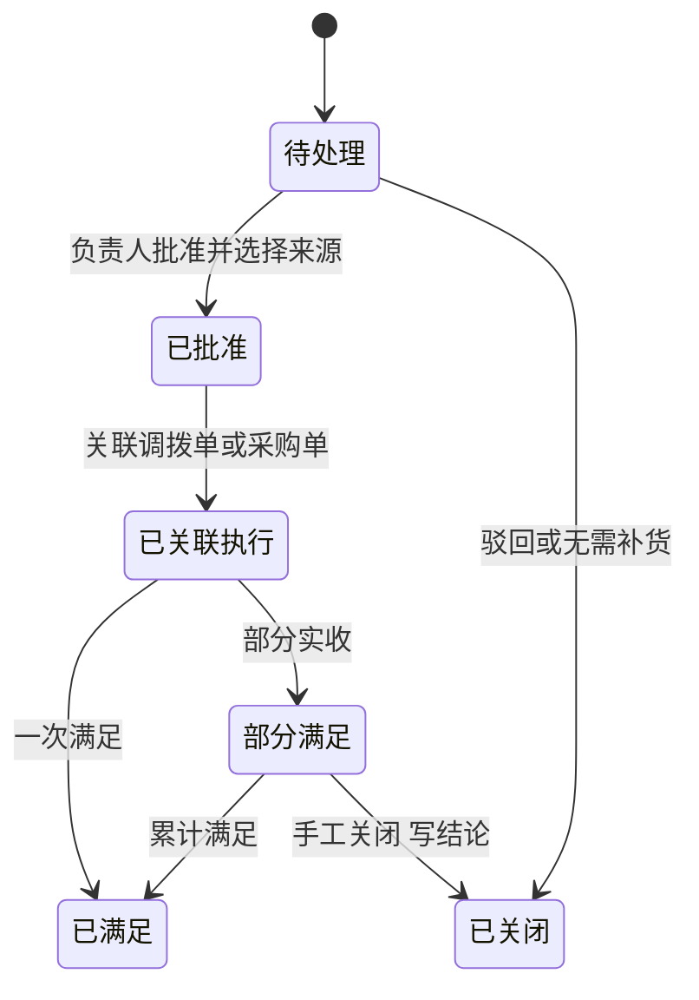

# 06 库存管理

## 1. 模块目标与来源

- PRD 来源：第 07 章（库存数量及状态、调拨、盘点、退货、库存上下限、畅销滞销、销售订单数量口径、补货待办）、第 16 章。
- 需求组：R03；决策 D02、D10、D11。
- 目标：
  - 按 仓或门店仓 + SKU + 来源批次 + 状态 管理 MX 实物库存。
  - 不超卖、不重复扣减；在途、当地待派送、仓库、门店的数量分开展示。
  - 提供调拨、盘点、冻结、退货回仓、上下限预警。
  - 结合库存量和销售订单数量判断畅销、滞销；生成补货待办。

## 2. 范围

| 一期做 | 一期不做 |
| --- | --- |
| MX 仓与门店仓的库存余额、流水、来源批次 | 国内仓库存 |
| 订单预留、冻结（待检、破损、待处理退货、手工冻结） | 库龄、库龄预警、每日跌价计提 |
| 仓到店、店到店调拨（调出、在途、实收） | 库位、货架管理 |
| 盘点（差异审批后调整） | |
| 库存上下限、预警 | |
| 库存与订单联合的畅销滞销分类 | 营销费模型 |
| 补货待办（关联 MX 调拨或中国采购） | 未经批准自动下采购单 |

## 3. 权限点

| 权限码 | 说明 |
| --- | --- |
| `inv:stock:view` | 库存查询（限授权仓） |
| `inv:txn:view` | 流水查询 |
| `inv:freeze:create` / `release` | 手工冻结、解冻 |
| `inv:transfer:create` / `ship` / `receive` | 调拨：创建、调出、实收 |
| `inv:stocktake:create` / `count` / `submit` / `approve` | 盘点 |
| `inv:limit:config` | 库存上下限配置 |
| `inv:classify:config` / `view` | 分类规则配置、分类结果查看 |
| `inv:replenish:create` / `decide` | 补货申请、补货处理 |

成本字段属于 `COST` 字段组。

## 4. 数量模型

### 4.1 公式（PRD 第 07 章）

```
实物结存 on_hand = 已确认入库 − 已确认出库
可售数量 available = on_hand − reserved（订单预留） − frozen（冻结）
```

- 预留与冻结不重叠：预留只能占用未冻结的部分。
- 待检、破损、待处理退货、手工冻结都属于冻结范围。
- 在途（国际在途、当地待派送、调拨在途）不计入 on_hand，也不计入可售。

### 4.2 两层余额

| 层级 | 表 | 键 | 用途 |
| --- | --- | --- | --- |
| 汇总层 | `inv_stock_summary` | 仓 + SKU | 预留、可售校验（防超卖的锁粒度） |
| 批次层 | `inv_batch_balance` | 仓 + SKU + 批次 | 实物数量、冻结数量、成本追溯 |

两层在同一事务内一起更新。不变式：汇总层的 `on_hand` 和 `frozen` 等于批次层对应数量之和。夜间任务核对这一不变式，发现不一致时生成告警待办。

### 4.3 展示口径

库存查询页对每个 SKU 分列展示：

- 实物、预留、冻结（按冻结类型展开）、可售；
- 国际在途、当地待派送、暂缓（来自 05）；
- 调拨在途（调出仓已出，调入仓未收）。

公司汇总时，每类数量只算一次：调拨在途不计入调出仓，也不计入调入仓。

## 5. 业务规则

### 5.1 库存变动统一入口

所有库存变动都通过 `InventoryApi` 执行，写入流水 `inv_stock_txn` 并更新余额，其他模块不能直接修改余额表。

| 方法 | 调用方 | 流水类型 |
| --- | --- | --- |
| `inbound` | 05 MX 实收 | RECEIPT_IN |
| `reserve` / `release` | 07 订单审批通过、取消、关闭 | 只变动预留，不写实物流水，写预留记录 |
| `outbound` | 07 销售出库 | SALES_OUT（消耗预留） |
| `transferOut` / `transferIn` | 本模块调拨 | TRANSFER_OUT / TRANSFER_IN |
| `adjust` | 本模块盘点 | STOCKTAKE_GAIN / STOCKTAKE_LOSS |
| `freeze` / `unfreeze` | 本模块、05、10 | FREEZE / UNFREEZE（实物不变） |
| `returnIn` | 10 销售退货验收 | RETURN_IN（合格直接可售，其他进入冻结） |
| `supplierReturnOut` | 10 采购退货 | SUPPLIER_RETURN_OUT |
| `scrapOut` | 冻结品报废（需要审批） | SCRAP_OUT |
| `openingIn` | 13 期初导入 | OPENING_IN |

### 5.2 防超卖与幂等

- 禁止负库存；预留和出库都会校验数量。
- 预留时使用条件更新：`available >= qty` 才成功，影响行数为 0 时返回 `INV_INSUFFICIENT_AVAILABLE`。
- 出库时先消耗该订单行在本仓的预留，再按批次扣减实物。批次选择默认先进先出（FIFO），也可以由操作员指定批次。
- 流水唯一键 `(source_type, source_line_id, txn_type, seq)`，重复请求不会重复扣减。
- 实际出库仓必须明确，与订单行的分仓记录一致。

### 5.3 来源批次

- 每次 MX 实收行生成一个批次 `inv_batch`，关联运输批次、采购行、入库成本快照（11）。
- 调拨时批次和成本随货转移，不产生销售收入。
- 无原单退货、盘盈、期初导入也会生成批次，并标明来源类型和成本来源。

### 5.4 冻结

- 冻结类型：`PENDING_INSPECT`（待检）、`DAMAGED`（破损）、`RETURN_PENDING`（待处理退货）、`MANUAL`（手工）、`TRANSIT_HOLD`（保留类型，一期不用，暂缓派送数量在 05 中不入库）。
- 冻结记录可以部分解冻；解冻时可以转为可售，也可以转为报废出库（需要审批）。

### 5.5 调拨

- 适用于 MX 仓到门店、门店到门店，使用同一套流程：调出、在途、实收。
- 调出时扣减调出仓的实物（`TRANSFER_OUT`），调拨在途单独记录；实收时增加调入仓的实物（`TRANSFER_IN`）。
- 可以部分实收；差异生成差异行，需要审批后处理（找回、报损）。
- 调出数量不能超过调出仓的可售数量。

### 5.6 盘点

- 创建盘点单时，按范围（仓、商品分类、SKU）生成账面快照。
- 默认采用“冻结作业”：盘点期间，盘点范围内的 SKU 不允许出入库（出库、调拨、实收会返回 `INV_STOCKTAKE_LOCKED`）。
- 录入实盘数量后提交，差异 = 实盘 − 账面快照。
- 差异必须经审批后才能过账，生成盘盈或盘亏流水；不能直接修改库存余额。
- 过账后发出 `INV_STOCKTAKE_POSTED` 事件，11 计算差异成本，12 生成凭证。

### 5.7 库存上下限与预警

- 用户按 SKU + 仓或门店设置下限、上限、预警开关和责任人。
- 校验：上下限非负，下限不高于上限。
- 比较时使用可售数量；页面同时展示实物、预留、冻结、在途。
- 预警类型：`BELOW_MIN`（低于下限）、`ABOVE_MAX`（高于上限）、`OUT_OF_STOCK`（缺货，可售为 0）。
- 触发：消费 `INV_STOCK_CHANGED` 事件做增量评估，每天全量评估一次。同一 SKU、同一仓、同一类型只保留一条未关闭的预警；条件消失后自动关闭。
- 库存预警与畅销滞销分类分开显示，可以同时存在。

### 5.8 畅销滞销联合分类

已确认规则（D11）：同时参考当前库存量和期间内的销售订单数量，不能只按库存高低贴标签。

#### 有效订单数量口径

```
有效订购数量 = 统计周期内符合条件的销售订单行确认数量 − 已取消数量
有效订单张数 = 统计周期内包含该 SKU、且有效订购数量 > 0 的不同销售订单数
```

| 规则 | 默认 |
| --- | --- |
| 进入统计周期的时间点 | 订单审批通过时间（按国家时区） |
| 计入的订单状态 | 已审批，且未取消（草稿、待审、驳回、撤回、取消部分都不计） |
| 未发货订单 | 有效未发订单仍计入需求 |
| 分批出库 | 不重复累加同一订购数量 |
| 退货件数、实际出库件数 | 单独展示，不改变需求口径 |
| 单位 | 按基础单位换算后计算 |
| 订单主指标 | 用户配置，默认使用有效订购件数（`QTY`），订单张数作为辅助 |

#### 统计维度

| 维度 | 订单归属 | 说明 |
| --- | --- | --- |
| 门店 | 订单的 `store_id` | |
| 仓库 | 订单行分配到该履约仓的数量 | 还没分配仓的数量单独一列 |
| 国家汇总 | 全部订单 | 多仓拆分不重复计数 |

只使用本国家的库存和订单数据，其他国家同一 SKU 的数据不影响本国的分类。

#### 规则配置

- 配置项：统计周期（滚动天数或自然周期）、订单主指标、库存指标（默认为可售数量）、条件组合、分类标签、优先级、生效时间、版本。
- 每个条件是“库存条件 AND 订单条件”，例如“可售 ≤ X 且有效订购件数 ≥ Y，则标为畅销候选”。
- 标签：`HOT_CANDIDATE`（畅销候选，关注补货）、`SLOW_CANDIDATE`（滞销候选，关注积压）、`NORMAL`（普通）、`WATCH`（观察），可扩展。
- 冲突检测：保存规则时检查各条件的取值区间。同一优先级下区间重叠但标签不同时，拒绝保存并提示冲突的条件，不随机选标签。
- 规则修改生成新版本。

#### 计算与结果

- 每个 SKU 在同一维度对象（仓或店）、同一规则版本下只输出一个主分类。
- 输出内容：统计起止日期、库存快照时间、库存数量（可售、实物、预留、冻结）、有效订购件数、订单张数、未分配仓数量、命中的条件、规则版本，以及能进入对应订单列表的链接。
- 缺少必要数据或没有配置规则时，输出 `PENDING_JUDGE`（待判断）。
- 库存为 0 时可以单独触发缺货预警，但不会因此自动判为畅销。
- 重算触发：订单审批、取消、数量修改、重新审批，库存变化，规则版本变化（增量），另外每天全量重算一次。结果变化时写变更日志，保留变更依据。

参考判断表（PRD 给出的建议，阈值由用户配置）：

| 库存与订单情况 | 建议显示 |
| --- | --- |
| 库存偏低，订单需求高 | 畅销候选，关注补货 |
| 库存偏高，订单需求低 | 滞销候选，关注积压 |
| 库存偏高，订单需求高 | 按组合规则判断，不能只因库存多判为滞销 |
| 库存偏低，订单需求低 | 普通或观察，不能只因库存少判为畅销 |

### 5.9 补货待办

- 来源：仓库人员手工提交，或由预警（低于下限、缺货）、畅销候选生成建议。
- 字段：SKU、需求数量、需求日期、原因、建议来源（MX 内部调拨或中国采购）。
- 负责人决定执行方式，批准后关联执行单（调拨单或采购单），可以关联多张。
- 满足程度按执行单的实收数量（调拨实收、MX 实收）计算：部分满足、已满足。
- 同一预警持续存在时，不重复创建相同待办：未关闭的补货待办以 `(warehouse_id, product_id, alert_id)` 作为去重键。
- 不能未经批准自动下采购单。

## 6. 状态机

### 6.1 调拨单



### 6.2 盘点单

`DRAFT`（草稿）、`COUNTING`（盘点中，范围锁定）、`SUBMITTED`（已提交）、`APPROVED`（已审批）、`POSTED`（已过账，解除锁定）、`CANCELLED`（已取消，解除锁定）。

### 6.3 补货待办（PRD 第 16 章）



## 7. 数据模型

### 7.1 余额与流水

| 表 | 关键字段 | 约束 |
| --- | --- | --- |
| `inv_stock_summary` | `warehouse_id`、`product_id`、`on_hand_qty`、`reserved_qty`、`frozen_qty`、`version` | `(warehouse_id, product_id)` 唯一；CHECK `on_hand_qty >= 0`；CHECK `on_hand_qty - reserved_qty - frozen_qty >= 0` |
| `inv_batch` | `product_id`、`batch_no`、`source_type`（MX_RECEIPT/TRANSFER/RETURN/STOCKTAKE_GAIN/OPENING）、`source_ref_id`、`shipment_id`、`po_line_id`、`first_inbound_date`、`cost_snapshot_id` | `(country_id, batch_no)` 唯一 |
| `inv_batch_balance` | `warehouse_id`、`product_id`、`batch_id`、`on_hand_qty`、`frozen_qty`、`version` | `(warehouse_id, batch_id)` 唯一 |
| `inv_stock_txn` | `warehouse_id`、`product_id`、`batch_id`、`txn_type`、`on_hand_change`、`frozen_change`、`source_type`、`source_id`、`source_line_id`、`seq`、`biz_date`、`occurred_at`、`operator_id`、`unit_cost`（由 11 回填） | `(source_type, source_line_id, txn_type, seq)` 唯一 |
| `inv_reservation` | `order_id`、`order_line_id`、`alloc_id`、`warehouse_id`、`product_id`、`qty`、`consumed_qty`、`released_qty`、`status`（ACTIVE/CONSUMED/RELEASED） | `(alloc_id)` 唯一 |
| `inv_freeze` | `warehouse_id`、`product_id`、`batch_id`、`freeze_type`、`qty`、`released_qty`、`reason`、`source_type`、`source_id`、`status` | |

### 7.2 调拨与盘点

| 表 | 关键字段 |
| --- | --- |
| `inv_transfer` | `doc_no`、`from_warehouse_id`、`to_warehouse_id`、`shipped_at`、`received_at`、`status`、`replenish_id` |
| `inv_transfer_line` | `transfer_id`、`product_id`、`batch_id`、`qty`、`shipped_qty`、`received_qty`、`diff_qty`、`diff_resolution` |
| `inv_stocktake` | `doc_no`、`warehouse_id`、`scope jsonb`、`snapshot_at`、`status`、`approval_instance_id` |
| `inv_stocktake_line` | `stocktake_id`、`product_id`、`batch_id`、`book_qty`、`counted_qty`、`diff_qty`、`reason` |

### 7.3 上下限与预警

| 表 | 关键字段 |
| --- | --- |
| `inv_stock_limit` | `warehouse_id`、`product_id`、`min_qty`、`max_qty`、`alert_enabled`、`owner_id`、`version_no`、`status`；`(warehouse_id, product_id)` 当前生效记录唯一；CHECK `0 <= min_qty <= max_qty` |
| `inv_stock_alert` | `warehouse_id`、`product_id`、`alert_type`、`available_qty`、`threshold`、`status`（OPEN/CLOSED）、`first_triggered_at`、`last_evaluated_at`、`closed_at`；未关闭记录按 `(warehouse_id, product_id, alert_type)` 部分唯一索引 |

### 7.4 分类

| 表 | 关键字段 |
| --- | --- |
| `inv_classify_rule` | `name`、`dim_type`（STORE/WAREHOUSE/COUNTRY）、`period_type`（ROLLING_DAYS/CALENDAR_MONTH/CALENDAR_WEEK）、`period_days`、`order_metric`（QTY/ORDER_COUNT）、`stock_metric`（AVAILABLE/ON_HAND）、`version_no`、`status`、`effective_from` |
| `inv_classify_rule_cond` | `rule_id`、`label`、`priority`、`stock_op`、`stock_value`、`stock_value2`、`order_op`、`order_value`、`order_value2`（op 取值 LT/LTE/GT/GTE/BETWEEN/ANY） |
| `inv_classify_result` | `rule_id`、`rule_version_no`、`dim_type`、`dim_id`、`product_id`、`period_start`、`period_end`、`stock_snapshot_at`、`available_qty`、`on_hand_qty`、`reserved_qty`、`frozen_qty`、`in_transit_qty`、`order_qty`、`order_count`、`unassigned_qty`、`outbound_qty`、`returned_qty`、`label`、`hit_cond_id`、`computed_at`；`(rule_id, rule_version_no, dim_type, dim_id, product_id)` 唯一 |
| `inv_classify_result_log` | `result_id`、`old_label`、`new_label`、`trigger`（ORDER/STOCK/RULE/DAILY）、`trigger_ref`、`changed_at`、`basis jsonb` |

### 7.5 补货

| 表 | 关键字段 |
| --- | --- |
| `inv_replenish` | `doc_no`、`warehouse_id`、`product_id`、`req_qty`、`need_date`、`reason`、`suggested_source`（TRANSFER/PURCHASE）、`decided_source`、`alert_id`、`status`、`decided_by`、`decision_note`、`fulfilled_qty` |
| `inv_replenish_link` | `replenish_id`、`exec_doc_type`（INV_TRANSFER/PUR_ORDER）、`exec_doc_id`、`exec_line_id`、`qty` |

## 8. REST 接口

| 方法 | 路径 | 用途 |
| --- | --- | --- |
| GET | `/api/v1/inv/stocks` | 库存查询（仓、SKU、分类；按数量口径分列） |
| GET | `/api/v1/inv/stocks/{warehouseId}/{productId}/batches` | 批次明细 |
| GET | `/api/v1/inv/txns` | 流水查询（可下钻到来源单据） |
| GET | `/api/v1/inv/reservations` | 预留明细 |
| POST | `/api/v1/inv/freezes` / `{id}/release` | 手工冻结、解冻 |
| CRUD | `/api/v1/inv/transfers` | 调拨单 |
| POST | `/api/v1/inv/transfers/{id}/ship` / `receive` | 调出、实收（幂等） |
| CRUD | `/api/v1/inv/stocktakes` | 盘点单 |
| POST | `/api/v1/inv/stocktakes/{id}/start` / `submit` / `post` | 开始盘点（锁定范围）、提交、过账 |
| PUT | `/api/v1/inv/stocktakes/{id}/lines` | 录入实盘数量（手机端扫码） |
| GET / PUT | `/api/v1/inv/limits` | 上下限查询与批量设置 |
| GET | `/api/v1/inv/alerts` | 预警列表 |
| CRUD | `/api/v1/inv/classify-rules` | 分类规则（保存时做冲突检测） |
| POST | `/api/v1/inv/classify-rules/{id}/validate` | 只做冲突检测，不保存 |
| POST | `/api/v1/inv/classify-rules/{id}/recalculate` | 手动触发重算（异步） |
| GET | `/api/v1/inv/classify-results` | 分类结果（维度、标签、SKU 筛选） |
| GET | `/api/v1/inv/classify-results/{id}/orders` | 下钻到计入的订单行 |
| CRUD | `/api/v1/inv/replenishments` | 补货待办 |
| POST | `/api/v1/inv/replenishments/{id}/decide` / `link` / `close` | 处理、关联执行单、关闭 |

## 9. 前端页面

| 路由 | 页面 | 手机端 |
| --- | --- | --- |
| `/inventory/stocks` | 库存总览：仓店切换，实物、预留、冻结、可售、在途分列；预警与分类标签并列显示 | 是（查询） |
| `/inventory/txns` | 库存流水 | 否 |
| `/inventory/freezes` | 冻结管理 | 否 |
| `/inventory/transfers` | 调拨单 | 是（调出、实收、扫码） |
| `/inventory/stocktakes` | 盘点单 | 是（录入实盘、扫码） |
| `/inventory/limits` | 上下限配置（表格批量编辑、导入） | 否 |
| `/inventory/alerts` | 预警列表 | 否 |
| `/inventory/analysis` | 库存与订单联合分析：散点图（横轴库存、纵轴订单量）、明细表、命中依据抽屉、下钻订单 | 否 |
| `/inventory/classify-rules` | 分类规则配置（条件矩阵、冲突提示、版本历史） | 否 |
| `/inventory/replenishments` | 补货待办 | 是（提交申请） |

## 10. 跨模块依赖

| 方向 | 内容 |
| --- | --- |
| 被 05 调用 | `inbound` |
| 被 07 调用 | `reserve` / `release` / `outbound` |
| 被 10 调用 | `returnIn` / `supplierReturnOut` / `freeze` |
| 读取 05 | 在途数量（展示） |
| 读取 07 | 有效订单数量（分类计算，通过 `SalesStatsApi`） |
| 联动 04 | 补货关联采购单 |
| 被 11 引用 | 流水回填单位成本 |
| 发出事件 | `INV_STOCK_CHANGED`、`INV_TRANSFER_SHIPPED`、`INV_TRANSFER_RECEIVED`、`INV_STOCKTAKE_POSTED` |

## 11. 对应验收用例

A04（只有实收数量入库）、A18（调拨、盘点、保留批次成本、无库龄）、A19（上下限与补货）、A20（库存与订单联合分类）、A30（并发不超卖）、A31（有效订单数量口径）、A32（统计范围与规则配置）、A36（同 SKU 的分类只用本国数据）。

## 12. 待确认与实施配置

- 统计周期、订单主指标、库存与订单阈值、组合条件（由用户配置）。
- 出库批次选择策略（默认 FIFO）。
- 盘点是否允许动态盘点（一期默认冻结作业）。
- 调拨是否需要审批。
