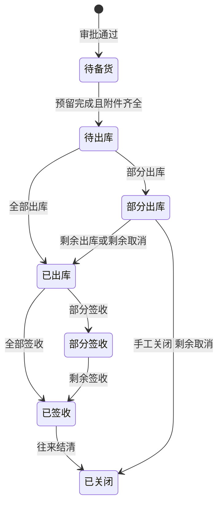

# 07 销售与门店

## 1. 模块目标与来源

- PRD 来源：第 04 章（现款销售、赊销销售流程）、第 08 章（内部代录、客户差异化定价、出库与签收）、第 09 章（单店上线、出库前的附件条件、收款与到账确认）。
- 需求组：R02、R04；决策 D01、D04、D05。
- 目标：
  - 业务员或门店人员代客户录入销售订单，第一期没有客户自助端。
  - 按 客户专属价、等级价、基础价 的顺序定价，保存成交价快照。
  - 出库前校验审批、附件、付款或授信条件、仓库权限、库存；实际出库时生成业务应收。
  - 记录配送和客户签收，拒收与差异单独跟踪。

收款登记、到账确认、核销见 [08](08-收款授信与客户应收.md)；本模块的订单页面嵌入收款入口。

## 2. 范围

| 一期做 | 一期不做 |
| --- | --- |
| 代录销售订单，包括部分发货、部分取消、多次收款 | 客户登录、商城、自助下单 |
| 基础价、等级价、客户 SKU 专属价，人工改价审批 | 营销活动、优惠券、订单关联营销活动 |
| 订单审批；关键字段变化后重新审批 | |
| 多仓拆分履约，分仓出库 | |
| 出库前附件拦截、签收 | 现金交班 |
| 门店按日收款清单（数据来自 08） | |

## 3. 权限点

| 权限码 | 说明 |
| --- | --- |
| `sal:order:view` / `create` / `edit` / `submit` / `cancel` / `close` | 订单 |
| `sal:order:manual-price` | 人工改价（另外按审批规则审批） |
| `sal:price:view` / `edit` | 价格表维护（`CUSTOMER_PRICE` 字段组） |
| `sal:outbound:create` / `confirm` | 出库（限授权仓） |
| `sal:sign:record` | 签收登记 |
| `sal:order:export` | 导出 |

数据范围：业务员默认只能看自己录入或自己归属客户的订单；门店人员只能看本门店的订单；仓库人员只能看分配到本仓的订单行（见 [02](02-权限与审批.md) 3.5 节）。

## 4. 业务流程

### 4.1 现款销售

### 4.2 赊销销售

销售草稿可以先创建，以便关联付款和凭证。赊销不要求上传还没有发生的收款凭证。

## 5. 业务规则

### 5.1 订单内容

- 头字段：客户、业务员、录入人、门店、销售来源（字典：业务员、门店）、收货地址快照、币种（取国家交易币种）、税口径（含税或不含税）、付款方式（现款或赊销）、账期快照、交期、附件。
- 行字段：SKU、单位、数量、基础单位数量、成交价、价格来源、折扣、税率、行金额、发货仓分配。
- 订单不强制关联营销活动。

### 5.2 定价

价格解析顺序（PRD 建议）：

1. 客户与 SKU 的专属价；
2. 客户等级价；
3. 基础价（兜底）。

匹配条件：单位一致、含税口径一致、数量满足阶梯起订量、业务日期在有效期内。都没有匹配时返回 `SAL_PRICE_NOT_FOUND`，录单人可以申请人工定价（需要权限）。

- 人工改价需要 `sal:order:manual-price` 权限，同时设置 `manual_price_flag`，提交审批时作为审批条件之一（例如偏离标准价超过配置比例）。
- 每行保存价格快照：价格来源、价格记录 ID、版本、标准价、成交价、折扣。后续调价不覆盖历史订单（对应 A15）。
- 价格表修改生成新版本；已审批订单不受影响。
- 成本、利润和其他客户的专属价按字段权限隐藏，导出时同样隐藏。

### 5.3 审批与重新审批

- 提交时调用 `ApprovalApi.submit`。条件包括金额、客户、折扣、仓库、付款方式、逾期、是否超额度（额度判断调用 08 的 `CreditApi.evaluate`）。
- 审批通过后：
  - 按分仓数量调用 `InventoryApi.reserve` 预留库存；
  - 赊销订单调用 08 的 `CreditApi.reserve` 占用信用额度；
  - 发出 `SAL_ORDER_APPROVED` 事件（06 的分类重算使用）。
- 修改客户、数量、金额、价格、付款条件、出库仓之后，订单回到 `DRAFT` 并重新审批，原审批实例失效；已有的预留和额度占用按新数量重新计算（多出的部分释放）。
- 已有出库记录的行，数量不能改到低于已出库数量。

### 5.4 多仓拆分

- 每个订单行可以分配到一个或多个仓（`sal_order_line_alloc`），分配数量之和等于行的有效数量。
- 每个仓分别生成出库单，所有出库单关联同一张销售订单。
- 订单页分别展示未发数量、已发数量、退货数量。

### 5.5 出库前校验（出库确认时逐项执行）

| 序号 | 校验 | 错误码 |
| --- | --- | --- |
| 1 | 订单为已审批，且审批没有失效（关键字段哈希一致） | `WF_APPROVAL_INVALIDATED` |
| 2 | 订单存在有效的销售单据附件（`SALES_DOC`）；附件被删除后再次拦截 | `SAL_ATTACHMENT_MISSING` |
| 3a | 现款订单：有收款凭证（`PAYMENT_PROOF`）或有效现金收款记录；已确认到账并分配到本订单的金额覆盖本次出库后的累计出库金额 | `SAL_PAYMENT_NOT_CONFIRMED` |
| 3b | 赊销订单：有已生效的赊销审批依据；按当前有效的授信规则重新检查额度与逾期策略 | `AR_CREDIT_BLOCKED` |
| 4 | 操作人有该出库仓的权限 | `SYS_FORBIDDEN` |
| 5 | 出库数量不超过该仓分配数量减去已出库数量 | `SAL_QTY_EXCEEDED` |
| 6 | 库存足够（消耗预留后的批次可用） | `INV_INSUFFICIENT_AVAILABLE` |
| 7 | 国家配置就绪，业务日期所在期间未结账 | `SYS_CONFIG_MISSING` / `FIN_PERIOD_CLOSED` |

3a 的“足额”口径默认按累计出库金额判断，可配置为“订单全额到账后才能首次出库”，见第 12 节。

### 5.6 出库确认

在同一个数据库事务中依次执行：

1. 写入出库单的实际出库数量、批次、操作人、时间、配送信息；
2. 调用 `InventoryApi.outbound`，消耗预留并扣减实物；
3. 调用 `ReceivableApi.createFromOutbound`，按实际出库数量和成交价形成业务应收，同时把额度预占转为应收占用；
4. 现款订单调用 `ReceivableApi.autoWriteoffFromPrepaid`，用已确认的预收款核销刚生成的应收；
5. 写入 `SAL_OUTBOUND_CONFIRMED` 事件，由 11 计算出库成本，由 12 生成凭证。

整个过程要求 `Idempotency-Key`。业务应收在出库时形成（D04），不等到签收或收款；应收形成不等于凭证已经审核或记账。

示例（A10）：订单 20 件，只出库 8 件，则只对这 8 件形成应收，未交数量仍为 12 件。

### 5.7 签收

- 记录客户实收数量、签收时间、签收人、签收证明（`SIGN_PROOF`）。
- 实收数量少于出库数量时，生成签收差异（拒收、短少、破损），单独跟踪处理：转退货、补发、责任认定。
- 签收不改变业务应收的形成时点；拒收导致的应收调整通过 10 的退货流程处理。

### 5.8 取消与关闭

- 未出库的数量可以部分取消：释放预留和额度占用，并发出 `SAL_ORDER_QTY_CHANGED` 事件。
- 已出库的数量不能取消，只能走退货。
- 已执行的出库单不能删除，更正通过关联退货、冲销或经批准的调整处理。

### 5.9 门店

- 门店使用统一的商品和客户档案，有自己的门店仓和收款账户（01、03）。
- 门店录单默认带出本门店、本门店仓、门店收款账户。
- 门店日报：按日期、门店汇总销售订单、出库、收款方式（现金、转账）、待确认到账金额。这不是交班流程。

## 6. 状态机

订单的审批状态、履约状态和付款状态三者独立（PRD 第 16 章）。

### 6.1 审批状态

`DRAFT`（草稿）、`PENDING`（待审批）、`APPROVED`（已通过）、`REJECTED`（已驳回）、`WITHDRAWN`（已撤回）。关键字段修改后从 `APPROVED` 回到 `DRAFT`。

### 6.2 履约状态

### 6.3 付款状态

`UNPAID`（未收款）、`PARTIAL`（部分收款）、`PAID`（已收齐），由 08 中已确认并分配到订单的金额计算得出。

### 6.4 出库单

`DRAFT`（草稿）、`OUTBOUNDED`（已出库）、`PARTIAL_SIGNED`（部分签收）、`SIGNED`（已签收）、`DIFF_PENDING`（签收差异待处理）。

## 7. 数据模型

### 7.1 价格

| 表 | 关键字段 |
| --- | --- |
| `sal_price_base` | `product_id`、`unit`、`currency`、`tax_mode`、`min_qty`、`price`、`effective_from`、`effective_to`、`version_no`、`status` |
| `sal_price_level` | `level_id`，其余字段同上 |
| `sal_price_customer` | `customer_id`，其余字段同上 |

三张表都按 `(country_id, 对象, product_id, unit, tax_mode, min_qty, effective_from)` 建唯一约束，并按版本保存历史。

### 7.2 `sal_order`

| 字段 | 说明 |
| --- | --- |
| `entity_id`、`store_id`、`salesperson_id`、`entered_by`、`sales_source` | 归属 |
| `customer_id`、`ship_address jsonb`、`customer_snapshot jsonb` | 客户与地址快照 |
| `currency`、`tax_mode` | 币种、含税口径 |
| `payment_type`（CASH/CREDIT）、`credit_rule_version_id`、`term_days`、`due_basis` | 付款条件快照 |
| `delivery_date` | 交期 |
| `total_qty`、`gross_amount`、`discount_amount`、`tax_amount`、`total_amount` | 汇总 |
| `approval_status`、`fulfillment_status`、`payment_status` | 三个独立状态 |
| `approval_instance_id`、`approved_at` | 审批 |
| `doc_version` | 每次关键修改加 1 |

### 7.3 `sal_order_line`

| 字段 | 说明 |
| --- | --- |
| `order_id`、`line_no`、`product_id`、`unit`、`qty`、`base_qty` | |
| `price`、`std_price`、`price_source`（CUSTOMER_SKU/LEVEL/BASE/MANUAL）、`price_ref_id`、`price_version_no`、`manual_price_flag` | 价格快照 |
| `discount_rate`、`discount_amount`、`tax_rate`、`line_amount`、`line_tax` | 金额 |
| `cancelled_qty`、`outbound_qty`、`signed_qty`、`returned_qty` | 数量（基础单位） |

### 7.4 其他表

| 表 | 关键字段 |
| --- | --- |
| `sal_order_line_alloc` | `order_line_id`、`warehouse_id`、`alloc_qty`、`outbound_qty`、`cancelled_qty`、`reservation_id` |
| `sal_order_version` | `order_id`、`doc_version`、`snapshot jsonb`、`change_reason`、`changed_by`、`changed_at` |
| `sal_order_cancel` | `order_line_id`、`alloc_id`、`qty`、`reason`、`cancelled_by` |
| `sal_outbound` | `doc_no`、`order_id`、`warehouse_id`、`outbound_at`、`biz_date`、`operator_id`、`carrier`、`tracking_no`、`driver`、`status`、`check_result jsonb`（出库校验结果留痕） |
| `sal_outbound_line` | `outbound_id`、`order_line_id`、`alloc_id`、`product_id`、`batch_id`、`qty`、`price`、`discount_amount`、`amount`、`tax_amount`、`receivable_id` |
| `sal_sign` | `outbound_id`、`signed_at`、`signer_name`、`status`、`remark` |
| `sal_sign_line` | `sign_id`、`outbound_line_id`、`signed_qty`、`diff_qty`、`diff_type`（REJECTED/SHORT/DAMAGED）、`diff_status`、`resolution` |

## 8. REST 接口

| 方法 | 路径 | 用途 | 关键校验 |
| --- | --- | --- | --- |
| GET | `/api/v1/sal/prices/resolve?customerId=&productId=&unit=&qty=&date=` | 查询适用价格 | 字段权限 |
| CRUD | `/api/v1/sal/prices/base`、`/level`、`/customer` | 价格表维护 | 版本化 |
| POST | `/api/v1/sal/prices/import` | 批量导入价格 | 走 13 的导入流程 |
| GET | `/api/v1/sal/orders` | 订单列表 | 数据范围 |
| POST | `/api/v1/sal/orders` | 新建草稿 | 客户启用、SKU 已在本国启用 |
| PUT | `/api/v1/sal/orders/{id}` | 修改 | 乐观锁；关键字段变化后审批失效 |
| POST | `/api/v1/sal/orders/{id}/submit` | 提交审批 | 配置就绪检查 |
| POST | `/api/v1/sal/orders/{id}/withdraw` | 撤回 | |
| PUT | `/api/v1/sal/orders/{id}/allocations` | 设置分仓 | 分配合计等于有效数量 |
| POST | `/api/v1/sal/orders/{id}/cancel-lines` | 部分取消 | 不超过未出库数量 |
| POST | `/api/v1/sal/orders/{id}/close` | 关闭 | |
| GET | `/api/v1/sal/orders/{id}/outbound-check?warehouseId=` | 出库前预检（返回逐项结果） | |
| GET | `/api/v1/sal/orders/{id}/timeline` | 订单时间轴（审批、出库、签收、收款、退货） | |
| POST | `/api/v1/sal/outbounds` | 创建出库单草稿 | |
| POST | `/api/v1/sal/outbounds/{id}/confirm` | 确认出库 | 幂等；执行 5.5 节全部校验 |
| POST | `/api/v1/sal/outbounds/{id}/sign` | 签收登记 | |
| POST | `/api/v1/sal/sign-diffs/{id}/resolve` | 处理签收差异 | |
| GET | `/api/v1/sal/store-daily?storeId=&date=` | 门店日报 | |
| POST | `/api/v1/sal/orders/export` | 异步导出 | 字段权限 |

对其他模块开放的接口 `SalesStatsApi`（供 06 分类使用）：

- `effectiveOrderQty(countryId, dim, dimId, productIds, periodStart, periodEnd)`：返回有效订购件数、订单张数、未分配仓数量。

## 9. 前端页面

| 路由 | 页面 | 手机端 |
| --- | --- | --- |
| `/sales/orders` | 订单列表（审批、履约、付款三种状态分列） | 是 |
| `/sales/orders/new` | 代客录单：客户选择、扫码加商品、自动带价并显示价格来源、付款方式、分仓、附件上传 | 是 |
| `/sales/orders/:id` | 订单详情：行明细（已发、未发、退货）、分仓、出库前检查清单、收款与核销、审批面板、时间轴 | 是 |
| `/sales/outbounds` | 出库任务（按仓库过滤，仓库人员只看到本仓行） | 是 |
| `/sales/outbounds/:id` | 出库执行：批次选择、配送信息、确认 | 是 |
| `/sales/signs` | 签收登记与差异 | 是 |
| `/sales/prices` | 价格表维护（基础价、等级价、专属价三个标签页，版本历史） | 否 |
| `/store/daily` | 门店日报 | 是 |

`OutboundCheckList` 组件把 5.5 节的每项校验显示为通过或未通过，未通过的项给出跳转链接（例如“去上传销售单据”“去确认到账”）。

## 10. 跨模块依赖

| 方向 | 内容 |
| --- | --- |
| 依赖 02 | 审批，执行前校验 |
| 依赖 03 | 客户、商品、单位 |
| 调用 06 | `reserve` / `release` / `outbound` |
| 调用 08 | `CreditApi.evaluate` / `reserve`，`ReceivableApi.createFromOutbound` / `autoWriteoffFromPrepaid`；收款查询 |
| 被 06 调用 | `SalesStatsApi` |
| 被 10 引用 | 退货关联出库行，退货价格取原成交价 |
| 被 11 引用 | 销售收入、出库成本 |
| 发出事件 | `SAL_ORDER_APPROVED`、`SAL_ORDER_QTY_CHANGED`、`SAL_OUTBOUND_CONFIRMED` |

## 11. 对应验收用例

A05（内部代录）、A06（新增门店后独立录单与收款）、A07（出库前附件拦截）、A08（赊销附件）、A10（出库生成应收）、A11（现款预收核销）、A14（分仓可见性、关键字段变化后旧审批失效）、A15（差异化定价）、A30（并发不超卖）、A31（有效订单数量口径数据来源）。

## 12. 待确认与实施配置

- 现款“足额到账”的口径：按累计出库金额（默认），还是要求订单全额到账后才能首次出库。
- 人工改价偏离多少比例需要审批。
- 签收差异的处理时限和责任人。
- 税率与含税口径由各国财务配置。
