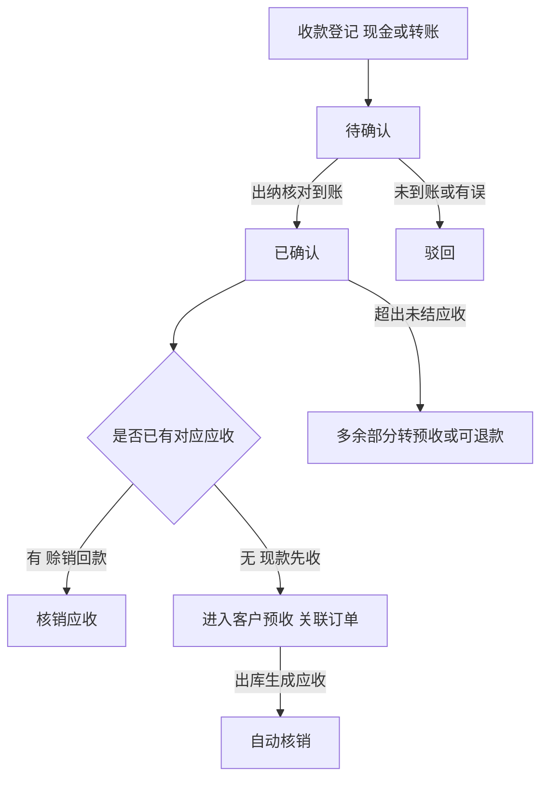
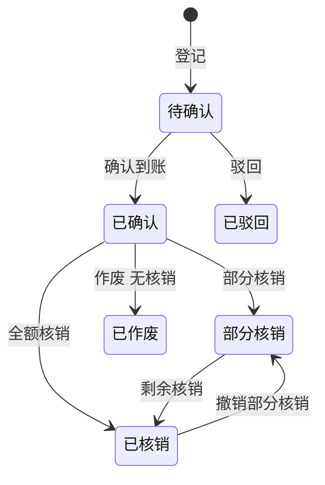

# 08 收款、授信与客户应收

## 1. 模块目标与来源

- PRD 来源：第 09 章（收款与到账确认）、第 10 章（可配置授信、出库应收、欠款及核销）、第 16 章（收款及应收状态）。
- 需求组：R02、R05；决策 D03、D04、D05。
- 目标：
  - 登记现金和转账收款；转账在财务确认前不能当作已到账。
  - 用户自行维护赊销资格、额度、账期、到期起算方式、逾期限制，规则有版本。
  - 实际出库时形成业务应收，按到账确认的金额核销；多收部分转为预收或可退款余额。
  - 提供客户往来时间轴、对账单、到期跟进待办。

## 2. 范围

| 一期做 | 一期不做 |
| --- | --- |
| 现金、转账收款登记；混合收款、多次到账 | 线上支付、银行流水自动对接 |
| 到账确认（确认人、实际到账日、参考号） | 现金交班 |
| 授信规则（客户或客户组）、版本、额度占用 | 信用评分模型 |
| 出库应收、借项和贷项调整、核销、撤销核销 | 跨币种直接抵减 |
| 预收、可退款余额、对账单、到期跟进 | |

## 3. 权限点

| 权限码 | 说明 |
| --- | --- |
| `ar:receipt:create` | 收款登记（业务员、门店） |
| `ar:receipt:confirm` / `reject` | 到账确认、驳回（财务、出纳） |
| `ar:credit-rule:view` / `edit` | 授信规则（A09：只有授权人员能改） |
| `ar:receivable:view` | 应收查询（`CREDIT` 字段组） |
| `ar:writeoff:create` / `reverse` | 核销、撤销核销 |
| `ar:adjustment:create` | 借项和贷项调整（需要审批） |
| `ar:statement:view` / `export` | 对账单 |

## 4. 业务流程



## 5. 业务规则

### 5.1 收款登记

- 现金：门店、币种、金额、收款人、业务时间、对应订单（可多张）、收款账户（门店现金账户）。
- 转账：付款人、收款账户、转账日期、金额、参考号、转账截图（`PAYMENT_PROOF`）。上传后进入待确认，不能自动当作到账。
- 同一订单支持现金加转账的混合收款、多次收款。
- 币种必须等于收款账户币种；普通销售收款使用国家交易币种（墨西哥为 MXN）。

### 5.2 到账确认

- 确认时保存确认人、实际到账日、银行参考号；现金由门店负责人或出纳确认。
- 只有已确认的收款可以用于核销，也只有已确认的收款才计入出库前的“足额到账”判断。
- 已确认的收款不能修改，只能作废（前提是没有核销，或先撤销核销），作废需要权限和原因。
- 确认后发出 `AR_RECEIPT_CONFIRMED` 事件（12 生成收款凭证：借现金或银行，贷预收）。

### 5.3 授信规则

| 配置项 | 说明 |
| --- | --- |
| 适用对象 | 客户或客户组；同时存在时，客户级规则优先 |
| 付款方式 | `CASH_ONLY`（仅现款）、`CREDIT_ALLOWED`（允许赊销） |
| 信用额度 | 金额与币种 |
| 账期天数 | 整数 |
| 到期起算方式 | `OUTBOUND_DATE`（默认，出库日起算）、`SIGN_DATE`、`MONTH_END_PLUS`（月结加 N 天） |
| 逾期策略 | `WARN`（提示）、`REQUIRE_APPROVAL`（需例外审批）、`BLOCK_ORDER`（禁止新订单）、`BLOCK_OUTBOUND`（禁止出库） |
| 宽限天数 | 逾期判断的宽限 |
| 例外审批 | 超额度或逾期时是否允许走例外审批 |
| 生效日期 | `effective_from` / `effective_to` |

- 没有配置赊销资格的客户默认只能现款。
- 规则修改生成新版本，不需要开发人员改代码；已批准的订单和已生成的应收保留原版本，不会被无提示地重写。修改前预览受影响的未出库订单数量。
- 改变到期起算方式只影响之后新生成的应收的到期日，不改变应收在出库时形成这一时点。

### 5.4 额度占用

```
已用额度 = 未结业务应收 + 已批准未出库订单的预占
可用额度 = 信用额度 − 已用额度
```

- 订单审批通过时写入预占（`ORDER_RESERVE`）。
- 出库时，按出库金额把预占转为应收占用（`AR_OPEN`），不重复计算（A12）。
- 取消未出库部分时，释放对应的预占。
- 核销后，应收占用随未结金额减少。
- 出库时按当前有效规则重新检查：额度、逾期、例外审批结果。

### 5.5 业务应收

- 由 07 的出库确认在同一事务内调用生成。每条出库单对应一条应收，金额 = 出库数量 × 成交价 − 折扣 + 税（按订单的含税口径）。
- 应收记录：业务日期（出库日）、到期日（按规则版本计算）、规则版本、来源出库单、订单。
- 来源唯一约束：`(source_type, source_id)`，重复调用不会重复生成。
- 业务应收、到期欠款、到账、凭证记账状态分开显示（凭证状态从 12 读取）。

### 5.6 核销

```
期末应收 = 经确认期初应收 + 本期出库业务应收 + 借项调整 − 已确认到账核销 − 已确认贷项核销
```

- 核销来源：已确认收款的未分配金额、客户预收、贷项（退货或调整）。
- 规则：
  - 支持部分核销；一笔到账可以核销多笔同币种应收。
  - 核销总额不超过来源的可用金额，也不超过应收的未结金额。
  - 币种必须相同；供应商的 CNY 结算走 09，不能与客户的 MXN 应收相抵。
- 撤销核销：生成反向核销记录，保留原记录，需要权限和原因；如果核销所在期间已结账，撤销记入当前开放期间。
- 现款预收自动核销（A11）：出库生成应收后，按“分配到该订单的已确认收款”自动核销，金额取两者较小值；不会重复增加应收或现金。
- 超额收款和退货超过未结应收的部分，分别进入预收余额或可退款余额，不用负数应收掩盖。

### 5.7 客户余额

| 余额 | 含义 |
| --- | --- |
| 未结应收 | 应收的未核销金额合计 |
| 预收余额 | 已确认但未核销的收款 |
| 可退款余额 | 来自退货贷项、超额收款，并被标记为可退的部分 |
| 已用额度、可用额度 | 见 5.4 节 |

可退款余额由 10 的退款单消耗，累计退款不超过可退款余额。

### 5.8 对账与跟进

- 客户时间轴：销售、出库、签收、应收、回款、核销、退货、退款、调整，按时间排列。
- 对账单：按客户、币种、期间生成，内容为期初、本期增加、本期核销、期末，并附明细；生成后保存快照。
- 到期跟进：在到期前 N 天、到期当天、逾期后，生成待办分配给销售归属人。

## 6. 状态机

### 6.1 收款



### 6.2 应收

- 结清状态：`OPEN`（未结）、`PARTIAL`（部分结清）、`SETTLED`（已结清）。
- 到期状态（每日按国家时区计算）：`NOT_DUE`（未到期）、`DUE_SOON`（即将到期）、`OVERDUE`（逾期）。

## 7. 数据模型

| 表 | 关键字段 |
| --- | --- |
| `ar_credit_rule` | `target_type`（CUSTOMER/GROUP）、`target_id`、`payment_mode`、`credit_limit`、`currency`、`term_days`、`due_basis`、`due_extra_days`、`overdue_policy`、`grace_days`、`allow_exception`、`effective_from`、`effective_to`、`version_no`、`status` |
| `ar_credit_occupation` | `customer_id`、`currency`、`occ_type`（ORDER_RESERVE/AR_OPEN）、`ref_type`、`ref_id`、`amount`、`released_amount`、`status` |
| `ar_receipt` | `doc_no`、`store_id`、`customer_id`、`method`（CASH/TRANSFER）、`currency`、`amount`、`fund_account_id`、`payer_name`、`transfer_date`、`reference_no`、`received_by`、`biz_time`、`status`、`confirmed_by`、`confirmed_at`、`arrival_date`、`allocated_amount`、`void_reason` |
| `ar_receipt_order` | `receipt_id`、`order_id`、`planned_amount`（登记时指定的订单分配） |
| `ar_receivable` | `doc_no`、`customer_id`、`order_id`、`source_type`（SAL_OUTBOUND/DEBIT_ADJ/OPENING）、`source_id`、`currency`、`amount`、`written_off_amount`、`open_amount`、`biz_date`、`due_date`、`credit_rule_version_id`、`settle_status`、`due_status`；`(source_type, source_id)` 唯一 |
| `ar_credit_note` | `doc_no`、`customer_id`、`source_type`（SALES_RETURN/CREDIT_ADJ/OVERPAY）、`source_id`、`currency`、`amount`、`used_amount`、`refundable_flag` |
| `ar_writeoff` | `doc_no`、`customer_id`、`currency`、`biz_date`、`status`（EFFECTIVE/REVERSED）、`reversal_of_id`、`reason` |
| `ar_writeoff_line` | `writeoff_id`、`from_type`（RECEIPT/CREDIT_NOTE）、`from_id`、`receivable_id`、`amount` |
| `ar_adjustment` | `doc_no`、`customer_id`、`adj_type`（DEBIT/CREDIT）、`currency`、`amount`、`reason`、`approval_instance_id`、`status` |
| `ar_statement` | `customer_id`、`currency`、`period_start`、`period_end`、`opening`、`increase`、`decrease`、`closing`、`detail_snapshot jsonb`、`generated_by` |

所有金额列都有 CHECK 约束：已核销金额不超过金额；未结金额 ≥ 0。

## 8. REST 接口

| 方法 | 路径 | 用途 | 关键校验 |
| --- | --- | --- | --- |
| POST | `/api/v1/ar/receipts` | 收款登记 | 账户币种一致；转账必须有凭证 |
| GET | `/api/v1/ar/receipts` | 收款列表（门店、方式、状态、日期） | |
| POST | `/api/v1/ar/receipts/{id}/confirm` | 到账确认 | 幂等；`ar:receipt:confirm` |
| POST | `/api/v1/ar/receipts/{id}/reject` / `void` | 驳回、作废 | |
| CRUD | `/api/v1/ar/credit-rules` | 授信规则（修改即生成新版本） | `ar:credit-rule:edit` |
| POST | `/api/v1/ar/credit-rules/{id}/preview-impact` | 预览影响 | |
| GET | `/api/v1/ar/customers/{id}/credit` | 客户额度视图 | |
| GET | `/api/v1/ar/receivables` | 应收列表（到期状态、客户、订单） | |
| POST | `/api/v1/ar/writeoffs` | 手工核销 | 幂等；同币种；金额上限 |
| POST | `/api/v1/ar/writeoffs/{id}/reverse` | 撤销核销 | 幂等 |
| CRUD | `/api/v1/ar/adjustments` | 借贷项调整 | 审批 |
| GET | `/api/v1/ar/customers/{id}/balances` | 客户余额 | |
| GET | `/api/v1/ar/customers/{id}/timeline` | 客户往来时间轴 | |
| POST | `/api/v1/ar/statements` | 生成对账单 | |
| GET | `/api/v1/ar/store-receipts?storeId=&date=` | 门店按日收款清单 | |

对其他模块开放的接口：

- `CreditApi.evaluate` / `reserve` / `release`（07）；
- `ReceivableApi.createFromOutbound` / `autoWriteoffFromPrepaid`（07）；
- `ReceivableApi.applyCreditNote`（10）；
- `CustomerBalanceApi.consumeRefundable`（10）。

## 9. 前端页面

| 路由 | 页面 | 手机端 |
| --- | --- | --- |
| `/ar/receipts` | 收款列表，待确认标签页 | 是（登记、拍照上传） |
| `/ar/receipts/confirm` | 到账确认工作台（按账户分组，核对参考号） | 否 |
| `/ar/credit-rules` | 授信规则（客户或组、版本历史、影响预览） | 否 |
| `/ar/receivables` | 应收与欠款（账龄式的到期分组：未到期、即将到期、逾期） | 否 |
| `/ar/writeoffs` | 核销工作台（左侧可用收款或贷项，右侧未结应收，金额分配） | 否 |
| `/ar/customers/:id` | 客户往来详情：余额卡片、时间轴、对账单 | 是（只读） |
| `/ar/statements` | 对账单 | 否 |

## 10. 跨模块依赖

| 方向 | 内容 |
| --- | --- |
| 被 07 调用 | 额度、应收生成、自动核销；收款状态回显 |
| 被 10 调用 | 贷项、可退款余额 |
| 依赖 03 | 收款账户、客户 |
| 被 12 引用 | 事件 `AR_RECEIPT_CONFIRMED`、`AR_WRITEOFF_DONE`、`AR_WRITEOFF_REVERSED`；总账核对读取应收余额 |
| 被 13 引用 | 待到账确认、到期跟进待办 |

## 11. 对应验收用例

A08（赊销回款后上传凭证并核销）、A09（用户配置授信，版本化，未授权不可改）、A10（只对出库数量形成应收）、A11（现款预收核销）、A12（信用预占转换）、A16（混合及多次收款，核销不超过已确认金额）、A17（欠款、到账、预收分别追溯）、A30（重复确认到账或核销不重复计算）。

## 12. 待确认与实施配置

- 各客户或客户组的资格、额度、账期、到期起算方式、逾期策略的具体数值。
- 到期提醒提前的天数。
- 现金收款由谁确认（门店负责人还是出纳）。
