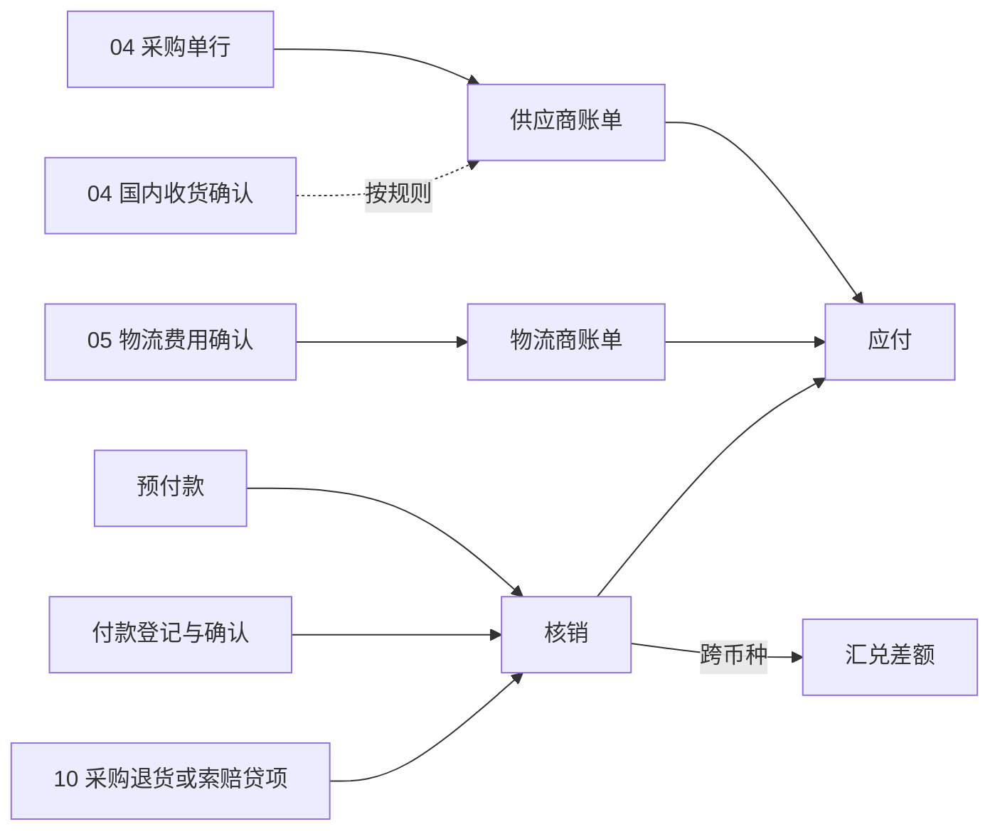
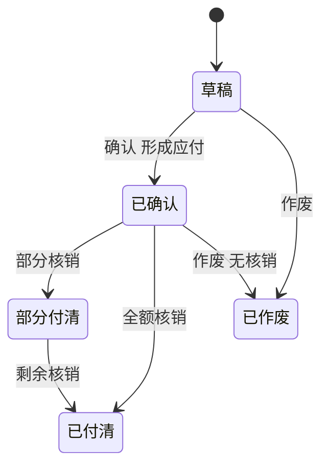

# 09 供应商与物流商应付

## 1. 模块目标与来源

- PRD 来源：第 05 章（供应商记账对账）、第 06 章（物流费用）、第 16 章。
- 需求组：R07；决策 D07、D08。
- 目标：
  - 管理采购应付、物流应付、预付款、付款、采购退货贷项和经批准的调整，并关联采购单、物流费用、账单和来源凭证。
  - 按供应商、币种、期间生成期初、本期增加、本期付款或抵扣、期末余额。
  - 记录跨币种付款（例如 CNY 账单用 MXN 支付）的换算依据和结算差额。
  - 只记录已确认的付款，不执行银行转账。

## 2. 范围

| 一期做 | 一期不做 |
| --- | --- |
| 供应商、物流商账单；应付确认规则 | 银行付款执行、网银对接 |
| 预付款、付款登记与确认 | 付款计划审批流以外的资金计划 |
| 核销（付款、预付、贷项抵扣应付） | |
| 跨币种结算换算与汇兑差额 | |
| 供应商贷项（采购退货、索赔）、调整 | |
| 供应商对账单 | |

## 3. 权限点

| 权限码 | 说明 |
| --- | --- |
| `ap:bill:view` / `create` / `confirm` / `void` | 账单 |
| `ap:prepayment:create` | 预付款申请 |
| `ap:payment:create` / `confirm` | 付款登记、付款确认（出纳） |
| `ap:settlement:create` / `reverse` | 核销 |
| `ap:adjustment:create` | 调整（需要审批） |
| `ap:statement:view` / `export` | 对账单 |

## 4. 业务流程



## 5. 业务规则

### 5.1 应付确认规则

采购下单本身不自动视为到期应付（PRD 第 05 章）。应付何时确认，由 `ap_recognition_rule` 按国家和账单类型配置：

| 触发方式 | 说明 |
| --- | --- |
| `BILL_CONFIRMED` | 账单确认时形成应付（默认） |
| `DOMESTIC_RECEIPT_CONFIRMED` | 国内收货确认时，按合格数量和单价自动生成账单草稿，确认后形成应付 |
| `MANUAL` | 只能手工建立账单 |

### 5.2 账单

- 账单行关联来源：采购行（数量、单价）、国内收货行、物流费用。
- 防重复：同一来源行（采购行加数量维度）累计开票数量不超过来源数量；物流费用 `(source_type = LGS_FEE, source_id)` 只能进入一张有效账单。这样采购台账和物流台账不会重复记同一笔款。
- 账单币种等于来源币种：CNY 采购账单按 CNY 保存。
- 到期日按付款条件计算。

### 5.3 付款与预付

- 付款登记：往来对象、付款币种、付款金额、付款账户、付款日期、参考号、付款凭证（`PAYMENT_OUT_PROOF`）。
- 付款确认后才能用于核销；系统不执行转账，只记录已发生的付款。
- 预付款按预付比例或手工金额登记，确认后形成预付余额，后续抵扣应付。

### 5.4 核销与跨币种结算

- 同币种：付款金额直接核销应付金额。
- 跨币种：例如 CNY 账单用 MXN 支付，需要登记：
  - 结算汇率及来源（实际成交汇率或已确认汇率记录）；
  - 付款币种金额、折算后的账单币种金额；
  - 汇兑差额 = 按付款日汇率折算的本位币金额 − 按账单确认时汇率折算的本位币金额（本位币口径由 12 确定）。
- 汇兑差额单独记录（`ap_fx_diff`），发出 `AP_SETTLEMENT_DONE` 事件，由 12 生成汇兑损益凭证。
- 不同币种的数值不能直接相抵。
- 撤销核销生成反向记录，保留原记录。

### 5.5 贷项与调整

- 贷项来源：采购退货（10）、货损索赔（10）、供应商折让。
- 调整：经批准的借项或贷项调整，必须写原因、走审批。
- 已记账的财务影响只能通过关联调整或冲销更正。

### 5.6 对账单

```
期末余额 = 期初余额 + 本期增加（账单） − 本期付款 − 本期抵扣（预付、贷项） ± 调整
```

按往来对象、币种、期间生成，明细合计必须等于期末余额（A23）。

## 6. 状态机

| 对象 | 状态 |
| --- | --- |
| 账单 | DRAFT / CONFIRMED / PARTIAL_PAID / PAID / VOIDED（只有未核销的账单可以作废） |
| 付款 | PENDING_CONFIRM / CONFIRMED / PARTIAL_SETTLED / SETTLED / VOIDED |
| 预付 | PENDING_CONFIRM / CONFIRMED / PARTIAL_USED / USED |
| 核销 | EFFECTIVE / REVERSED |



## 7. 数据模型

| 表 | 关键字段 |
| --- | --- |
| `ap_recognition_rule` | `bill_type`（PURCHASE/LOGISTICS/OTHER）、`trigger`、`version_no`、`status` |
| `ap_bill` | `doc_no`、`entity_id`、`partner_id`、`bill_type`、`currency`、`amount`、`tax_amount`、`bill_date`、`due_date`、`paid_amount`、`open_amount`、`rate_id`、`base_amount`、`status`、`partner_invoice_no` |
| `ap_bill_line` | `bill_id`、`source_type`（PUR_ORDER_LINE/PUR_RECEIPT_LINE/LGS_FEE/OTHER）、`source_id`、`product_id`、`qty`、`unit_price`、`amount`、`expense_item_id`；部分唯一索引：`(source_type, source_id)`，条件为来源是 LGS_FEE 且账单有效 |
| `ap_prepayment` | `doc_no`、`partner_id`、`currency`、`amount`、`used_amount`、`po_id`、`status` |
| `ap_payment` | `doc_no`、`partner_id`、`pay_currency`、`pay_amount`、`fund_account_id`、`pay_date`、`reference_no`、`status`、`settled_amount`、`confirmed_by`、`confirmed_at` |
| `ap_settlement` | `doc_no`、`partner_id`、`biz_date`、`status`、`reversal_of_id` |
| `ap_settlement_line` | `settlement_id`、`from_type`（PAYMENT/PREPAYMENT/CREDIT_NOTE）、`from_id`、`from_currency`、`from_amount`、`bill_id`、`bill_currency`、`bill_amount`、`settle_rate`、`rate_source`、`rate_id` |
| `ap_fx_diff` | `settlement_line_id`、`base_currency`、`bill_base_amount`、`pay_base_amount`、`diff_amount` |
| `ap_credit_note` | `doc_no`、`partner_id`、`source_type`（PURCHASE_RETURN/CLAIM/DISCOUNT）、`source_id`、`currency`、`amount`、`used_amount` |
| `ap_adjustment` | `doc_no`、`partner_id`、`adj_type`、`currency`、`amount`、`reason`、`approval_instance_id`、`status` |
| `ap_statement` | `partner_id`、`currency`、`period_start`、`period_end`、`opening`、`increase`、`paid`、`offset`、`adjust`、`closing`、`detail_snapshot jsonb` |

## 8. REST 接口

| 方法 | 路径 | 用途 | 关键校验 |
| --- | --- | --- | --- |
| CRUD | `/api/v1/ap/bills` | 账单 | 来源不重复、数量上限 |
| POST | `/api/v1/ap/bills/from-sources` | 从采购行或物流费用批量生成账单草稿 | |
| POST | `/api/v1/ap/bills/{id}/confirm` / `void` | 确认、作废 | 幂等 |
| CRUD | `/api/v1/ap/prepayments` | 预付 | |
| POST | `/api/v1/ap/prepayments/{id}/confirm` | 确认预付 | |
| CRUD | `/api/v1/ap/payments` | 付款登记 | 付款凭证 |
| POST | `/api/v1/ap/payments/{id}/confirm` | 付款确认 | 幂等 |
| POST | `/api/v1/ap/settlements` | 核销（跨币种时必填汇率） | 幂等；金额上限 |
| POST | `/api/v1/ap/settlements/{id}/reverse` | 撤销 | |
| CRUD | `/api/v1/ap/adjustments` | 调整 | 审批 |
| GET | `/api/v1/ap/partners/{id}/balances` | 往来余额（按币种） | |
| POST | `/api/v1/ap/statements` | 生成对账单 | |
| GET | `/api/v1/ap/payables?dueBefore=` | 到期应付 | |

对其他模块开放的接口：`CreditNoteApi.createFromPurchaseReturn`（10）、`PayableQueryApi`（04 进度、12 核对）。

## 9. 前端页面

| 路由 | 页面 |
| --- | --- |
| `/ap/bills` | 账单列表、从来源生成账单 |
| `/ap/bills/:id` | 账单详情（来源行可跳转到采购单或物流费用） |
| `/ap/payments` | 付款登记与确认 |
| `/ap/prepayments` | 预付款 |
| `/ap/settlements` | 核销工作台（跨币种时显示汇率输入和汇兑差额预览） |
| `/ap/partners/:id` | 往来详情、对账单 |

一期都是电脑端页面。

## 10. 跨模块依赖

| 方向 | 内容 |
| --- | --- |
| 依赖 04 | 采购行、国内收货事件 |
| 依赖 05 | 物流费用事件 |
| 依赖 03 | 汇率、往来对象、付款账户 |
| 被 10 调用 | 生成贷项 |
| 被 11 引用 | 实际费用与暂估的对比 |
| 被 12 引用 | 事件 `AP_BILL_CONFIRMED`、`AP_PAYMENT_CONFIRMED`、`AP_SETTLEMENT_DONE`；总账核对 |

## 11. 对应验收用例

A23（采购和物流的应付、预付、付款、退货及结算差额可查，币种清楚，期末与明细一致）、A30（重复付款确认或核销不重复计算）。

## 12. 待确认与实施配置

- 各账单类型的应付确认触发方式（默认为账单确认）。
- 跨币种结算使用实际成交汇率还是系统汇率。
- 付款是否需要审批，以及审批阈值。
