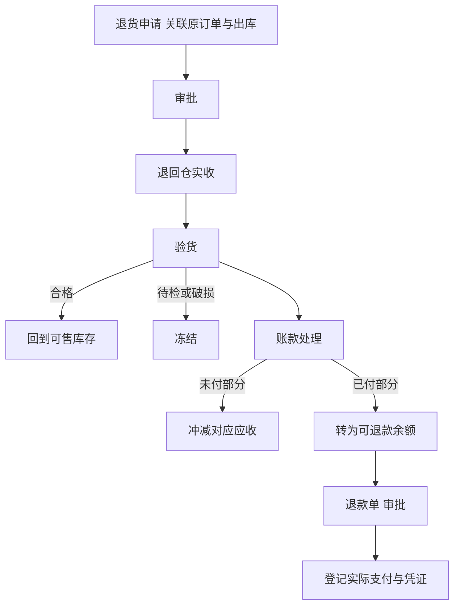
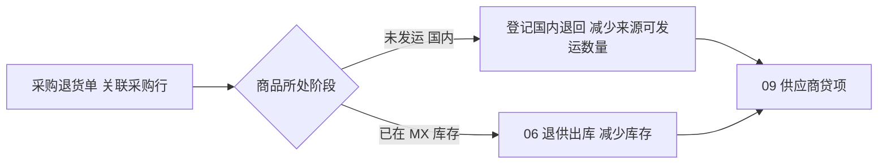
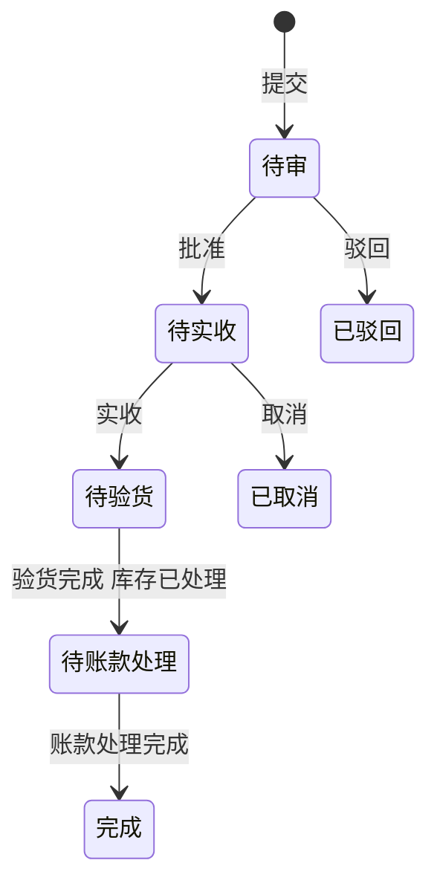

# 10 退货与退款

## 1. 模块目标与来源

- PRD 来源：第 07 章（退货验收回仓）、第 11 章（退货与退款）、第 16 章（退货及退款状态）。
- 需求组：R03、R05、R07。
- 目标：
  - 销售退货关联原销售及出库。申请、批准、实收、验货、库存处理、应收或预收调整、退款分步记录。
  - 未付部分冲减应收，已付部分形成可退款余额；退款需要审批和实际支付记录，不能重复退款。
  - 中国供应商退货关联采购来源和供应商贷项；货损、索赔与正常采购退货分开记录。

关键边界：商品入库不等于退款完成；实收、库存回补、应收冲减、退款是独立的动作。

## 2. 范围

| 一期做 | 一期不做 |
| --- | --- |
| 有原单的销售退货；无原单退货走例外审批 | 线上退货申请 |
| 实收、验货（合格、待检、破损） | 库龄相关的退货成本处理 |
| 账款处理：冲减应收、转可退款余额 | |
| 退款单（审批、支付登记、凭证） | 线上退款执行 |
| 采购退货（未发运、已在 MX 库存两种情形） | |
| 货损、索赔记录 | |

## 3. 权限点

| 权限码 | 说明 |
| --- | --- |
| `rtn:sales:create` / `submit` | 销售退货申请 |
| `rtn:sales:receive` / `inspect` | 实收、验货（限授权仓） |
| `rtn:sales:settle` | 账款处理（财务） |
| `rtn:refund:create` / `pay` | 退款申请、退款支付登记（出纳） |
| `rtn:purchase:create` / `ship` | 采购退货 |
| `rtn:claim:create` / `resolve` | 货损、索赔 |

## 4. 业务流程

### 4.1 销售退货与退款

### 4.2 采购退货

## 5. 业务规则

### 5.1 销售退货申请

- 必填：原销售订单、原出库单、商品、数量、原因（字典 `RETURN_REASON`）、责任方（字典 `RESPONSIBILITY`）、退回仓、附件。
- 数量上限：累计退货数量（包括审批中的申请）不超过“原实际交付数量 − 已退数量”。实际交付数量取出库数量；如果签收时有拒收，取签收数量，拒收部分走签收差异处理。
- 退货价格：按原交易成交价及折扣计算，不使用当前价格（A15）。
- 无原单退货：需要例外审批，同时必须指定成本来源（指定批次，或按最近入库成本，由财务选择）。
- 退回仓必须是本国家的仓或门店仓。

### 5.2 实收与验货

- 实收数量可以少于申请数量；差额要写原因，或者等待后续到货。
- 验货结果：
  - 合格：调用 `InventoryApi.returnIn`，回到可售库存；
  - 待检、破损：调用 `InventoryApi.returnIn` 并冻结（`RETURN_PENDING` 或 `DAMAGED`）。
- 成本优先沿用原出库批次的成本（由 11 处理），不计算库龄。
- 申请被批准不会直接增加可售库存。
- 发出 `RTN_SALES_RECEIVED` 事件。

### 5.3 账款处理

退货金额 = 验收数量 × 原成交价（扣除折扣，含税口径与原单一致）。

1. 先冲减原订单下未结的应收：生成贷项（`ar_credit_note`，来源为销售退货），并立即核销原订单的应收。
2. 剩余部分（客户已付款的部分）转为可退款余额：生成标记为可退的贷项。
3. 每张退货单只能做一次账款处理（唯一约束）；再次处理需要先撤销上一次。
4. 发出 `RTN_SALES_SETTLED` 事件，由 12 生成冲减收入和应收的凭证，由 11 生成冲减成本的记录。

### 5.4 退款

- 退款单：客户、币种、金额、退款方式（现金或转账）、付款账户、收款人信息。
- 金额上限：累计退款不超过客户的可退款余额。
- 必须审批；审批通过后，由出纳登记实际支付信息（支付日期、参考号、凭证 `REFUND_PROOF`），然后才算完成。
- 幂等：支付登记要求 `Idempotency-Key`，重复操作不会重复扣减余额。
- 发出 `RTN_REFUND_PAID` 事件。

### 5.5 采购退货

- 关联采购单行，以及来源（国内收货行，或 MX 批次）。
- 阶段一，未发运（国内）：只减少来源行的可发运数量，回写采购行的 `returned_qty`，不涉及库存。
- 阶段二，已在 MX 库存：调用 `InventoryApi.supplierReturnOut`，按实际退库数量减少库存；不能只修改采购数量。
- 两种情形都生成供应商贷项（09 `CreditNoteApi`）；金额按原采购单价计算。
- 发出 `RTN_PURCHASE_RETURN_DONE` 事件。

### 5.6 货损与索赔

- 类型：`DAMAGE`（货损）、`CLAIM`（向物流商或供应商索赔）。可以关联 05 的到货差异、批次、物流商。
- 索赔结果：获赔金额（生成 09 贷项，或其他收入）、拒赔。与正常采购退货分开记录。
- 已生成或已记账的财务影响，通过关联调整或冲销处理。

## 6. 状态机

### 6.1 销售退货（PRD 第 16 章）

退款单独跟踪状态：`PENDING_APPROVAL`（待审）、`APPROVED`（已批准）、`PAID`（已支付）、`REJECTED`（已驳回）、`CANCELLED`（已取消）。

### 6.2 采购退货

`DRAFT`（草稿）、`PENDING_APPROVAL`（待审）、`APPROVED`（已批准）、`SHIPPED_BACK`（已退出或已退库）、`CREDITED`（已生成贷项）、`COMPLETED`（完成）、`CANCELLED`（已取消）。

## 7. 数据模型

| 表 | 关键字段 |
| --- | --- |
| `rtn_sales_return` | `doc_no`、`order_id`、`outbound_id`、`customer_id`、`return_warehouse_id`、`reason_code`、`responsibility`、`no_origin_flag`、`cost_source`（ORIGIN_BATCH/SPECIFIED_BATCH/LATEST_COST）、`status`、`approval_instance_id`、`settled_flag` |
| `rtn_sales_return_line` | `return_id`、`outbound_line_id`、`order_line_id`、`product_id`、`origin_batch_id`、`req_qty`、`received_qty`、`good_qty`、`frozen_qty`、`freeze_type`、`unit_price`、`discount_amount`、`amount`、`tax_amount` |
| `rtn_sales_receipt` | `return_id`、`warehouse_id`、`received_at`、`received_by`、`remark` |
| `rtn_sales_settlement` | `return_id` 唯一、`total_amount`、`ar_offset_amount`、`refundable_amount`、`credit_note_ids jsonb`、`writeoff_id`、`status`（EFFECTIVE/REVERSED） |
| `rtn_refund` | `doc_no`、`customer_id`、`currency`、`amount`、`method`、`fund_account_id`、`payee_info jsonb`、`status`、`approval_instance_id`、`paid_at`、`reference_no`、`paid_by` |
| `rtn_refund_source` | `refund_id`、`credit_note_id`、`amount` |
| `rtn_purchase_return` | `doc_no`、`supplier_id`、`po_id`、`stage`（DOMESTIC/MX_STOCK）、`warehouse_id`、`reason`、`status`、`ap_credit_note_id` |
| `rtn_purchase_return_line` | `return_id`、`po_line_id`、`source_line_id`、`batch_id`、`product_id`、`qty`、`unit_price`、`amount` |
| `rtn_claim` | `doc_no`、`claim_type`（DAMAGE/CLAIM）、`against_type`（SUPPLIER/CARRIER）、`partner_id`、`discrepancy_id`、`batch_id`、`qty`、`claim_amount`、`currency`、`result`（PENDING/COMPENSATED/REJECTED）、`compensated_amount`、`ap_credit_note_id` |

## 8. REST 接口

| 方法 | 路径 | 用途 | 关键校验 |
| --- | --- | --- | --- |
| GET | `/api/v1/rtn/sales/returnable?outboundId=` | 可退数量 | |
| CRUD | `/api/v1/rtn/sales` | 销售退货申请 | 数量上限；原价 |
| POST | `/api/v1/rtn/sales/{id}/submit` | 提交审批 | |
| POST | `/api/v1/rtn/sales/{id}/receive` | 实收 | 幂等 |
| POST | `/api/v1/rtn/sales/{id}/inspect` | 验货并处理库存 | 幂等；合格加冻结等于实收 |
| POST | `/api/v1/rtn/sales/{id}/settle` | 账款处理 | 幂等；只能处理一次 |
| POST | `/api/v1/rtn/sales/{id}/settle/reverse` | 撤销账款处理 | 前提是可退款余额没有被退款使用 |
| CRUD | `/api/v1/rtn/refunds` | 退款申请 | 不超过可退余额 |
| POST | `/api/v1/rtn/refunds/{id}/pay` | 登记实际支付 | 幂等；凭证必填 |
| CRUD | `/api/v1/rtn/purchase` | 采购退货 | 退货数量上限 |
| POST | `/api/v1/rtn/purchase/{id}/ship` | 退出或退库 | 幂等；MX 库存情形调用 06 |
| CRUD | `/api/v1/rtn/claims` | 货损、索赔 | |
| POST | `/api/v1/rtn/claims/{id}/resolve` | 记录索赔结果 | |

## 9. 前端页面

| 路由 | 页面 | 手机端 |
| --- | --- | --- |
| `/returns/sales` | 销售退货列表（分步状态） | 是 |
| `/returns/sales/:id` | 退货详情：申请、实收、验货、账款处理、退款，分区块展示，每一步都有独立按钮和结果 | 是（实收、验货） |
| `/returns/refunds` | 退款单 | 否 |
| `/returns/purchase` | 采购退货 | 否 |
| `/returns/claims` | 货损索赔 | 否 |

## 10. 跨模块依赖

| 方向 | 内容 |
| --- | --- |
| 依赖 07 | 原出库行、成交价 |
| 调用 06 | `returnIn`、`supplierReturnOut`、冻结 |
| 调用 08 | 贷项、核销、可退款余额 |
| 调用 09 | 供应商贷项 |
| 依赖 05 | 到货差异转索赔 |
| 被 11 引用 | 退货成本沿用原批次 |
| 被 12 引用 | 事件 `RTN_SALES_SETTLED`、`RTN_REFUND_PAID`、`RTN_PURCHASE_RETURN_DONE` |

## 11. 对应验收用例

A15（退货使用原价）、A17（欠款、到账、退货、预收分别追溯；退款经审批，不超过可退余额，重复操作不重复退款）、A30（重复操作不双算）。

## 12. 待确认与实施配置

- 无原单退货的默认成本来源。
- 退款审批的阈值和审批人。
- 退货是否需要由质检人员单独验货。
