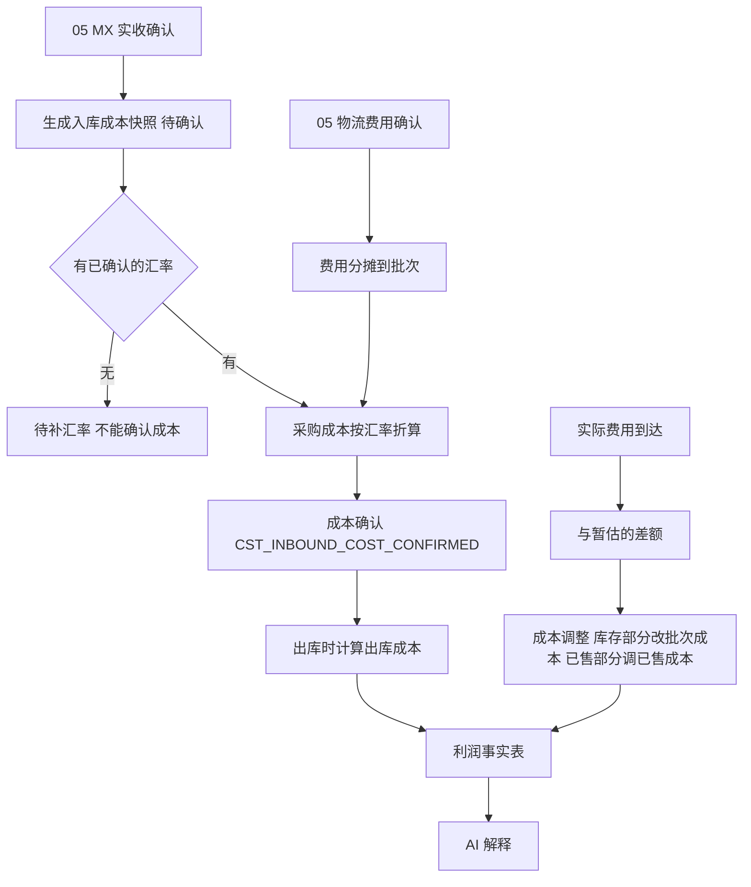

# 11 成本费用与利润、AI 分析

## 1. 模块目标与来源

- PRD 来源：第 13 章（进口成本与费用、利润口径、AI 单品盈亏解释）、第 17 章（币种汇率）。
- 需求组：R06；决策 D07、D08、D09、D10。
- 目标：
  - 每次 MX 入库都保存成本快照：采购来源、数量、CNY 金额、汇率及日期、确认人、分摊的物流费用。历史成本不随最新汇率变动。
  - 物流等费用按规则分摊，明细合计等于原费用；已计入库存成本的费用，不在利润中再扣一次。
  - 暂估与实际分开记录，差额通过调整追溯到库存、已售成本和期间。
  - 计算单品基础毛利和系统内贡献利润；由 AI 解释盈亏原因，AI 只读、不修改业务。

## 2. 范围

| 一期做 | 一期不做 |
| --- | --- |
| 成本计价方法配置（账套启用前确定） | 库龄跌价、每日 0.5% 跌价计提 |
| 入库成本快照、出库成本、调拨成本随货、退货成本 | 线下营销费的录入与分摊 |
| 费用分摊（数量、重量、体积、货值、人工依据） | 全成本净利润 |
| 暂估与实际的差额调整 | |
| 直接销售费用、期间费用登记与分摊 | |
| 单品毛利、贡献利润、差异来源 | |
| AI 单品盈亏解释 | AI 自动改价、采购、调账等任何写操作 |

## 3. 权限点

| 权限码 | 说明 |
| --- | --- |
| `cst:method:config` | 成本计价方法（财务主管） |
| `cst:cost:view` | 成本查看（`COST` 字段组） |
| `cst:cost:confirm` | 入库成本确认 |
| `cst:allocation:create` / `confirm` | 费用分摊 |
| `cst:adjustment:create` / `confirm` | 成本调整 |
| `cst:expense:create` | 费用登记 |
| `cst:profit:view` | 利润分析（`PROFIT` 字段组） |
| `ai:analysis:use` | 使用 AI 分析 |

## 4. 业务流程



## 5. 业务规则

### 5.1 成本计价方法

- 候选方法：移动加权平均（`MOVING_AVG`）、先进先出（`FIFO`）、批次个别计价（`BATCH_SPECIFIC`）。最终启用哪种由财务确定。
- 在账套启用前配置，保存生效版本。账套已有记账数据后，不能直接切换（返回 `CST_METHOD_LOCKED`）。
- 批次层（06 的 `inv_batch_balance`）在三种方法下都保留，用于来源追溯；计价方法只影响出库成本怎么取。

### 5.2 入库成本快照

| 字段 | 来源 |
| --- | --- |
| 采购来源、数量 | 04 采购行、05 实收行 |
| 采购原币金额 | 采购单价 × 实收数量（CNY） |
| 汇率 | 03 中已确认的汇率（适用范围 PURCHASE_COST），保存汇率 ID、汇率值、汇率日期 |
| 本位币采购成本 | 原币金额 × 汇率 |
| 分摊费用 | 本批次承担的资本化费用（暂估或实际） |
| 单位成本 | （本位币采购成本 + 分摊费用）÷ 数量 |
| 确认人、确认时间 | |

- 缺少汇率时，快照状态为 `PENDING_RATE`，不能确认成本，也不能把 CNY 金额当作 MXN 使用（A21）。
- 汇率修改后，已确认的快照不重算；如需更正，走成本调整。
- 破损和待检的数量同样有成本快照；后续报废时按快照成本处理。

### 5.3 费用分摊

- 费用项目的 `cost_treatment` 决定处理方式：
  - `CAPITALIZE`：分摊进入库存成本；
  - `PERIOD_EXPENSE`：计入期间费用；
  - `DIRECT_SELLING`：直接销售费用，分摊到 SKU 用于计算贡献利润。
- 分摊依据：数量、重量、体积、货值，或经批准的人工比例。
- 分摊对象：费用关联的运输批次下的实收行（批次）。批次还没有实收时，先挂在运输批次上，实收时再落到批次。
- 舍入：每行先按币种小数位四舍五入，差额由分摊金额最大的行吸收，保证明细合计等于原费用（A22）。
- 同一笔费用只能有一个有效的分摊结果；重新分摊时先撤销原分摊，再生成新的分摊。
- 已计入库存成本的费用，在利润计算中不再作为期间费用扣减。

### 5.4 暂估与实际

- 暂估费用参与分摊，成本快照的状态为 `ESTIMATED`。
- 实际费用到达时，计算 差额 = 实际 − 暂估，按原分摊比例分配到各批次：
  - 批次仍有库存的部分：调整批次的单位成本（`cst_cost_adjustment.target = INVENTORY`）；
  - 已售出的部分：调整当期的已售成本（`target = COGS`），记入当前开放期间，不改写已结账期间。
- 调整记录关联原费用、实际费用、分摊、期间，并发出 `CST_COST_ADJUSTED` 事件。

### 5.5 出库成本

- 由 `SAL_OUTBOUND_CONFIRMED` 事件触发，按计价方法计算每条出库行的成本，写入 `cst_cogs`，并回填库存流水的单位成本。
- 调拨：批次与成本随货转移，不产生收入或成本结转。
- 销售退货：优先沿用原出库成本（原批次），作为负数的已售成本。
- 采购退货：按批次成本减少库存成本。
- 盘点盈亏：盘亏按批次成本，盘盈按配置（最近入库成本，或人工指定）。

### 5.6 利润口径

```
单品基础毛利 = 不含税净销售额 − 对应净销售数量的出库成本
系统内单品贡献利润 = 基础毛利 − 已登记的直接销售费用 − 已确认分摊的期间费用
```

- 净销售额 = 销售出库金额（不含税）− 退货 − 折扣。
- 期间：按业务日期所在的会计期间。
- 现金到账不作为销售收入；采购付款不作为当期销售成本。
- 三种利润分别标识：销售毛利、系统内贡献利润、财务利润表（来自 12）。页面提供三者的差异来源，例如未分摊的期间费用、未记账业务、暂估成本。
- 利润页面和 AI 输出必须标明“按系统内已登记数据计算，未包含线下营销费用”，不能称为全成本净利润。

### 5.7 数据完整度

每条利润记录标记完整度：

- `COMPLETE`：完整；
- `ESTIMATED`：含暂估成本或暂估费用；
- `INSUFFICIENT`：缺成本快照，或缺汇率。

页面显示完整度，AI 输出时也要说明。

### 5.8 AI 单品盈亏解释


- 先用结构化数据计算结果，再交给模型解释。模型不做数值计算，输出中的数字都来自计算结果。
- 解释维度：采购成本、汇率、售价与折扣、物流费用、退货、数据完整度。
- 输出必须包含：期间、币种、成本版本、来源单据链接、数据完整度、免责声明。
- 可以提出建议（复核价格、补齐费用、调整补货），但没有任何写操作工具。AI 服务的数据库账号只有只读权限，并且只能调用只读的查询接口。
- 取数继承用户的国家、数据范围和字段权限；没有权限的字段在发给模型之前就已去除。用户无法通过提问获取其他客户的专属价或受限成本。
- 每次请求记录用户、参数、数据快照哈希、模型版本、输出内容，并写审计日志。
- 模型服务通过 `AiProvider` 接口接入，供应商未定。

## 6. 状态

| 对象 | 状态 |
| --- | --- |
| 入库成本快照 | PENDING_RATE / ESTIMATED / CONFIRMED / ADJUSTED |
| 费用分摊 | DRAFT / CONFIRMED / REVERSED |
| 成本调整 | DRAFT / CONFIRMED |
| 计价方法配置 | DRAFT / ACTIVE / LOCKED |

## 7. 数据模型

| 表 | 关键字段 |
| --- | --- |
| `cst_method_config` | `book_id`、`method`、`effective_from`、`version_no`、`status` |
| `cst_inbound_cost` | `book_id`、`receipt_line_id`、`batch_id`、`product_id`、`qty`、`po_line_id`、`src_currency`、`src_unit_price`、`src_amount`、`rate_id`、`rate`、`rate_date`、`base_currency`、`base_purchase_amount`、`alloc_fee_amount`、`unit_cost`、`status`、`confirmed_by`、`confirmed_at`；`(receipt_line_id)` 唯一 |
| `cst_fee_allocation` | `fee_id`、`basis`、`fee_currency`、`fee_amount`、`rate_id`、`base_amount`、`status`、`reversal_of_id` |
| `cst_fee_allocation_line` | `allocation_id`、`target_type`（BATCH/SHIPMENT_LINE）、`target_id`、`basis_value`、`amount`、`rounding_adj` |
| `cst_cost_adjustment` | `doc_no`、`book_id`、`period_id`、`reason`（ACTUAL_VS_ESTIMATE/MANUAL/RATE_CORRECTION）、`fee_id`、`batch_id`、`target`（INVENTORY/COGS）、`amount`、`status` |
| `cst_cogs` | `book_id`、`source_type`（SAL_OUTBOUND/RTN_SALES/STOCKTAKE/SCRAP/SUPPLIER_RETURN）、`source_line_id`、`product_id`、`warehouse_id`、`batch_id`、`qty`、`unit_cost`、`amount`、`method`、`period_id`；`(source_type, source_line_id)` 唯一 |
| `cst_expense_record` | `doc_no`、`expense_item_id`、`treatment`、`currency`、`amount`、`base_amount`、`biz_date`、`alloc_basis`、`status` |
| `cst_expense_alloc_line` | `expense_id`、`product_id`、`store_id`、`warehouse_id`、`amount` |
| `cst_profit_fact` | `book_id`、`period_id`、`product_id`、`store_id`、`warehouse_id`、`net_sales_qty`、`net_sales_amount`、`cogs_amount`、`gross_profit`、`direct_expense`、`period_expense_alloc`、`contribution_profit`、`completeness`、`refreshed_at` |
| `ai_analysis_request` | `user_id`、`country_id`、`params jsonb`、`data_snapshot_hash`、`completeness`、`model_name`、`model_version`、`output text`、`sources jsonb`、`disclaimer`、`created_at` |

## 8. REST 接口

| 方法 | 路径 | 用途 |
| --- | --- | --- |
| GET / PUT | `/api/v1/cst/method?bookId=` | 计价方法 |
| GET | `/api/v1/cst/inbound-costs` | 入库成本快照（状态筛选：待补汇率、暂估） |
| POST | `/api/v1/cst/inbound-costs/{id}/confirm` | 成本确认（校验汇率；幂等） |
| POST | `/api/v1/cst/allocations` | 发起费用分摊（预览） |
| POST | `/api/v1/cst/allocations/{id}/confirm` / `reverse` | 确认、撤销分摊 |
| GET | `/api/v1/cst/adjustments` | 成本调整列表 |
| POST | `/api/v1/cst/adjustments` | 手工调整（需要审批） |
| CRUD | `/api/v1/cst/expenses` | 期间费用、直接销售费用 |
| GET | `/api/v1/cst/batches/{batchId}/cost-trace` | 批次成本追溯（采购、汇率、分摊、调整） |
| GET | `/api/v1/cst/profit?period=&dim=` | 利润分析 |
| GET | `/api/v1/cst/profit/reconcile?period=` | 销售毛利、贡献利润、财务利润表的差异来源 |
| POST | `/api/v1/ai/analysis` | 发起 AI 分析（异步，返回任务 ID） |
| GET | `/api/v1/ai/analysis/{id}` | 查看分析结果 |

## 9. 前端页面

| 路由 | 页面 |
| --- | --- |
| `/cost/inbound` | 入库成本：待补汇率、暂估、已确认，批量确认 |
| `/cost/allocations` | 费用分摊：选择费用和依据，预览分摊明细与舍入行，确认 |
| `/cost/adjustments` | 成本调整 |
| `/cost/expenses` | 费用登记 |
| `/cost/batch-trace/:batchId` | 批次成本追溯 |
| `/analysis/profit` | 单品利润：期间与币种选择、完整度标识、免责声明横幅、下钻到来源单据 |
| `/analysis/ai` | AI 分析：选择 SKU 和期间，或自由提问；输出区显示来源链接和免责声明 |

一期都是电脑端页面。

## 10. 跨模块依赖

| 方向 | 内容 |
| --- | --- |
| 消费 05 | `LGS_RECEIPT_CONFIRMED`、`LGS_FEE_CONFIRMED` |
| 依赖 03 | 汇率、费用项目 |
| 依赖 06 | 批次、流水（回填单位成本） |
| 消费 07 | `SAL_OUTBOUND_CONFIRMED` |
| 消费 10 | `RTN_SALES_RECEIVED`、`RTN_PURCHASE_RETURN_DONE` |
| 被 12 引用 | 事件 `CST_INBOUND_COST_CONFIRMED`、`CST_COST_ADJUSTED`、`CST_EXPENSE_RECORDED`；库存与总账核对 |
| 依赖 02 | AI 取数的权限 |

## 11. 对应验收用例

A21（CNY 至 MXN 换算，缺汇率不完成成本确认，改汇率不改历史）、A22（分摊合计等于原费用，库存成本与期间费用不重复扣减，暂估与实际有调整记录）、A29（AI 盈亏分析可追溯来源，缺成本有标识，标明不含线下营销费；AI 不修改业务）。

## 12. 待确认与实施配置

- 成本计价方法（由财务确定）。
- 各费用项目的处理方式和默认分摊依据。
- 期间费用分摊到 SKU 的依据（例如按销售额）。
- 盘盈的成本取值方式。
- AI 模型供应商和部署方式（例如是否允许数据出境）。
