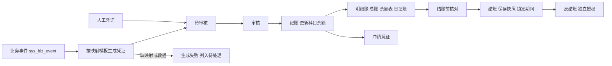
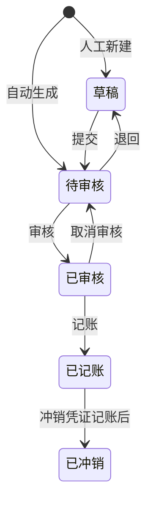
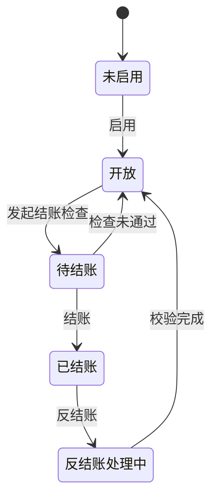

# 12 内部财务、总账与结账

## 1. 模块目标与来源

- PRD 来源：第 14 章（内部凭证、总账与结账）、第 16 章（凭证、会计期间状态）、第 17 章（各国账簿独立）。
- 需求组：R06；决策 D07。
- 目标：
  - 提供完整的内部账务：会计科目、辅助核算、凭证、明细账、总账、科目余额、现金及银行日记账、试算平衡、期末结账。
  - 输出内部用的资产负债表、利润表、现金流量表。
  - 业务事件按映射模板生成待审凭证，同一事件只生成一次；默认生成待审凭证，不自动记账。
  - 结账前核对；结账后锁定期间；反结账有独立权限。
  - 不对接外部财务系统；不做外部税务开票、申报或合并报表。

## 2. 范围

| 一期做 | 一期不做 |
| --- | --- |
| 账套、本位币、会计期间、科目、辅助项、期初余额 | 法定税务申报、电子发票 |
| 凭证字、编号规则；人工凭证；自动凭证 | 合并报表、跨主体抵销 |
| 审核、记账、冲销 | 外部财务系统接口 |
| 明细账、总账、科目余额、日记账、试算平衡 | |
| 结账前核对、结账快照、反结账 | |
| 三张内部报表、报表映射 | |
| 子账与总账核对（应收、应付、库存、现金银行） | |

## 3. 权限点

| 权限码 | 说明 |
| --- | --- |
| `fin:book:config` | 账套、期间、本位币 |
| `fin:account:edit` | 科目、辅助项 |
| `fin:opening:edit` / `confirm` | 期初余额 |
| `fin:mapping:edit` / `review` | 凭证映射模板（复制过来的模板必须经过复核才生效） |
| `fin:voucher:create` / `edit` | 凭证编制 |
| `fin:voucher:generate` | 触发自动凭证生成 |
| `fin:voucher:audit` / `unaudit` | 审核、取消审核 |
| `fin:voucher:post` | 记账 |
| `fin:voucher:reverse` | 冲销 |
| `fin:ledger:view` / `export` | 账簿查询、导出 |
| `fin:period:close` / `reopen` | 结账、反结账 |
| `fin:report:view` / `export` | 财务报表 |

## 4. 业务流程

## 5. 业务规则

### 5.1 账套与期间

- 账套属于国家和经营主体。本位币在初始化时确定（墨西哥默认建议 MXN）；有记账数据后不能修改本位币。
- 业务账套启用与财务启用分开：`POST /fin/books/{id}/activate` 沿用 `fin:book:config`、账套/主体数据范围和 `version`，仅将草稿账套启用，不补录未知期初，不自动生成期间、余额或凭证。缺失计价方法、期间、科目、期初等仍由所属能力独立校验；启用账套不代表已完成财务配置，也不授予记账或结账权限。现有账套编辑入口 `PUT /fin/books/{id}` 仅允许名称与 `version`，不接受主体、本位币或状态的夹带修改。
- 会计期间默认按自然月划分，可以配置。期间的起止日期按账套所属国家的时区计算。
- 各国的账簿、期间、结账彼此独立；一个国家结账不会锁定其他国家。

### 5.2 科目与辅助核算

- 科目为树形结构，包括编码、名称、类别（资产、负债、权益、成本、损益）、余额方向、是否末级、是否外币核算、是否现金科目、是否银行科目。
- 辅助核算类型：客户、供应商（往来对象）、仓库、门店、商品、费用项目、资金账户、员工。每个科目配置自己需要的辅助核算。
- 被凭证引用的科目只能停用，不能删除；有余额的科目不能修改余额方向。

### 5.3 凭证映射模板

- 每种业务事件配置一个模板：分录行的借贷方向、科目取值规则、金额表达式、辅助项映射、摘要模板。
- 科目取值规则：
  - 固定科目；
  - 按费用项目取（`md_expense_item.account_id`）；
  - 按资金账户取（`md_fund_account.gl_account_id`）；
  - 按商品分类取科目映射表。
- 金额表达式引用事件 `payload` 中的字段，例如 `amountExclTax`、`taxAmount`、`cogsAmount`。
- 模板有版本。从墨西哥复制来的模板，在目标国家状态为 `NEED_REVIEW`，复核前不生效，生成凭证时会提示缺项。

下表是建议的默认映射，仅供参考，最终由财务复核确定，不代表已适用于所有国家的财务政策：

| 事件 | 借 | 贷 |
| --- | --- | --- |
| `AR_RECEIPT_CONFIRMED`（现款先收） | 现金或银行 | 预收账款（客户） |
| `SAL_OUTBOUND_CONFIRMED`（收入部分） | 应收账款（客户） | 主营业务收入；应交税费 |
| `SAL_OUTBOUND_CONFIRMED`（成本部分，金额来自 11） | 主营业务成本 | 库存商品 |
| `AR_WRITEOFF_DONE`（预收冲应收） | 预收账款 | 应收账款 |
| `AR_WRITEOFF_DONE`（回款核销） | 现金或银行 | 应收账款 |
| `CST_INBOUND_COST_CONFIRMED` | 库存商品 | 应付账款或在途物资（暂估） |
| `LGS_FEE_CONFIRMED`（资本化部分在分摊后计入） | 库存商品或期间费用 | 应付账款（物流商） |
| `AP_PAYMENT_CONFIRMED` / `AP_SETTLEMENT_DONE` | 应付账款 | 银行；汇兑损益（差额） |
| `RTN_SALES_SETTLED` | 主营业务收入；应交税费 | 应收账款或其他应付（可退款） |
| `RTN_REFUND_PAID` | 其他应付（可退款） | 现金或银行 |
| `INV_STOCKTAKE_POSTED` | 待处理财产损溢或库存商品 | 库存商品或待处理财产损溢 |
| `CST_COST_ADJUSTED` | 库存商品或主营业务成本 | 应付账款或暂估 |

具体使用哪个科目，以及先收款是记预收还是其他科目，由各国财务在映射模板中配置。

### 5.4 自动凭证生成

- 消费 `sys_biz_event` 中的事件，按 `book_id` 和事件日期确定期间，套用当前生效的映射模板版本生成凭证，状态为 `PENDING_AUDIT`。
- 同一个事件只能生成一张凭证：`fin_voucher.source_event_id` 唯一。重复消费或重复点击“生成”，都只有一个结果（A24）。
- 生成失败（缺映射、缺辅助项、借贷不平、期间已结账）时，记录失败原因，事件状态为 `FAILED`，在“未生成凭证”列表中列出，修复后可以重试。
- 业务应收已形成，不代表凭证已审核或记账；各状态在 08 和本模块分开显示。

### 5.5 人工凭证

- 字段：日期、凭证字、摘要、科目、辅助项、原币、汇率、本位币借方或贷方金额、附件（`VOUCHER_ATTACH`）。
- 保存时校验：借贷平衡（本位币）、末级科目、必填的辅助项、期间开放。
- 外币科目要求填写原币和汇率；本位币金额 = 原币 × 汇率，按币种小数位舍入。

### 5.6 审核、记账、冲销

- 状态流转：草稿、待审核、已审核、已记账；只能逐级流转。
- 审核人默认不能是编制人（02）。
- 记账时在同一事务中更新 `fin_account_balance`（按账套、期间、科目、辅助项组合、币种）。
- 已记账的凭证不能编辑或删除，只能冲销：生成一张红字（金额取负）或借贷对调的冲销凭证，关联原凭证，必要时再做一张调整凭证。冲销凭证也要经过审核和记账。
- 已审核但未记账的凭证可以取消审核，并且要写原因。

### 5.7 账簿与下钻

- 明细账：科目加辅助项，按日期列出凭证行，带期初、本期发生、期末。
- 总账：按科目汇总各期间的期初、借方发生、贷方发生、期末。
- 科目余额表：支持按辅助项展开。
- 现金日记账、银行日记账：来自现金和银行科目的凭证行，按资金账户展开；门店现金日记账按门店资金账户筛选。
- 下钻链路：报表到科目余额，到明细账，到凭证，再到业务来源单据（A25）。

### 5.8 子账与总账核对

| 核对项 | 业务侧 | 总账侧 |
| --- | --- | --- |
| 应收 | 08 未结应收减去预收 | 应收、预收科目余额（按客户辅助项） |
| 应付 | 09 未结应付减去预付 | 应付、预付科目余额（按供应商辅助项） |
| 库存 | 06 批次数量 × 11 单位成本 | 库存商品科目余额 |
| 现金银行 | 08、09、10 已确认的收付款 | 现金、银行科目余额（按资金账户） |

- 差异分为两部分：已生成但未记账的凭证、尚未生成凭证的业务。两者都单独列出，可以下钻到单据。
- 不能用业务台账的余额冒充已入账的总账余额。

### 5.9 结账

结账前检查清单（全部通过，或者不影响本期核算的项目经确认后，才能结账）：

1. 本期没有未审核或未记账的凭证；
2. 没有借贷不平的凭证；
3. 本期业务事件都已生成凭证（没有 PENDING 或 FAILED 的事件）；
4. 库存成本已处理：没有待补汇率的成本、没有未确认的分摊、没有未过账的盘点调整；
5. 应收、应付与总账的差异已处理；
6. 库存与总账的差异已处理；
7. 现金、银行分录都有现金流项目。

结账执行：

- 保存期间余额快照和三张报表的快照；
- 期间状态变为 `CLOSED`，同时打开下一个期间；
- 锁定该期间：业务日期在已结账期间内的单据，不能新建、修改、确认，返回 `FIN_PERIOD_CLOSED`。补录和更正只能在开放期间内，按授权流程处理。

### 5.10 反结账

- 需要 `fin:period:reopen` 权限，并填写原因。
- 校验：后续期间必须没有结账；列出后续期间对本期余额的依赖。
- 记录反结账前后的影响（快照对比）；完成更正后必须重新执行结账前核对。

### 5.11 财务报表

- 资产负债表、利润表：按报表模板（行项目对应科目和取数公式，例如期末余额、本期发生）生成。
- 现金流量表：按现金银行分录上的现金流项目汇总，不能用销售额代替现金流入。
- 试算平衡：全部科目的借方合计等于贷方合计；试算结果与总账一致（A28）。
- 报表导出继承财务数据权限。
- 跨国家汇总查看需要独立权限，按指定汇率换算，并显示汇总币种；不做法定合并。

## 6. 状态机

### 6.1 凭证

### 6.2 会计期间

## 7. 数据模型

| 表 | 关键字段 |
| --- | --- |
| `fin_book` | `entity_id`、`code`、`name`、`base_currency`、`start_period`、`status`（DRAFT/ACTIVE）、`source_template_id` |
| `fin_period` | `book_id`、`fiscal_year`、`period_no`、`start_date`、`end_date`、`status`、`closed_by`、`closed_at` |
| `fin_account` | `book_id`、`code`、`name`、`parent_id`、`level`、`category`、`direction`、`is_leaf`、`fx_enabled`、`is_cash`、`is_bank`、`aux_types jsonb`、`status`；`(book_id, code)` 唯一 |
| `fin_category_account_map` | `book_id`、`category_id`、`purpose`（INVENTORY/REVENUE/COGS）、`account_id` |
| `fin_opening_balance` | `book_id`、`account_id`、`aux_key`、`currency`、`orig_amount`、`base_amount`、`direction`、`status`、`import_batch_id` |
| `fin_voucher_word` | `book_id`、`code`（例如“记”）、`name`、`number_rule` |
| `fin_mapping_template` | `book_id`、`event_type`、`version_no`、`status`（NEED_REVIEW/ACTIVE/RETIRED）、`source_template_item_id`、`reviewed_by` |
| `fin_mapping_line` | `template_id`、`seq`、`direction`、`account_rule jsonb`、`amount_expr`、`aux_mapping jsonb`、`summary_tpl`、`cashflow_item_id` |
| `fin_voucher` | `book_id`、`period_id`、`word_id`、`voucher_no`、`voucher_date`、`source_kind`（AUTO/MANUAL/REVERSAL/ADJUST）、`source_event_id`（唯一，可空）、`mapping_template_id`、`status`、`total_debit`、`total_credit`、`attachment_count`、`prepared_by`、`audited_by`、`audited_at`、`posted_by`、`posted_at`、`reversal_of_id`、`reversed_by_id` |
| `fin_voucher_line` | `voucher_id`、`seq`、`summary`、`account_id`、`aux jsonb`、`aux_key`、`currency`、`orig_amount`、`rate`、`debit`、`credit`、`cashflow_item_id`、`source_doc_type`、`source_doc_id` |
| `fin_account_balance` | `book_id`、`period_id`、`account_id`、`aux_key`、`currency`、`opening_debit`、`opening_credit`、`period_debit`、`period_credit`、`closing_debit`、`closing_credit`、`orig_closing`；`(book_id, period_id, account_id, aux_key, currency)` 唯一 |
| `fin_cashflow_item` | `book_id`、`code`、`name`、`category`（OPERATING/INVESTING/FINANCING）、`direction` |
| `fin_report_template` | `book_id`、`report_type`（BALANCE_SHEET/INCOME/CASHFLOW）、`version_no`、`status` |
| `fin_report_line` | `template_id`、`line_no`、`name`、`formula`（例如 `BAL(1001..1012,closing)`）、`seq` |
| `fin_close_check` | `period_id`、`check_code`、`result`（PASS/FAIL/WAIVED）、`detail jsonb`、`checked_at`、`waived_by`、`waive_reason` |
| `fin_period_snapshot` | `period_id`、`snapshot_type`（BALANCE/REPORT）、`content jsonb`、`created_at` |
| `fin_reopen_log` | `period_id`、`reason`、`dependencies jsonb`、`before_snapshot_id`、`after_snapshot_id`、`operator_id`、`operated_at` |
| `fin_reconcile_result` | `period_id`、`recon_type`（AR/AP/INVENTORY/CASH）、`business_amount`、`gl_amount`、`unposted_amount`、`ungenerated_amount`、`diff_amount`、`detail jsonb` |

`aux_key` 是辅助项组合的规范化字符串，例如 `C:123|W:5`，用于余额表的唯一键。

## 8. REST 接口

| 方法 | 路径 | 用途 |
| --- | --- | --- |
| CRUD | `/api/v1/fin/books` | 账套 |
| POST | `/api/v1/fin/books/{id}/activate` | 启用业务账套（校验主体、本位币和版本；不生成期间、期初或凭证） |
| GET / POST | `/api/v1/fin/periods` | 期间列表、生成期间 |
| CRUD | `/api/v1/fin/accounts` | 科目 |
| CRUD | `/api/v1/fin/opening-balances` | 期初余额 |
| POST | `/api/v1/fin/opening-balances/confirm` | 确认期初（试算平衡） |
| CRUD | `/api/v1/fin/mapping-templates` | 映射模板 |
| POST | `/api/v1/fin/mapping-templates/{id}/review` | 复核生效 |
| POST | `/api/v1/fin/mapping-templates/{id}/simulate?eventId=` | 用某个事件试算凭证（不保存） |
| GET | `/api/v1/fin/events?status=` | 业务事件生成状态（未生成、失败） |
| POST | `/api/v1/fin/events/{id}/generate` | 手动生成或重试（幂等） |
| CRUD | `/api/v1/fin/vouchers` | 凭证 |
| POST | `/api/v1/fin/vouchers/{id}/submit` / `audit` / `unaudit` / `post` | 状态流转（批量接口：`/batch-audit`、`/batch-post`） |
| POST | `/api/v1/fin/vouchers/{id}/reverse` | 冲销 |
| GET | `/api/v1/fin/ledgers/detail` / `general` / `balance` / `journal` | 明细账、总账、余额表、日记账 |
| GET | `/api/v1/fin/trial-balance?periodId=` | 试算平衡 |
| GET | `/api/v1/fin/reconcile?periodId=&type=` | 子账与总账核对 |
| POST | `/api/v1/fin/periods/{id}/close-check` | 结账前检查 |
| POST | `/api/v1/fin/periods/{id}/close` | 结账 |
| POST | `/api/v1/fin/periods/{id}/reopen` | 反结账 |
| GET | `/api/v1/fin/reports/{type}?periodId=` | 报表 |
| POST | `/api/v1/fin/reports/{type}/export` | 异步导出 |

对其他模块开放的接口：

- `PeriodApi.assertOpen(bookId, bizDate)`：所有业务写操作都要调用；
- `VoucherStatusApi.statusBySource(sourceType, sourceId)`：08、09 用来显示凭证状态。

## 9. 前端页面

| 路由 | 页面 |
| --- | --- |
| `/finance/books` | 账套与期间 |
| `/finance/accounts` | 科目树、辅助核算配置 |
| `/finance/opening` | 期初余额录入或导入，试算平衡 |
| `/finance/mappings` | 映射模板编辑、复核、试算 |
| `/finance/events` | 业务事件生成监控（未生成、失败及原因、重试） |
| `/finance/vouchers` | 凭证列表（状态标签页、批量审核、批量记账） |
| `/finance/vouchers/:id` | 凭证编辑或查看（分录表格、借贷合计、来源单据链接、附件） |
| `/finance/ledgers` | 账簿查询（明细账、总账、余额表、日记账，可层层下钻） |
| `/finance/trial-balance` | 试算平衡 |
| `/finance/reconcile` | 子账与总账核对 |
| `/finance/closing` | 结账工作台（检查清单、逐项下钻、结账、反结账） |
| `/finance/reports` | 资产负债表、利润表、现金流量表 |

一期都是电脑端页面。

## 10. 跨模块依赖

| 方向 | 内容 |
| --- | --- |
| 消费 | 05、06、07、08、09、10、11 发出的事件 |
| 读取 | 08、09、06、11 的余额，用于核对 |
| 被调用 | 所有写业务的模块调用 `PeriodApi.assertOpen` |
| 被 01 调用 | 复制国家时复制科目表结构和映射模板（状态为 NEED_REVIEW） |
| 被 13 引用 | 待审凭证待办、期初导入 |

## 11. 对应验收用例

A24（凭证来源唯一与记账）、A25（凭证更正与账簿下钻）、A26（结账前核对）、A27（期间锁与反结账）、A28（内部财务报表）、A35（第二国家使用本国币种和财务映射）、A36（各国独立结账）、A37（第二国家的凭证及报表）、A38（账务模板版本独立）。

## 12. 待确认与实施配置

- 本位币、科目表、辅助核算、现金流项目、报表模板（由财务提供）。
- 各事件的映射模板，以及现款先收的科目处理方式。
- 会计期间划分（默认自然月）。
- 是否允许编制人审核自己的凭证。
