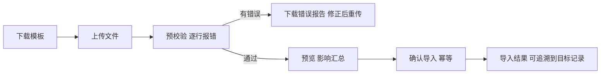

# 13 工作台、通知与数据导入

## 1. 模块目标与来源

- PRD 来源：第 15 章（一期导航中的工作台）、第 17 章（导入、导出、界面、备份恢复）、第 19 章（用户初始化与上线后配置）。
- 目标：
  - 工作台聚合各模块的待办：待审批、待派送、待收货、待出库、待到账确认、逾期跟进、待审凭证、配置缺项等。待办可以进入原单，完成后可以查看处理结果。
  - 抄送和系统通知；抄送不会增加权限。
  - 提供统一的导入框架：模板、预校验、预览、确认；重复导入不会重复形成库存、往来或凭证。
  - 期初数据导入，与未完成的业务不重复计算。
  - 统一的异步导出任务。

## 2. 范围

| 一期做 | 一期不做 |
| --- | --- |
| 工作台待办与数量角标、待办列表 | 邮件、短信、即时通讯推送（预留通道接口） |
| 站内通知（抄送、审批结果、系统提醒） | |
| 导入框架与一期导入类型 | 外部系统数据同步 |
| 期初导入（库存、应收、应付、预收预付、科目余额、未完采购与在途） | 历史交易明细迁移（按实施评估） |
| 异步导出任务中心 | |

## 3. 权限点

| 权限码 | 说明 |
| --- | --- |
| `sys:todo:view` | 查看自己的待办（所有用户默认拥有） |
| `sys:import:{type}` | 各导入类型单独授权，例如 `sys:import:opening-stock` |
| `sys:import:confirm` | 确认导入 |
| `sys:export:view` | 查看自己的导出任务 |

## 4. 工作台

### 4.1 待办类型

| 类型 | 来源模块 | 生成条件 | 处理人 |
| --- | --- | --- | --- |
| `APPROVAL` | 02 | 审批任务待处理 | 审批人 |
| `CONFIG_MISSING` | 01、02 | 缺审批人、缺配置导致业务被拦截 | 国家管理员 |
| `PENDING_DISPATCH` | 05 | 批次待发运、待派送 | 采购物流员 |
| `LOGISTICS_DELAY` | 05 | 节点超过计划时间 | 采购物流员 |
| `HOLD_REVIEW` | 05 | 暂缓派送到达复查日期 | 暂缓责任人 |
| `PENDING_RECEIPT` | 05、06 | 派送单或调拨单待实收 | 目标仓人员 |
| `PENDING_OUTBOUND` | 07 | 订单待出库（按仓分配） | 仓库人员 |
| `OUTBOUND_BLOCKED` | 07 | 出库前校验未通过（缺附件、未到账） | 录单人 |
| `PENDING_PAYMENT_CONFIRM` | 08 | 收款待确认 | 出纳、财务 |
| `OVERDUE_FOLLOWUP` | 08 | 即将到期或已逾期 | 销售归属人 |
| `SIGN_DIFF` | 07 | 签收差异待处理 | 录单人 |
| `STOCK_ALERT` | 06 | 库存预警 | 预警责任人 |
| `REPLENISH` | 06 | 补货待办待处理 | 补货负责人 |
| `RETURN_STEP` | 10 | 退货待实收、待验货、待账款处理、待退款 | 对应岗位 |
| `PENDING_VOUCHER_AUDIT` | 12 | 凭证待审核 | 财务主管 |
| `VOUCHER_GEN_FAILED` | 12 | 事件生成凭证失败 | 财务 |
| `EVENT_FAILED` | 00 | 业务事件消费多次失败 | 系统管理员 |

### 4.2 规则

- 待办分两种：
  - 推送型：事件发生时写入 `sys_todo`，例如配置缺项、生成凭证失败；
  - 查询型：实时从业务表统计，例如待出库、待到账确认，避免两边数据不一致。
- 推送型待办用 `dedup_key` 去重：同一业务对象、同一类型只保留一条未关闭的待办（例如同一个预警持续存在，不会重复生成）。
- 业务完成后自动关闭待办，记录处理人和处理结果。
- 待办列表和数量严格按用户的国家和数据范围过滤；切换国家后刷新。
- 点击待办跳转到原单，原单页面仍然按权限校验。

## 5. 通知

- 通知类型：`CC`（抄送）、`APPROVAL_RESULT`（审批结果）、`MENTION`（提及）、`SYSTEM`（系统提醒）。
- 抄送只发通知；打开单据时按收件人原有的数据范围校验，没有权限时提示无权查看（A14）。
- 通知通道接口 `NotifyChannel`：一期只实现站内通道，之后可以扩展邮件或即时通讯。

## 6. 数据导入

### 6.1 导入流程

### 6.2 一期导入类型

| 类型 | 目标 | 去重键 |
| --- | --- | --- |
| 商品、单位、条码 | 03 | `product_code`、`barcode` |
| 客户、地址 | 03 | `(country_id, code)` |
| 供应商、物流商 | 03 | `(country_id, code)` |
| 价格表 | 07 | 价格唯一键 |
| 库存上下限 | 06 | `(warehouse_id, product_id)` |
| 授信规则 | 08 | `(target_type, target_id)`，导入生成新版本 |
| 期初库存 | 06、11 | `(country_id, cutoff_date, warehouse_id, product_id, batch_no)` |
| 期初应收、预收 | 08 | `(country_id, cutoff_date, customer_id, ref_no)` |
| 期初应付、预付 | 09 | `(country_id, cutoff_date, partner_id, ref_no)` |
| 期初未完采购、在途 | 04、05 | `(country_id, cutoff_date, ref_no)` |
| 期初科目余额 | 12 | `(book_id, account_id, aux_key, currency)` |

### 6.3 规则

- 每个导入批次记录文件哈希。同一文件再次导入，提示“已导入”并给出原批次。
- 确认导入要求 `Idempotency-Key`；业务表上的去重键唯一约束兜底，重复导入不会重复形成库存、往来或凭证（A30）。
- 期初数据必须填写截止日期 `cutoff_date`，并且可以核对来源。
- 防止重复计入：
  - 截止日期之后发生的业务必须在系统中录入，不能写进期初；
  - 期初未完采购、在途、未结应收应付，与系统中的新单据通过 `ref_no` 关联；已经有系统单据的 `ref_no`，导入时拒绝；
  - 期初库存导入后生成 `OPENING_IN` 流水和批次，成本按导入的单位成本形成快照；
  - 期初往来与期初科目余额分别导入，导入后由 12 的核对功能检查两者是否一致。
- 导入的数据属于当前国家；目标国家的期初数据只能在该国家下独立导入（A36）。
- 导入后的修改走正常业务流程，不能重新覆盖导入。

## 7. 异步导出

- 所有导出都创建任务：记录筛选条件、发起人、国家，后台执行，完成后在任务中心下载。
- 导出使用与列表相同的查询服务和字段权限，隐藏的字段不输出。
- 文件保留 7 天（可配置）；下载需要校验发起人身份；每次导出写审计日志。

## 8. 状态

| 对象 | 状态 |
| --- | --- |
| 待办 | OPEN / DONE / CANCELLED |
| 通知 | UNREAD / READ |
| 导入批次 | UPLOADED / VALIDATING / VALIDATED / VALIDATION_FAILED / CONFIRMING / COMPLETED / FAILED / CANCELLED |
| 导出任务 | PENDING / RUNNING / DONE / FAILED / EXPIRED |

## 9. 数据模型

| 表 | 关键字段 |
| --- | --- |
| `sys_todo` | `todo_type`、`biz_type`、`biz_id`、`title`、`assignee_user_id`、`assignee_role_id`、`scope_ref jsonb`、`dedup_key`、`status`、`due_at`、`done_by`、`done_at`、`result`；未关闭记录按 `(country_id, dedup_key)` 部分唯一索引 |
| `sys_notification` | `user_id`、`notify_type`、`title`、`content`、`biz_type`、`biz_id`、`read_at` |
| `sys_import_template` | `import_type`、`version_no`、`columns jsonb`、`file_key` |
| `sys_import_batch` | `import_type`、`template_version`、`file_attachment_id`、`file_sha256`、`cutoff_date`、`status`、`total_rows`、`valid_rows`、`error_rows`、`preview jsonb`、`confirmed_by`、`confirmed_at` |
| `sys_import_row` | `batch_id`、`row_no`、`raw jsonb`、`errors jsonb`、`target_type`、`target_id` |
| `sys_async_job` | `job_type`（EXPORT/REPORT/RECALC）、`params jsonb`、`status`、`progress`、`result_attachment_id`、`error`、`created_by`、`expire_at` |

## 10. REST 接口

| 方法 | 路径 | 用途 |
| --- | --- | --- |
| GET | `/api/v1/sys/workbench/summary` | 各类待办数量 |
| GET | `/api/v1/sys/todos?type=` | 待办列表 |
| GET | `/api/v1/sys/notifications` | 通知列表 |
| POST | `/api/v1/sys/notifications/{id}/read` | 标记已读 |
| GET | `/api/v1/sys/import-templates/{type}` | 下载模板 |
| POST | `/api/v1/sys/imports` | 上传并创建批次（自动开始预校验） |
| GET | `/api/v1/sys/imports/{id}` | 批次状态、预览 |
| GET | `/api/v1/sys/imports/{id}/errors` | 错误报告下载 |
| POST | `/api/v1/sys/imports/{id}/confirm` | 确认导入（幂等） |
| POST | `/api/v1/sys/imports/{id}/cancel` | 取消 |
| GET | `/api/v1/sys/jobs` | 我的导出和异步任务 |
| GET | `/api/v1/sys/jobs/{id}/download` | 下载结果 |

## 11. 前端页面

| 路由 | 页面 | 手机端 |
| --- | --- | --- |
| `/workbench` | 工作台：待办卡片（数量）、待办列表、最近通知；不同角色看到的卡片不同 | 是 |
| `/notifications` | 通知中心 | 是 |
| `/settings/imports` | 导入中心：选择类型、上传、预校验结果、预览、确认、历史批次 | 否 |
| `/jobs` | 导出任务中心 | 否 |

PRD 第 15 章的一期导航菜单：

1. 工作台
2. 中国采购与物流（04、05）
3. MX 库存（06）
4. 销售与门店（07）
5. 客户及供应商往来（08、09、10）
6. 成本与经营分析（11）
7. 内部财务（12）
8. 系统设置（01、02、03、13）

## 12. 上线初始化步骤

1. 平台管理员初始化墨西哥国家配置（币种、时区、地区参数）。
2. 建立经营主体、账套、本位币、会计期间、科目、映射模板（财务复核）。
3. 建立 MX 仓和 1 家门店、门店仓、收款账户。
4. 导入商品、客户、供应商和物流商、价格、库存上下限、授信规则。
5. 确认汇率，配置成本计价方法。
6. 按截止日期导入期初库存、期初往来、期初未完采购和在途、期初科目余额，然后执行核对。
7. 分配人员、角色、数据范围、审批链。
8. 执行就绪检查，没有阻断缺项后正式上线。

上线后可以继续分配人员、调整上下限、授信、价格、审批，新增门店。必需的执行配置没有完成时，相应操作会提示配置待办，不会向所有人开放，也不需要开发人员改代码。

## 13. 对应验收用例

A13（新账号未授权时工作台为空）、A14（抄送不增加权限）、A30（重复导入不双算；期初导入不与未完业务重复）、A36（期初独立导入）。

## 14. 待确认与实施配置

- 历史数据迁移范围（只导期初余额，还是同时迁移历史交易）。
- 导出文件的保留天数。
- 后续是否需要邮件或即时通讯通知。
