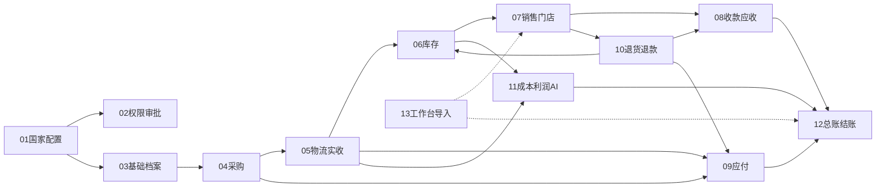

# 跨国进销存与内部财务系统：模块设计文档

需求依据：《跨国进销存与内部财务系统 PRD V0.4》（2026-10-15，以下简称 PRD）。
本目录按功能模块拆解 PRD，作为 Vue 3 + Spring Boot 实施的设计基线。文档只描述设计，不代表功能已实现。

真实后端分阶段实施依据见 [一致性方案](superpowers/plans/2026-10-15-real-backend-foundation.md)；实际开放范围与验证分别记录在 [M0/M1](backend/acceptance-m0-m1.md)、[M2](backend/acceptance-m2.md)、[M3](backend/acceptance-m3.md)、[M4](backend/acceptance-m4.md) 和 [M5](backend/acceptance-m5.md)。M5 运维工具用于隔离演练与上线门槛复核；真实部署、生产数据范围及期初仍需独立落实。

## 技术选型

| 层 | 选型 |
| --- | --- |
| 后端 | Spring Boot 3.x、Java 21、模块化单体（Maven 多模块） |
| 持久化 | PostgreSQL 16、MyBatis-Plus、Flyway 管理表结构迁移 |
| 安全 | Spring Security、JWT 访问令牌 + 刷新令牌 |
| 前端 | Vue 3、Vite、TypeScript、Element Plus、Pinia、Vue Router、vue-i18n |
| 附件 | 对象存储接口，默认 MinIO，可替换为本地磁盘或云存储 |
| 异步 | 数据库任务表 + Spring 调度（导出、报表、分类重算、凭证生成），一期不引入消息中间件 |

带“假设”标记的选型（MyBatis-Plus、MinIO、无消息中间件、AI 模型供应商）见 [00 总体架构](00-总体架构与通用约定.md) 第 12 节，可在实施前替换。

## 文档索引与阅读顺序

编号按 PRD 第 19 章开发顺序排列。

| 编号 | 文档 | PRD 来源 | 需求组 |
| --- | --- | --- | --- |
| 00 | [总体架构与通用约定](00-总体架构与通用约定.md) | 16、17 | 全部 |
| 01 | [国家配置与组织](01-国家配置与组织.md) | 03、09、17 | R02、R08 |
| 02 | [权限与审批](02-权限与审批.md) | 03、12 | 全部 |
| 03 | [基础档案](03-基础档案.md) | 03、17 | 全部 |
| 04 | [中国采购](04-中国采购.md) | 04、05 | R01、R07 |
| 05 | [国际物流与MX实收](05-国际物流与MX实收.md) | 04、06 | R01、R07 |
| 06 | [库存管理](06-库存管理.md) | 07 | R03 |
| 07 | [销售与门店](07-销售与门店.md) | 04、08、09 | R02、R04 |
| 08 | [收款授信与客户应收](08-收款授信与客户应收.md) | 09、10 | R02、R05 |
| 09 | [供应商物流商应付](09-供应商物流商应付.md) | 05、06 | R07 |
| 10 | [退货与退款](10-退货与退款.md) | 11 | R03、R05、R07 |
| 11 | [成本费用与利润AI分析](11-成本费用与利润AI分析.md) | 13 | R06 |
| 12 | [内部财务总账与结账](12-内部财务总账与结账.md) | 14 | R06 |
| 13 | [工作台通知与数据导入](13-工作台通知与数据导入.md) | 15、17、19 | 全部 |
| 99 | [验收用例追踪矩阵](99-验收用例追踪矩阵.md) | 18、20 | 全部 |

## 模块依赖

实线表示业务数据依赖；虚线表示工作台聚合各模块的待办。所有模块都依赖 00、01、02。

## 开发批次（PRD 第 19 章）

| 批次 | 内容 | 涉及文档 |
| --- | --- | --- |
| 第 1 批 | 国家配置及模板复制基础；墨西哥、MX 仓、1 家门店；权限；币种汇率；科目 | 00、01、02、03、12（科目部分） |
| 第 2 批 | 中国采购、运输节点、换柜派送、MX 实收及库存，数量与成本追溯 | 04、05、06、11（入库成本部分） |
| 第 3 批 | 代录销售、差异化价格、现款与赊销、附件校验、出库应收、签收、收款核销、退货 | 07、08、09、10 |
| 第 4 批 | 凭证、记账、账簿、结账、报表；成本费用、畅销滞销、补货、AI；第二国家验收 | 06（分类补货）、11、12、13、99 |

四批都属于一期范围，分批只决定开发顺序，不代表删减功能。

## 一期明确不做（PRD 第 02 章）

- 客户自助下单、商城、线上营销、广告投放、营销费用及归因
- 现金交班和班次交接（门店按日收款清单和现金日记账仍然要做）
- 库龄、库龄预警、每日 0.5% 跌价及自动计提
- 其他国家实际投产（但国家模板复制和第二国家测试要做）
- 外部财务、银行、支付、仓配、营销平台的自动接口；线上付款执行；法定税务申报

## 实施时需要用户填写的配置

PRD 不固定以下数值，系统提供配置页，由用户在实施或上线时录入：

- 人员名单与授权、真实仓店名称、门店收款账户
- 授信资格、额度、账期天数、到期起算方式、逾期策略
- 库存上下限、畅销滞销统计周期、订单主指标、阈值和组合条件
- 审批链与审批条件阈值
- 本位币、会计科目、成本计价方法、凭证映射模板、现金流项目映射
- 汇率、期初库存、期初往来、期初科目余额
- 经营数据规模、性能基线、历史迁移范围、设备清单
