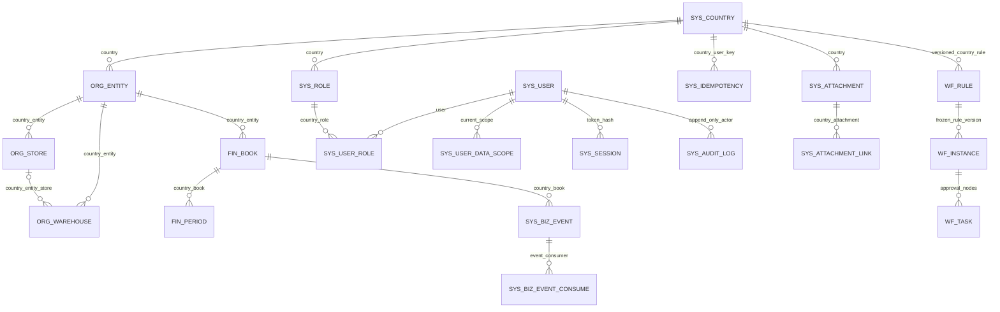

# M0–M3 配置与关系

所有具体经营数据由操作者确认。工程不填会计科目、期初、汇率、计价方法、审批人、支付账户或实际公司资料；初始化仅接收明确配置，不读取浏览器演示库。

运行环境：Java 21+；Spring Boot 4.1.1；Maven Wrapper 3.9.16（Apache wrapper 3.3.4 only-script，发行 zip SHA256 `5af3b743dd8b876b5c45da33b676251e5f1687712644abb4ee519ca56e1d89ce`）。当前验证机 Java 26.0.1，目标字节码 21。完整依赖锁定以根 pom 及 Maven dependency tree 为准。

必填部署配置：

- JXC_DB_URL 指向经过管理员准备的专用数据库；JXC_DB_USER / JXC_DB_PASSWORD 仅为受限运行身份。运行身份不能拥有任何应用表、继承 owner、拥有 DDL 或 BYPASSRLS。
- JXC_MIGRATION_USER / JXC_MIGRATION_PASSWORD 仅供 Flyway 建表和约束，禁止给应用运行连接复用。先撤销 public schema 的 PUBLIC CREATE；具体管理员准备脚本为 `jxc-server/scripts/provision-db.sql`。
- JXC_BIND_ADDRESS 默认 loopback；JXC_PORT 为本地服务端口。生产监听地址、反代和 HTTPS 另行确定，本次未部署。
- JXC_STORAGE_ENDPOINT / JXC_STORAGE_ACCESS_KEY / JXC_STORAGE_SECRET_KEY / JXC_STORAGE_BUCKET 为私有对象存储配置；应用凭据需限定专用 bucket，不能把测试 MinIO root 身份直接用作生产身份。
- `JXC_BANK_ENCRYPTION_KEY` 为 Base64 编码的 32 字节 AES 密钥，供现有供应商、物流商、客户银行信息共用 AES-GCM 保护。没有有效密钥时保存原始账号返回 `MD_BANK_ENCRYPTION_REQUIRED`；不得填写测试密钥到实际环境。历史掩码不是原始账号，接口不返回密文；密钥保管、备份和轮换需在部署时落实。
- `jxc.security.session-hours` 默认 12，由 Spring 配置提供；会话数据库只保存 token hash，撤权仍重新取权。

仅测试配置：`compose.test.yml` 固定 PostgreSQL16 与 MinIO2024 摘要，端口只绑定 127.0.0.1。JXC_TEST_POSTGRES_PASSWORD / JXC_TEST_MINIO_ROOT_USER / JXC_TEST_MINIO_ROOT_PASSWORD 必须显式设置，无默认密码；Testcontainers 则每轮随机隔离凭据。镜像摘要是可重现测试证据，生产镜像安全升级未在本次处理。

显式 bootstrap 配置：JXC_BOOTSTRAP_CONFIG_FILE（当前用户所有、regular、0600、最多64KiB的JSON）与 JXC_APP_JAR（预先构建的可执行jar）。脚本必须有准确 JDBC 目标与运行角色；JSON `databaseName` 必须等于 `current_database()`。该入口不接收命令参数，不启动web，不运行Flyway，不联网下载。

JSON 字段全部由操作者提供：schemaVersion=1、databaseName、operator、reason；currencies 中 code/name/decimals；country 中 code/name/defaultCurrency/timezone/status，以及操作者明确填写的 locale/enabledModules（例如 fin 的启用必须自行明确提供，程序不推断）；entity 的 code/name；book 的 code/name/baseCurrency/status；admin 的 username/displayName/password/isPlatformAdmin；role 的 code/name/roleType/permissions/fieldPolicies；dataScope 的 scopeType 必须明确 COUNTRY_ALL。权限必须是现有目录的具体权限码，全部六个字段组必须明确 HIDDEN/READ/WRITE；不补通配、范围或默认WRITE。未知字段拒绝，避免误把期初/凭证等配置传给基础初始化。

ID 和金额界限按 ADR0001：JSON number 类型保持；正安全整数 ID；金额/数量绝对值至100000000000、最多4位，汇率至1000000、最多8位。原始十进制 JSON 直接 BigDecimal；不能通过字符串或先double绕开边界。账套解析、零影响事件和附件撤权分别见 ADR0002—0004。

数据库关系（V001/V002 的基础结构，不代表后续业务表已实现）：

国家表同时 FORCE RLS；复合 FK 防止跨国/跨账套引用。审计和事实的追加约束、允许更新的队列诊断列以及运行角色列级权限，以实际迁移 SQL 为准。金额事实守卫先锁账套再判期间；服务层与数据库共同拒绝关闭期间写入。范围授权、字段裁剪和来源链仍由服务层细化，RLS 不能替代这些规则。

## M2 主流程的显式前提

V003.1–V004.1 新增采购物流、库存、销售往来、退货退款和成本来源表，继续使用 V001/V002 的授权、期间、幂等、审批、附件、审计及事务事件。运行角色不拥有新表；所有实际含 `country_id` 的业务表必须 FORCE RLS，由 SchemaIT 动态检查。

- 商品主档、分类和单位保持全局；经营国家 SKU、单位换算、供应商/物流商/客户、仓库与门店归属由操作者配置。交易锁定原单位、换算系数、基础数量、原币及来源价格。
- 经营主体必须能唯一确定 ACTIVE 账套，或明确提供匹配账套；仓库/资金账户只授予对应来源的权限，不能反推整个账套可见。期间需明确生成并开放，不能缺期间继续写。
- 入库成本方法沿用 `/cst/method`，按账套显式配置 FIFO、指定批次或移动平均及生效日期。原币转本位币使用已确认的 `PURCHASE_COST` 汇率；同币种按 1。缺来源或汇率保留 PENDING 及缺项，不推断、不填零，不自动重估已冻结事实。
- 赊销需有效的客户/客户组授信规则、币种、额度、账期和逾期策略；需要审批时必须存在有效规则与审批人。无原单退货、调拨差异和退款沿用原审批流程，不能通过调用 API 跳过。
- 出库单据、签收、AP 付款/预付及退款的凭据沿用原附件类别和字段授权。对象校验在事务外完成，命令在事务内重验来源、哈希、链接与当前授权；本轮记录支付事实，不执行外部支付。
- 普通编辑提交 `version`；确认/接收等动作可继续空 body，由权威源行锁与状态、审批快照约束。幂等写入口必须携带 UUID `Idempotency-Key`，前端显式复用现有 CommandIntent，不自动重试资金命令。

M2 不自动导入演示库，不建立真实期初，不生成总账凭证、不记账、不结账。M3/M4 才处理完整估值调整、财务映射、记账结账和真实页面切换；验收范围见 [M2 记录](acceptance-m2.md)。

## M3 配置与后台生成

V005/V006 及其后续迁移只建立本轮成本、内部总账及必要原表约束，不自动创建会计科目、模板、映射、凭证或期初。按现有入口显式维护科目、辅助核算、资金/费用对应科目、现金流项目、凭证字和映射版本；先复核映射，再试算指定事件、显式生成待审凭证，审核后记账。期初金额和截止日期必须由操作者确认，不从业务余额推导。

采购/资本化费用的库存分位分配可能与原单应付本金相差一分。映射分别引用 `amount`、`apAmount` 和 `differenceAmount`，差额科目必须由操作者按实际会计规则明确选择；系统不编造科目。包含 AP 核对科目的模板不得将应付改为库存分配金额以凑平。原四位估值、固定财务分位及跨期精度差额在核对中分别展示，不自动调账。

`jxc.accounting.worker.enabled` 默认为 false。仅在操作者配置好现存运行主体后设为 true；`jxc.accounting.worker.assignments` 必须显式列出 `countryId:userId`（多个用逗号分隔）。可配置 `jxc.accounting.worker.delay-ms`（默认 30000）。配置本身不创建身份或权限，运行中每轮按该主体当前权限、字段及账套范围判断，撤权即失效。后台只生成待审凭证，不审核、不记账；授权凭证生命周期仍由原显式操作完成。

M3 的测试、不可改写事实、来源完整性及退出条件见 [M3 验收记录](acceptance-m3.md)。结账、反结账、快照和正式报表保留 M4 边界。
